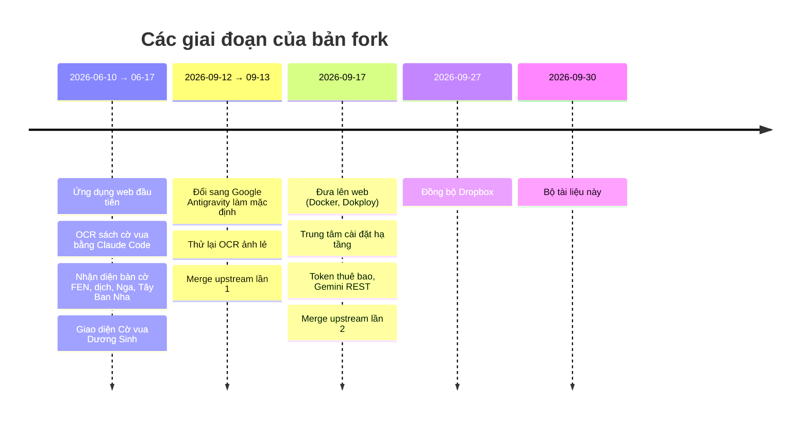

# Lịch sử phát triển và nhật ký tương tác

> Tài liệu này mô tả mã nguồn tại commit `2c1df67b44` (2026-09-27).
> Nguồn: `git log --author=covuaduongsinh` (24 commit của fork trên tổng 428 commit của repo), thông điệp commit, các
> kế hoạch trong `docs/plans/`, và các phiên làm việc với trợ lý AI (mục 4).
> Chỉ ghi điều có bằng chứng trong git hoặc tài liệu; phần "vì sao" lấy từ chú thích mã và tài liệu, không suy đoán.

## 1. Bức tranh chung

Repo là fork của `microsoft/markitdown`. Lịch sử upstream bắt đầu từ 2024-11-13; **phần của fork bắt đầu 2026-06-10**.
Fork chưa bao giờ sửa lõi thư viện: mọi thay đổi của fork là **tệp mới ở thư mục gốc** cộng vài tài liệu, và hai lần merge từ upstream.

## 2. Dòng thời gian commit của fork

Sắp theo ngày. Thông điệp ngắn (tiếng Việt không dấu hoặc tiếng Anh) được chép nguyên; thông điệp dài được rút gọn
và có chỗ thêm dấu tiếng Việt — xem `git log` để có bản gốc.

| Ngày | Commit | Thông điệp | Ý nghĩa |
|---|---|---|---|
| 2026-06-10 | `bb16393` | web gui | Khởi tạo `markitdown_gui.py` (Gradio) |
| 2026-06-11 | `c772c50`, `f7b378a` | batch file, fix batch file | `run_gui.bat` |
| 2026-06-11 | `6ca19bc` | ocr chess board | Nhận diện bàn cờ (`chessboard_fen.py`) |
| 2026-06-11 | `1f3ad58` | ocr chess book | OCR sách cờ vua (`claude_ocr.py`) |
| 2026-06-11 | `0e2972d` | sonet + giảm effort low | Đổi model mặc định sang Sonnet, hạ effort xuống `low` (xem chú thích `_claude_fast_flags`) |
| 2026-06-11 | `f46c6ab` | translate chessbook | Dịch sách (`claude_translate.py`) |
| 2026-06-12 | `f583918` | bo header footer | Bỏ header/footer/số trang (`_PROMPT_CLEANUP`) |
| 2026-06-12 | `829a67e` | tiếng nga | Chế độ ký hiệu Nga |
| 2026-06-15 | `49d4059` | giao diện mới Cờ vua Dương Sinh + bàn cờ FEN | Giao diện navy/sun/teal; vẽ bàn cờ trong xem trước |
| 2026-06-17 | `2e264f9` | Tay ban nha | Chế độ ký hiệu Tây Ban Nha |
| 2026-09-12 | `3acbbee` | feat: tích hợp Google Antigravity làm AI engine mặc định và tối ưu tiết kiệm token | Tạo `ai_engine.py`; các preset Tiết kiệm/Cân bằng/Chính xác; gộp OCR+dịch |
| 2026-09-13 | `721a8ac` | fix(ocr): retry single-image OCR, refresh GUI docs/launcher | Thử lại ảnh lẻ; `GUI_README.md` |
| 2026-09-13 | `46d5350` | merge: cập nhật từ upstream | Merge upstream #1 |
| 2026-09-17 | `bf9b723` | feat(deploy): update Dockerfile and launcher for web production deployment | Docker + bind `0.0.0.0` |
| 2026-09-17 | `b86e92f` | feat(ui): Infrastructure & API Setup Center, live connection testing, instant conversion feedback | `infrastructure.py`, thẻ Cài đặt Hạ tầng |
| 2026-09-17 | `1109e87` | feat: monthly subscription connection support for Claude Code and Antigravity CLI | Ô dán token thuê bao |
| 2026-09-17 | `a3cf11d` | feat: full support for Google Antigravity CLI and OAuth on VPS and Web | Lưu token Antigravity phía máy chủ |
| 2026-09-17 | `5c4c748` | fix(docker): allow copying root Python scripts and assets into image | Sửa `.dockerignore`/COPY |
| 2026-09-17 | `9e6ba26` | fix(web): Direct Gemini REST API support, robust file handling, graceful fallback | `call_gemini_api_direct` |
| 2026-09-17 | `3000e93` | fix: remove root restriction flag for claude cli test | Sửa kiểm tra Claude trong container chạy root |
| 2026-09-17 | `f2ddf6f` | fix: `is_engine_available` accepts `claude_token`, `agy_token` | Sửa chữ ký hàm |
| 2026-09-17 | `ba0a8ad` | merge: cập nhật từ upstream | Merge upstream #2 |
| 2026-09-27 | `2c1df67` | feat(dropbox): automatic Dropbox sync … | Dropbox (`infrastructure.py`, GUI, `docs/DROPBOX_GUIDE.md`) |

## 3. Các quyết định thiết kế và lý do (có bằng chứng)

| Quyết định | Vì sao | Bằng chứng |
|---|---|---|
| Dùng CLI thuê bao (`agy`, `claude`) thay khoá API | Không tốn tiền theo lượt; dùng phiên đăng nhập sẵn có | Docstring `claude_ocr.py`, `infrastructure.py`: *"KHÔNG cần API key"*, *"0đ phí API"* |
| Hạ `effort` xuống `low` | OCR chỉ là chép chữ; `effortLevel: xhigh` trong cài đặt người dùng khiến model "suy nghĩ hàng chục nghìn token mỗi trang" | Chú thích `_claude_fast_flags` (`claude_ocr.py:398`), commit `0e2972d` |
| Nhận diện bàn cờ bằng ONNX cục bộ | Không tốn quota AI, nhanh; AI chỉ chèn FEN đúng chỗ | Docstring `chessboard_fen.py`; prompt `_PROMPT_CHESS_GIVEN` |
| Vẽ trang ở DPI cao, thu nhỏ để gửi AI | Ảnh nét cho mô hình bàn cờ; ảnh nhỏ cho OCR | `_render_page_pair` |
| Gộp OCR + dịch trong một lần gọi | Tiết kiệm ~30–40% lượt gọi/hạn mức | Nhãn `Tùy chọn nâng cao` ở `markitdown_gui.py:1709`, `GUI_README.md` |
| Đặt banner "đầu ra = tiếng Việt" đầu prompt | Footer dịch ở cuối bị model bỏ qua khi nhiều trang/effort thấp | Chú thích `claude_ocr.py:161–164` |
| Tách placeholder `⟦CHESSBOARD_n⟧` khi dịch | Đảm bảo FEN không bao giờ bị dịch/sửa/mất | Docstring `claude_translate.py` |
| Chunk dịch cắt tại dòng trống | OCR không còn chèn `## Trang N`, cả sách dồn thành một chunk | Chú thích `_split_chunks` |
| Sách Nga giữ chữ Cyrillic đến bước dịch | Tránh đụng độ `K` Latin (Vua) với `К` Cyrillic (Mã) | Chú thích `claude_ocr.py:117–120` |
| Sách Tây Ban Nha: `T`→`X`, `A`→`T` | Bảng nguồn/đích dùng chung chữ cái | Chú thích `_CHESS_II_ES`, `GUI_README.md` |
| `pick_files.py` là tiến trình con | Tránh xung đột tkinter với luồng nền của Gradio | Docstring `pick_files.py` |
| `_stream_job` yield ≤ 5 s/lần | Kết nối SSE của Gradio không rớt khi tác vụ dài | Docstring `_stream_job` |
| Lưu tùy chọn ở `BrowserState` | Không phải nhập lại; không cần tài khoản/DB | `docs/DROPBOX_GUIDE.md`, `prefs` |
| Refresh Token cho Dropbox | Access Token chỉ sống vài giờ | `docs/plans/2026-09-27-dropbox-sync-integration.md` |

## 4. Nhật ký tương tác với trợ lý AI

Mục này ghi **những gì được yêu cầu và làm**, để phiên sau (người hay AI) nối tiếp được. Quy ước:
mỗi phiên một mục, ngày tuyệt đối, chỉ nêu điều không suy ra được từ git.

### 2026-09-30 — Phiên lập tài liệu

**Yêu cầu của chủ dự án:** tạo hoặc cập nhật các tệp `.md` quan trọng (`AGENTS.md`, `CLAUDE.md`, `README.md`,
`SKILLS.md`, `TECH.md`, `MEMORY.md`…) để thống kê, giới thiệu, mô tả chi tiết thuật toán, lưu lịch sử tương tác,
của **tất cả** module/tính năng — làm cơ sở **rà soát, xây dựng module mới, nhân bản phần mềm**.

**Đã làm** (chỉ thêm tệp `.md` mới, và thêm một khối đầu vào `README.md`; **không sửa mã**):

- Gốc repo: `AGENTS.md`, `CLAUDE.md`, `TECH.md`, `SKILLS.md`, `MEMORY.md`; thêm khối "Bản fork Cờ vua Dương Sinh" vào đầu `README.md`.
- `docs/`: `README.md` (mục lục), `TONG-QUAN-KIEN-TRUC.md`, `LICH-SU-PHAT-TRIEN.md` (tệp này),
  `NHAN-BAN-VA-MO-RONG.md`, `RA-SOAT-RUI-RO.md`.
- `docs/tinh-nang/01…11`: mười một tài liệu tính năng theo mẫu hai tầng (Phần A chức năng / Phần B kỹ thuật).

**Cách kiểm chứng:** số dòng bằng script đếm ký tự xuống dòng (không lấy từ công cụ đọc tệp); mọi đường dẫn tương đối;
mọi "điều đáng ngờ" đánh dấu là suy ra từ mã, chưa chạy thử.

**Chưa làm / để ngỏ:**
- Chưa chạy ứng dụng, chưa gọi `agy`/`claude`/Gemini/Dropbox thật → hành vi thời gian chạy chưa được xác nhận.
- Các mục trong `RA-SOAT-RUI-RO.md` chưa được sửa, chỉ ghi nhận.

### 2026-10-13 — Sửa lỗi OCR thất bại toàn bộ + đăng nhập Claude Code bền vững

**Bối cảnh:** Chủ dự án báo OCR trên web production lỗi "thất bại ở toàn bộ 97 trang". Điều tra qua SSH
vào VPS production (Dokploy) xác định CLI `claude` hoạt động bình thường,
nhưng cơ chế xác thực của ứng dụng dùng sai: `_claude_env`/`infrastructure.py` đặt cookie `sessionKey`
người dùng tự lấy từ claude.ai vào ba biến môi trường không chính thức, trong đó `ANTHROPIC_API_KEY` có
độ ưu tiên xác thực **cao hơn** biến đúng `CLAUDE_CODE_OAUTH_TOKEN` — khiến CLI luôn thử xác thực sai
kiểu. Xác nhận qua tài liệu chính thức Claude Code CLI (code.claude.com/docs/en/authentication).

**Yêu cầu tiếp theo của chủ dự án:** không muốn tiếp tục lấy lại cookie `sessionKey` thủ công mỗi lần hết
hạn — muốn cơ chế đăng nhập bền vững hơn, cả giải pháp nhanh lẫn một nút đăng nhập ngay trên web.

**Đã làm:**
- Sửa `claude_ocr.py:_claude_env`, `infrastructure.py` (`test_claude_cli_connection`,
  `get_infrastructure_status`): bỏ 3 biến sai, chỉ set `CLAUDE_CODE_OAUTH_TOKEN`.
- Thêm `claude --version` vào `Dockerfile` sau dòng cài Claude Code CLI để build fail cứng nếu cài lỗi.
- Sửa nhãn/hướng dẫn ô token trên UI (`markitdown_gui.py`) từ "cookie sessionKey" sang "OAuth Token từ
  `claude setup-token`".
- Thêm file mới `claude_login_bridge.py`: cầu nối pipe+regex quanh `claude setup-token` (singleton
  xuyên request HTTP, kill-tree an toàn, ghi stdin an toàn ranh giới UTF-8, timeout ≠ thất bại) + nút
  "Đăng nhập Claude Code" trên tab "Cài đặt Hạ tầng & API".
- Tài liệu mới `docs/tinh-nang/12-dang-nhap-claude-code.md`; cập nhật `05-ha-tang-va-ket-noi.md`,
  `RA-SOAT-RUI-RO.md` (đánh dấu S10 đã xử lý), `TONG-QUAN-KIEN-TRUC.md`, `docs/README.md`, `AGENTS.md`,
  `MEMORY.md`.

**Cách kiểm chứng:** hàm thuần `_claude_env`/`get_infrastructure_status` kiểm bằng `python -c` (không
gọi CLI thật); toàn bộ logic `claude_login_bridge.py` (bắt URL, ghi stdin, heuristic success/error,
timeout, dọn tiến trình) kiểm bằng một CLI Python giả lập hành vi `claude setup-token`, không gọi AI
thật; `markitdown_gui.py` import thành công (toàn bộ Blocks UI dựng được, xác nhận wiring đúng số
input/output).

**Chưa làm / để ngỏ:**
- Giai đoạn 0 của kế hoạch (chạy `claude setup-token` thật qua SSH, lấy token 1 năm, set vào biến môi
  trường Dokploy) cần chính chủ dự án tự thực hiện (đăng nhập bằng tài khoản cá nhân) — chưa xác nhận đã
  làm xong tại thời điểm ghi nhật ký này.
- Hành vi thật của `claude setup-token` (định dạng dòng output, có treo sau khi in token không) chưa
  được quan sát trên VPS thật — xem mục "chưa kiểm chứng" trong `docs/tinh-nang/12-dang-nhap-claude-code.md`.
- Chưa build lại Docker image / deploy lên Dokploy — thay đổi mới chỉ nằm trong working tree, chưa commit/push.

### 2026-11-21: Đồng bộ upstream microsoft/markitdown lên v0.1.9 (commit ed17895)

**Yêu cầu của chủ dự án:** Repo gốc có update, lên kế hoạch và triển khai update, đồng bộ vào repo ở local và GitHub. Từ giờ, các kế hoạch luôn để ở thư mục `/docs/plans`.

**Đã làm:**
- Tạo kế hoạch chi tiết tại [`plans/2026-11-21-dong-bo-upstream-markitdown.md`](plans/2026-11-21-dong-bo-upstream-markitdown.md).
- Commit toàn bộ bộ tài liệu kiến trúc, vận hành và kế hoạch vào nhánh `main` (`8d77815`).
- Merge thành công 23 commit mới từ `upstream/main` (`945314a..ed17895`) với merge commit `a722ceb`.
- Không phát sinh xung đột: git ort tự động gộp `README.md` (giữ nguyên banner fork Cờ vua Dương Sinh ở đầu và nhận nội dung mới về Azure Document Intelligence, hosted service của upstream). Toàn bộ 8 tệp mã nguồn riêng của fork ở thư mục gốc không bị ảnh hưởng.
- Cập nhật phiên bản các gói trong `TECH.md` (`markitdown` 0.1.9, `markitdown-ocr` 0.1.2, `markitdown-mcp` 0.0.1a8).
- Cập nhật bộ nhớ dự án trong `MEMORY.md`.

**Cách kiểm chứng:**
- Smoke test import upstream `MarkItDown()` và toàn bộ 7 module riêng của fork (`markitdown_gui`, `claude_ocr`, `claude_translate`, `chessboard_fen`, `ai_engine`, `infrastructure`, `claude_login_bridge`): đạt 100%.
- Kiểm tra toàn bộ test case roundtrip FEN và bảo vệ khối dịch tiếng Việt (`_test_translate_roundtrip.py`): đạt 100%.

- Đã deploy thành công lên VPS Dokploy (`217.15.160.118`), dịch vụ Docker Swarm `app-copy-primary-feed-r4ikwl` chuyển sang container mới, tên miền `https://markitdown.dsc.edu.vn` phản hồi `HTTP 200 OK`. Kế hoạch triển khai chi tiết tại [`plans/2026-11-21-trien-khai-cap-nhat-vps-dokploy.md`](plans/2026-11-21-trien-khai-cap-nhat-vps-dokploy.md).

## 5. Cách nối tiếp lịch sử này

Khi làm một thay đổi có ý nghĩa, thêm một mục vào mục 4 với: ngày, yêu cầu, những gì đã làm, quyết định + lý do,
việc dang dở. Nếu quyết định mới thay đổi một dòng ở mục 3, sửa dòng đó thay vì thêm bản trùng. Sự kiện
chỉ có ích cho phiên sau (ví dụ "đã thử X, không chạy") nên đưa vào [`../MEMORY.md`](../MEMORY.md).
