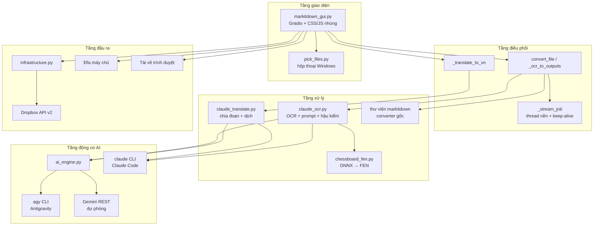
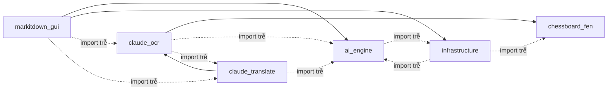
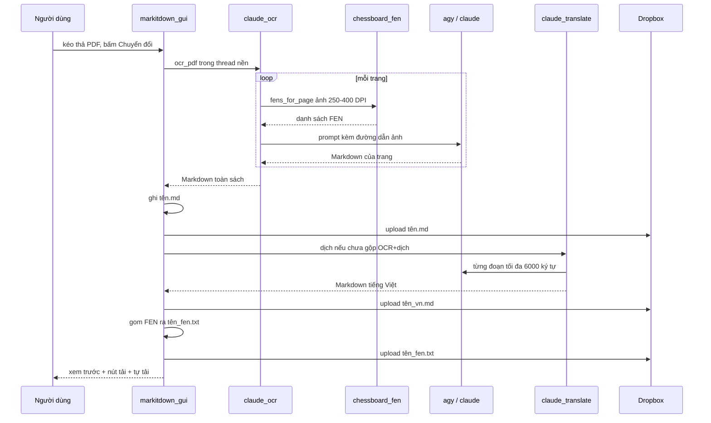
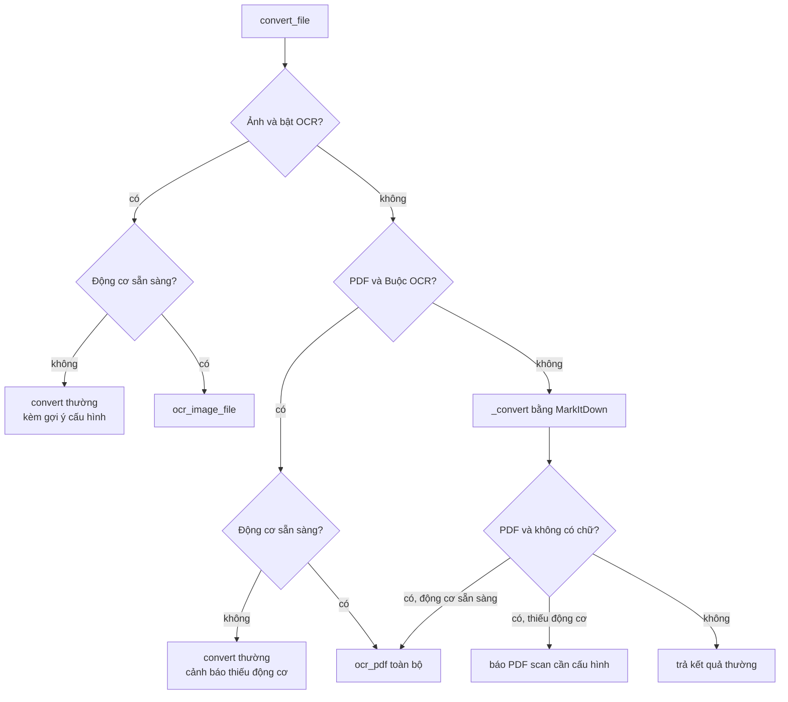

# Tổng quan kiến trúc — MarkItDown, bản fork Cờ vua Dương Sinh

> Tài liệu này mô tả mã nguồn tại commit `2c1df67b44` (2026-09-27).
> Các con số dòng lấy bằng `wc -l` / đếm ký tự xuống dòng qua script, không chép tay.

---

# Phần A — Chức năng

## Dự án là gì

Đây là bản fork của thư viện **MarkItDown** (Microsoft) — công cụ đổi tài liệu (PDF, Word, Excel,
PowerPoint, ảnh, HTML, YouTube…) sang Markdown. Bản fork của **Cờ vua Dương Sinh** giữ nguyên thư
viện gốc và thêm **một ứng dụng web riêng** chuyên làm một việc: biến **sách cờ vua scan** thành
Markdown đọc được, có dịch sang tiếng Việt.

Người dùng thật của phần mềm là đội biên tập/dịch sách cờ vua. Họ kéo thả một cuốn sách (PDF scan)
vào trang web, bấm **Chuyển đổi**, và nhận về:

| Tệp kết quả | Nội dung |
|---|---|
| `<tên>.md` | Toàn văn OCR, giữ ngôn ngữ gốc |
| `<tên>_vn.md` | Bản dịch tiếng Việt, ký hiệu nước đi đổi sang V/H/X/T/M |
| `<tên>_fen.txt` | Danh sách thế cờ (FEN), mỗi dòng một thế |

Các tệp này có thể tự tải về máy, lưu trên máy chủ, và đẩy lên Dropbox cho các phần mềm khác trong
quy trình tiêu thụ.

## Các mảng tính năng lớn

1. **OCR sách scan bằng AI** — mỗi trang PDF được vẽ thành ảnh rồi giao cho một "động cơ AI" đọc
   chữ và dựng lại Markdown; đồng thời loại bỏ tiêu đề chạy đầu trang, chân trang, số trang.
2. **Nhận diện bàn cờ → FEN** — sơ đồ bàn cờ trong sách được nhận diện bằng mô hình ONNX chạy ngay
   trên máy (không tốn hạn mức AI) rồi chèn vào Markdown dưới dạng khối ```` ```chessboard ````.
3. **Dịch sang tiếng Việt** — dịch văn bản, giữ nguyên bàn cờ, đổi ký hiệu nước đi từ Anh / Nga /
   Tây Ban Nha sang ký hiệu Việt. Có thể gộp OCR và dịch trong một lượt gọi để tiết kiệm.
4. **Hai động cơ AI dùng gói thuê bao** — Google Antigravity (`agy`) và Claude Code (`claude`),
   không cần khoá API; thêm đường dự phòng Gemini REST API.
5. **Đồng bộ Dropbox** — tự đẩy kết quả lên thư mục `/MarkItDown`.
6. **Giao diện web Gradio** mang bộ nhận diện Cờ vua Dương Sinh (navy / vàng / teal), sáng–tối.
7. **Thư viện MarkItDown gốc** cùng plugin OCR, máy chủ MCP và plugin mẫu (đi kèm từ upstream).

## Quy mô

| Thành phần | Dòng mã | Số tệp `.py` |
|---|---:|---:|
| Ứng dụng riêng của fork (7 tệp Python ở thư mục gốc) | 4.738 | 7 |
| Thư viện `markitdown` (upstream), `src/` | 7.554 | 41 |
| Bộ kiểm thử `markitdown` | 10.424 | 36 |
| Plugin `markitdown-ocr`, `src/` + tests | 863 + 2.149 | 8 + 9 |
| Máy chủ `markitdown-mcp`, `src/` + tests | 152 + 611 | 3 + 4 |
| Plugin mẫu, `src/` + tests | 88 + 46 | 3 + 2 |

Phần **do fork tự viết** chỉ là 4.738 dòng ở thư mục gốc; phần còn lại là mã upstream. Khi rà soát
hay nhân bản, hầu hết công sức nằm ở 4.738 dòng này.

---

# Phần B — Kỹ thuật

## 1. Ngăn xếp công nghệ

Chi tiết phiên bản và biến môi trường: xem [`../TECH.md`](../TECH.md). Tóm tắt:

- Python 3.12 (Dockerfile `python:3.12-slim`; thư viện gốc hỗ trợ 3.10–3.13).
- Giao diện: **Gradio** (venv đang cài 6.17.3), CSS/JS tùy biến nhúng ngay trong `markitdown_gui.py`.
- OCR/dịch: gọi tiến trình con `agy -p …` hoặc `claude -p …`; dự phòng HTTP tới Gemini REST.
- Nhận diện bàn cờ: `onnxruntime` 1.20.1 + `opencv-python-headless` + `python-chess` + Pillow + NumPy.
- Vẽ trang PDF thành ảnh: `pypdfium2`.
- Dropbox: gọi thẳng REST bằng `urllib` (gói `dropbox` có cài trong Dockerfile nhưng **không được import**).
- Triển khai: Docker → Dokploy trên VPS (`markitdown.dsc.edu.vn`).

## 2. Bản đồ module

### 2.1 Ứng dụng riêng của fork (thư mục gốc)

| Tệp | Dòng | Vai trò | Tài liệu chi tiết |
|---|---:|---|---|
| **`markitdown_gui.py`** | 1.043 | Giao diện Gradio: `build_ui`, handler, khởi chạy | [06](tinh-nang/06-giao-dien-gradio.md) |
| `pipeline.py` | 477 | Lõi chuyển đổi không phụ thuộc Gradio: ghi tệp, `convert_file`, `_publish_output`, dịch | [06](tinh-nang/06-giao-dien-gradio.md) |
| `ui_theme.py` + `assets/ui/` | 124 + 153 JS + 229 CSS | Theme, CSS/JS đọc từ tệp, thanh tiêu đề, thẻ chế độ | [06](tinh-nang/06-giao-dien-gradio.md) |
| `presets.py` | 119 | Preset chất lượng, nhớ tùy chọn | [06](tinh-nang/06-giao-dien-gradio.md) |
| `ui_render.py` | 68 | HTML danh sách tải về | [06](tinh-nang/06-giao-dien-gradio.md) |
| `fake_engine.py` | 120 | Engine giả để kiểm thử (`MID_FAKE_ENGINE=1`) | [04](tinh-nang/04-ai-engine.md) |
| `jobs.py` | ~470 | Công việc nền lưu đĩa: hàng đợi, điểm lưu, chạy tiếp, dọn dẹp | [13](tinh-nang/13-cong-viec-nen.md) |
| `proc_control.py` | ~150 | `CancelToken`, `run_cli`: Dừng thật (diệt cây tiến trình AI) | [13](tinh-nang/13-cong-viec-nen.md) |
| `job_handlers.py`, `job_view.py` | ~220 + ~190 | Handler Gradio và vẽ trạng thái/lịch sử cho công việc nền | [13](tinh-nang/13-cong-viec-nen.md) |
| `fen_tools.py`, `review.py`, `review_handlers.py` | ~120 + ~190 + ~200 | Hiệu đính: bảng thế cờ (FEN), đối chiếu trang gốc ↔ Markdown | [14](tinh-nang/14-hieu-dinh-ket-qua.md) |
| `glossary.py`, `obsidian.py` | ~100 + ~130 | Bảng thuật ngữ dịch (chèn vào prompt), xuất Obsidian (frontmatter, tách chương) | [14](tinh-nang/14-hieu-dinh-ket-qua.md) |
| **`claude_ocr.py`** | 810 | OCR PDF/ảnh: prompt, gộp trang, hậu kiểm FEN | [01](tinh-nang/01-ocr-pdf-anh.md) |
| `infrastructure.py` | 574 | Kiểm tra kết nối, token Antigravity, Dropbox | [05](tinh-nang/05-ha-tang-va-ket-noi.md), [07](tinh-nang/07-dong-bo-dropbox.md) |
| `chessboard_fen.py` | 511 | Nhận diện bàn cờ → FEN bằng ONNX | [03](tinh-nang/03-nhan-dien-ban-co-fen.md) |
| `claude_translate.py` | 474 | Dịch Markdown, bảo vệ khối bàn cờ | [02](tinh-nang/02-dich-tieng-viet.md) |
| `claude_login_bridge.py` | 392 | Đăng nhập Claude Code trên web (OAuth token 1 năm) | [12](tinh-nang/12-dang-nhap-claude-code.md) |
| `ai_engine.py` | 362 | Chọn động cơ, tìm CLI, gọi `agy` / Gemini REST | [04](tinh-nang/04-ai-engine.md) |
| `pick_files.py` | 24 | Hộp thoại chọn tệp Windows (tiến trình con) | [06](tinh-nang/06-giao-dien-gradio.md) |
| `run_gui.bat` | 45 | Khởi động trên Windows, dò CLI | [10](tinh-nang/10-trien-khai-docker-vps.md) |
| `Dockerfile` | 52 | Đóng gói web production | [10](tinh-nang/10-trien-khai-docker-vps.md) |
| `_test_dropbox_sync.py`, `_test_translate_roundtrip.py` | 72 + 90 | Kiểm thử của fork (không nằm trong CI) | [11](tinh-nang/11-kiem-thu.md) |

> **Ghi chú 2026-11-21 (G0.3):** `markitdown_gui.py` (trước đó 2.104 dòng) đã tách thành `markitdown_gui.py`, `pipeline.py`, `ui_theme.py`,
> `presets.py`, `ui_render.py` và `assets/ui/app.{css,js}`. Số dòng/số tổng bên dưới và các trích dẫn `markitdown_gui.py:NNN` trong tài liệu
> là của **tệp trước khi tách** — hãy tìm theo tên hàm/hằng.

Tổng bảy tệp chạy thật (`markitdown_gui`, `claude_ocr`, `infrastructure`, `chessboard_fen`,
`claude_translate`, `ai_engine`, `pick_files`) = 1.985 + 806 + 576 + 511 + 474 + 362 + 24 = **4.738 dòng**.

### 2.2 Thư viện và gói con (upstream Microsoft)

| Gói | Phiên bản (`__about__.py`) | Vai trò | Tài liệu |
|---|---|---|---|
| `packages/markitdown` | 0.1.8b3 | Lõi: lớp `MarkItDown`, 20 tệp converter | [08](tinh-nang/08-loi-markitdown.md) |
| `packages/markitdown-ocr` | 0.1.1b2 | Plugin OCR qua LLM vision cho PDF/DOCX/PPTX/XLSX | [09](tinh-nang/09-plugin-ocr-mcp-mau.md) |
| `packages/markitdown-mcp` | 0.0.1a7 | Máy chủ MCP (stdio / HTTP / SSE) | [09](tinh-nang/09-plugin-ocr-mcp-mau.md) |
| `packages/markitdown-sample-plugin` | 0.1.0a1 | Ví dụ plugin đọc RTF | [09](tinh-nang/09-plugin-ocr-mcp-mau.md) |

**Điểm mấu chốt:** ứng dụng web của fork **không dùng** plugin `markitdown-ocr`
(`enable_plugins` bị đặt cố định `False`, ô ẩn). Nó tự có đường OCR riêng qua `claude_ocr.py`.
Hai hệ OCR này độc lập nhau.

## 3. Sơ đồ

### 3.1 Kiến trúc theo tầng



### 3.2 Quan hệ phụ thuộc giữa các tệp gốc



Có **vòng phụ thuộc** giữa `claude_ocr` ↔ `claude_translate` và `ai_engine` ↔ `infrastructure`; cả hai
vòng được cắt bằng cách `import` bên trong hàm (chú thích trong mã: *"Lazy-import tránh import vòng"*).
Đừng chuyển các `import` này lên đầu tệp.

### 3.3 Luồng một lần chuyển đổi tệp (đường chính)



### 3.4 Quyết định rẽ nhánh trong `convert_file`



## 4. Điểm vào

| Tiến trình | Lệnh | Cổng | Ghi chú |
|---|---|---|---|
| Web GUI | `python markitdown_gui.py` | 7860 (`PORT` hoặc `GRADIO_SERVER_PORT`) | Windows: bind `127.0.0.1` và tự mở trình duyệt; Docker: `0.0.0.0` |
| Windows | `run_gui.bat` | 7860 | Kiểm tra `.venv`, dò `agy`/`claude`, rồi chạy GUI |
| CLI thư viện | `markitdown <tệp>` | — | Từ `packages/markitdown` |
| MCP | `markitdown-mcp [--http]` | 3001 | Chỉ khi bật `--http`; mặc định stdio |

Không có API HTTP riêng của fork ngoài các endpoint Gradio.

## 5. Mô hình dữ liệu

Ứng dụng **không có cơ sở dữ liệu**. Trạng thái nằm ở:

| Nơi | Nội dung | Vòng đời |
|---|---|---|
| `gr.BrowserState` → `localStorage` trình duyệt | preset, chế độ, engine, **API key, token Claude/Antigravity/Dropbox, App Secret**, thư mục | Vĩnh viễn trên máy người dùng |
| `<tmp>/markitdown_gui_output/` | các `.md`, `_fen.txt`, `markitdown_ketqua.zip` | Không tự dọn |
| `<tmp>/mid_ocr_*/` | ảnh PNG từng trang PDF | Xóa trong `finally` sau mỗi PDF |
| `~/.gemini/antigravity-cli/` (máy chủ) | token Antigravity do người dùng dán | Vĩnh viễn, **dùng chung cho mọi người dùng trên máy chủ** |
| Biến môi trường | `GEMINI_API_KEY`, `DROPBOX_*`, … | Theo tiến trình |

## 6. Quy ước mã nguồn

- Chú thích và chuỗi giao diện bằng **tiếng Việt**; tên hàm/biến bằng tiếng Anh.
- Hàm nội bộ mở đầu bằng gạch dưới (`_ocr_to_outputs`, `_translate_to_vn`).
- Mọi lệnh gọi AI đi qua **một hàm điều phối theo engine** (`_run_engine_ocr`, `_call_engine_translate`);
  muốn thêm engine thì thêm nhánh ở hai hàm này (xem [`NHAN-BAN-VA-MO-RONG.md`](NHAN-BAN-VA-MO-RONG.md)).
- Các hàm xử lý nhận tham số `engine`, `api_key`, `claude_token`, `agy_token` **lan xuyên suốt** từ GUI
  xuống tận tiến trình con — không có đối tượng cấu hình chung.
- Lỗi được biến thành **chuỗi trạng thái có biểu tượng** (✅ ⚠️ ❌) hiển thị trên giao diện, thay vì ném
  ngoại lệ ra ngoài; lỗi từng trang OCR được chèn vào Markdown dạng `*[Lỗi OCR trang N: …]*`.
- Chỉ thị "giữ nguyên" cho AI viết bằng **chữ hoa** trong prompt (`BẮT BUỘC`, `KHÔNG`, `NGUYÊN VĂN`).
- Tiến trình con gọi CLI luôn `stdin=DEVNULL` (trừ dịch bằng Claude, truyền đoạn qua stdin).

## 7. Điểm cần lưu ý và hạn chế

Danh sách đầy đủ, có đánh dấu mức độ chắc chắn: [`RA-SOAT-RUI-RO.md`](RA-SOAT-RUI-RO.md). Ba điều quan trọng nhất:

**Thiết kế**
- Mô hình ONNX nhận diện bàn cờ **không nằm trong repo**; đường dẫn mặc định trỏ vào một thư mục cá nhân
  ngoài repo (`chessboard_fen.py:37`). Dockerfile không mang mô hình theo → trong container, tính
  năng FEN cục bộ tắt (`available()` trả `False`) và OCR lùi về để AI tự đoán bàn cờ.
- Hai hệ OCR (GUI riêng và plugin `markitdown-ocr`) cùng tồn tại, không chia sẻ mã.

**Vận hành**
- Ứng dụng web **không có xác thực**; token người dùng dán vào được ghi ra ổ đĩa máy chủ và dùng chung.
- Khoá/token lưu dạng chữ thường trong `localStorage`.

**Điều đáng ngờ** (suy ra từ mã, chưa chạy thử)
- Đường Gemini REST đính kèm **mọi ảnh trong thư mục tạm** vào từng lần gọi.

## 8. Đường dẫn tham chiếu nhanh

| Muốn xem… | Mở |
|---|---|
| Luồng bấm nút Chuyển đổi | **`markitdown_gui.py`** `on_convert_files` |
| Cách ghép prompt OCR | **`claude_ocr.py`** `_build_prompt`, `_build_prompt_multi` (207, 271) |
| Vòng lặp OCR theo trang, song song, thử lại | **`claude_ocr.py`** `ocr_pdf` (689) |
| Hậu kiểm và chuẩn hóa khối `chessboard` | `claude_ocr.py` `_normalize_chessboard_blocks` (330) |
| Cơ chế bảo vệ FEN khi dịch | `claude_translate.py` `_extract_boards`, `_restore_boards` (197, 213) |
| Bảng ký hiệu Anh/Nga/Tây Ban Nha → Việt | `claude_translate.py` `_CHESS_II_EN/RU/ES` (48, 66, 95) |
| Pipeline ONNX 5 mô hình | **`chessboard_fen.py`** `infer_fen` (367) |
| Chọn engine, tìm CLI | `ai_engine.py` `find_agy`, `find_claude`, `is_engine_available` (66, 102, 127) |
| Preset Tiết kiệm/Cân bằng/Chính xác | `presets.py` `_PRESET_OPTS_AGY`, `_PRESET_OPTS_CLAUDE` |
| Đồng bộ Dropbox | `infrastructure.py` `upload_to_dropbox` (466) |
| Chạy trên VPS | `Dockerfile`, `docs/plans/2026-09-27-dropbox-sync-integration.md` |
