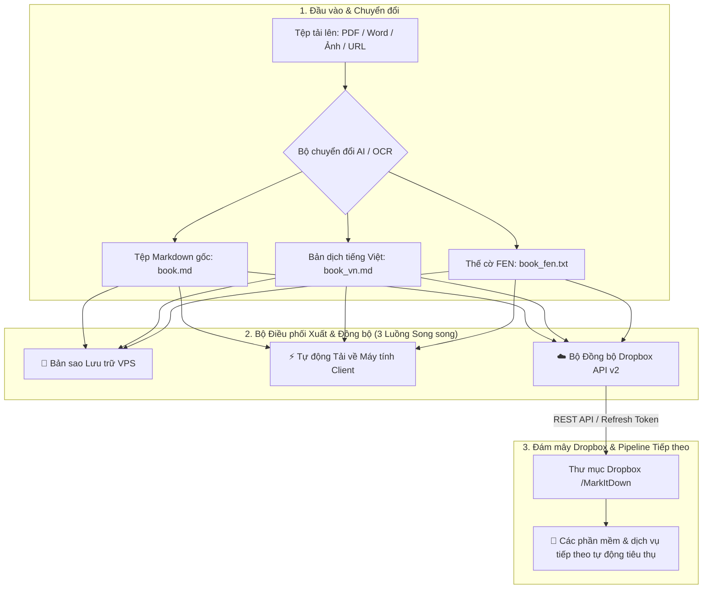

# Kế hoạch Triển khai Tính năng Đồng bộ Tự động với Dropbox (MarkItDown Sync)

> **Mục tiêu:** Bổ sung tính năng đồng bộ tệp kết quả tự động lên Dropbox ngay sau khi chuyển đổi xong (`.md`, `_vn.md`, `_fen.txt`). Cho phép các phần mềm và khâu tiếp theo trong pipeline tự động sử dụng tài liệu qua Dropbox mà không cần thao tác thủ công. Giữ nguyên 100% tính năng tự động tải về trình duyệt máy tính cá nhân và lưu bản sao cục bộ trên VPS.

---

## 1. Kiến trúc Tổng thể & Luồng Dữ liệu Đồng bộ

---

## 2. Chi tiết các Hạng mục Triển khai

### Hạng mục 1: Xây dựng Module Xử lý & Xác thực Dropbox (`infrastructure.py`)
- **Cơ chế Xác thực Kép (Dual Auth Mode)**:
  1. **Access Token trực tiếp**: Dành cho nhu cầu test nhanh hoặc token dài hạn.
  2. **OAuth2 Refresh Token + App Key + App Secret**: Tự động làm mới Access Token vĩnh viễn, không bao giờ bị hết hạn (khắc phục giới hạn 4 giờ của Dropbox).
- **Kiểm tra Kết nối Thời gian thực (`test_dropbox_connection`)**:
  - Gửi yêu cầu kiểm tra tới `https://api.dropboxapi.com/2/users/get_current_account` và `https://api.dropboxapi.com/2/users/get_space_usage`.
  - Trả về tên chủ tài khoản, email, dung lượng đã dùng / tổng dung lượng và độ trễ ms.
- **Tải tệp Tự động (`upload_to_dropbox`)**:
  - Tải tệp lên đường dẫn đích (mặc định: `/MarkItDown/<filename>`).
  - Hỗ trợ chế độ ghi đè thông minh (`mode='overwrite'`).
  - Độc lập, không chặn luồng chính, có bắt lỗi ngoại lệ chi tiết để không làm gián đoạn chuyển đổi.

### Hạng mục 2: Bổ sung Cấu hình Dropbox trên Giao diện Web (`markitdown_gui.py`)
- **Trong Tùy chọn Nâng cao (Cột bên phải)**:
  - Checkbox: `☁️ Tự động đồng bộ lên Dropbox` (Mặc định: Bật nếu có cấu hình token).
  - Textbox: `📁 Thư mục Dropbox` (Mặc định: `/MarkItDown`).
- **Trong Tab "⚙️ Cài đặt Hạ tầng & API"**:
  - Nhóm cấu hình **☁️ Cài đặt Đồng bộ Đám mây Dropbox**:
    - Ô nhập `Dropbox Access Token / Refresh Token`.
    - Ô nhập `Dropbox App Key` và `Dropbox App Secret` (tùy chọn để tự động refresh token).
    - Ô nhập `Thư mục lưu trữ mặc định trên Dropbox` (vd: `/MarkItDown`).
    - Nút `🔍 Kiểm tra kết nối Dropbox` -> hiển thị kết quả kiểm tra trực quan.
    - Khung hướng dẫn nhanh 1 phút (Quick Guide): Cách tạo App trên Dropbox Developer Console và cấp quyền `files.content.write`, `files.content.read`.
- **Lưu trữ Trạng thái (`BrowserState`)**:
  - Tự động lưu các thiết lập Dropbox vào `localStorage` của trình duyệt người dùng để không cần nhập lại.
  - Hỗ trợ các biến môi trường máy chủ: `DROPBOX_ACCESS_TOKEN`, `DROPBOX_REFRESH_TOKEN`, `DROPBOX_APP_KEY`, `DROPBOX_APP_SECRET`, `DROPBOX_TARGET_FOLDER`.

### Hạng mục 3: Cập nhật Luồng Chuyển đổi (`on_convert_files` & `on_convert_url`)
- Khi từng tệp (`.md`, `_vn.md`, `_fen.txt`) được xử lý xong:
  - Nếu bật đồng bộ Dropbox: Tự động gọi `upload_to_dropbox`.
  - Cập nhật dòng trạng thái trực quan: `☁️ [Dropbox] Đã đồng bộ: /MarkItDown/filename.md`.
  - Tự động download về máy tính (`auto_download_on`) vẫn kích hoạt song song.

### Hạng mục 4: Cập nhật Phụ thuộc & Container (`Dockerfile`)
- Thêm thư viện `dropbox` vào `Dockerfile` và hỗ trợ fallback REST API thuần nếu môi trường chưa cài thư viện.

### Hạng mục 5: Viết Hướng dẫn Sử dụng Chi tiết (`docs/DROPBOX_GUIDE.md`)
- Hướng dẫn từng bước với hình ảnh/mô tả rõ ràng:
  1. Tạo Dropbox App trên https://www.dropbox.com/developers/apps.
  2. Chọn quyền `Scoped access` -> `Full Dropbox` hoặc `App folder`.
  3. Cấp permissions: `files.content.write`, `files.content.read`, `account_info.read`.
  4. Lấy Refresh Token hoặc Access Token dán vào Web MarkItDown.

### Hạng mục 6: Commit, Push & Tự động Deploy lên VPS Dokploy
1. Commit mã nguồn và push lên `origin main` (`github.com/covuaduongsinh/markitdown`).
2. Kích hoạt build và cập nhật dịch vụ Docker Swarm `app-copy-primary-feed-r4ikwl` trên VPS `217.15.160.118`.
3. Kiểm tra tính khả dụng của web tại `https://markitdown.dsc.edu.vn`.

---

## 3. Kế hoạch Kiểm thử & Tiêu chí Nghiệm thu

| Kịch bản kiểm thử | Kỳ vọng |
| :--- | :--- |
| **Kiểm tra kết nối Dropbox hợp lệ** | Hiển thị: `✅ Kết nối Dropbox thành công: Tên người dùng (email) · Dung lượng...` |
| **Kiểm tra kết nối Dropbox token sai** | Hiển thị thông báo lỗi rõ ràng, hướng dẫn kiểm tra lại token |
| **Chuyển đổi tệp khi bật Dropbox Sync** | Tệp tự động tải lên Dropbox `/MarkItDown/` + Trình duyệt tự động download + VPS lưu đĩa |
| **Chuyển đổi tệp khi tắt Dropbox Sync** | Chỉ tải về trình duyệt và lưu VPS, không gọi Dropbox |
| **Deploy VPS Dokploy** | Dịch vụ `app-copy-primary-feed-r4ikwl` khởi động thành công, domain `markitdown.dsc.edu.vn` hoạt động bình thường |
