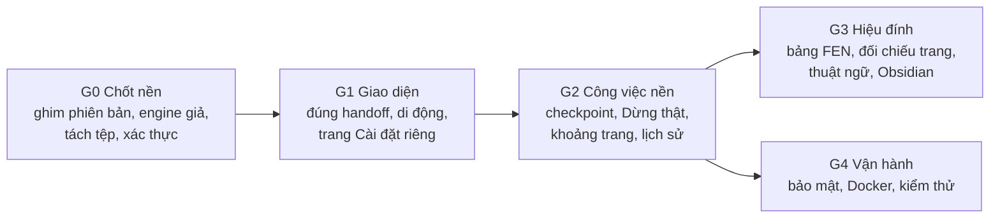

# Kế hoạch nâng cấp giao diện và bổ sung tính năng MarkItDown GUI (2026-11-21)

> **Mục tiêu:** Đưa giao diện web về đúng thiết kế đã chốt (Phương án A) và hết phụ thuộc vào cấu trúc DOM nội bộ của Gradio;
> bổ sung các tính năng còn thiếu để chuyển một cuốn sách cờ vua dài (hàng trăm trang) một cách **tin cậy, dừng/chạy tiếp được,
> hiệu đính được**; đóng các rủi ro 🔴 trước khi chia sẻ web cho người khác.
>
> Khảo sát mã tại `d72cc40`; khi viết xong kế hoạch `HEAD = 9faa7e9` (chỉ thêm tài liệu, không đổi tệp `.py`). Số dòng nêu dưới
> đây lấy bằng `grep -n` tại thời điểm khảo sát — khi triển khai hãy tìm theo **tên hàm/hằng**.
> Prompt triển khai: [`2026-11-21-nang-cap-giao-dien-va-tinh-nang-prompt-trien-khai.md`](2026-11-21-nang-cap-giao-dien-va-tinh-nang-prompt-trien-khai.md).

---

## 1. Kết quả khảo sát

### 1.1 Giao diện trên production đang lệch thiết kế (quan sát trực tiếp `https://markitdown.dsc.edu.vn`, 2026-11-21 ~21:45)

| # | Quan sát | Số liệu / bằng chứng | Nguyên nhân |
|---|---|---|---|
| K1 | Production chạy **Gradio 6.32.0**, máy dev là **6.17.3** | `window.gradio_config.version`; `.venv/Lib/site-packages/gradio-6.17.3.dist-info` | `Dockerfile` cài `gradio` không ghim (mục O4 sổ rà soát) → mỗi lần build có thể đổi phiên bản |
| K2 | Nhiều quy tắc CSS **không còn khớp** phần tử nào | `#mid-convert button` → 0 phần tử (id nay nằm ngay trên `<button>`); `.mid-input-tabs .tab-nav` → 0 (lớp nay là `.tab-container`); `.mid-pick-btn button` → 0 | Khối `CSS` (dòng 677) bám vào DOM nội bộ của Gradio (`.tab-nav`, `.wrap`, `.form`, `button` con…) |
| K3 | Nút **Chuyển đổi** hiện màu xanh mặc định của Gradio, góc vuông | `background: rgb(59,130,246)`, `border-radius: 0` thay vì navy `#2B3990` bo 12px | hệ quả K2 |
| K4 | Chữ thương hiệu "MarkItDown" **tối màu trên nền navy**, gần như không đọc được | `color: rgb(39,39,42)` | Gradio ghi đè màu chữ trong `gr.HTML` |
| K5 | Thẻ lồng thẻ (viền kép), nền khối xám thay vì trắng | `.mid-card` khớp 8 phần tử (lớp bị gắn cả lên khối con) | hệ quả đổi DOM |
| K6 | Thẻ nhập không còn dạng segmented; nút "Chọn tệp từ máy" trông như một dòng chữ đậm | ảnh chụp | hệ quả K2 |
| K7 | Vùng kéo-thả hiện **tiếng Anh**: "Drop File Here – or – Click to Upload" | ảnh chụp | chuỗi mặc định của `gr.File` |
| K8 | Trang đứng ở **"Loading…" hơn 20 giây** rồi mới hiện | console: `ERR_TIMED_OUT`, `Unable to preload CSS for https://fonts.googleapis.com/css2?family=Roboto…` (quan sát 1 lần) | Theme dùng `gr.themes.GoogleFont` + `_FONTS_LINK` nạp phông từ CDN; mạng chậm tới Google Fonts thì cả trang chờ |
| K9 | Thẻ "⚙️ Cài đặt Hạ tầng & API" nhét trong cột trái 412px → cột trái cao **3.333 px** | đo ở khung 1366 px | 4 nhóm cấu hình + hướng dẫn xếp dọc trong một tab nhập liệu |
| K10 | Di động 375 px: trang cao **4.762 px**, kết quả nằm **dưới cùng**; tab "Từ URL" bị đẩy vào menu "…"; 17 vùng bấm thấp hơn 40 px | đo bằng giả lập 375×812 | bố cục 1 cột xếp nguyên cột trái lên trên cột phải; chưa có thiết kế riêng cho di động |
| K11 | Chưa có các trạng thái mà handoff mô tả | không có: trạng thái rỗng có biểu tượng, chip "Chưa chạy / Đang xử lý / Xong n/n", **thanh tiến độ**, danh sách tệp đang chạy, hàng đợi tệp có nút ×, nút "Chạy lại", meta mỗi tệp kết quả | mới làm tới mức `gr.Markdown` một dòng trạng thái |
| K12 | Bảng trạng thái báo "Nhận diện Bàn cờ: Sẵn sàng (ONNX FEN)" trên VPS | ảnh chụp tab Cài đặt | Rất có thể là báo sai (mục B6: chỉ kiểm `import`, không gọi `available()`; `MEMORY.md` ghi mô hình ONNX không có trong image) — **chưa kiểm chứng trong container** |

> Chưa kiểm: bản chạy cục bộ trên Gradio 6.17.3 có vỡ giống vậy không. Dù kết quả thế nào, cách chữa là như nhau (mục G0, G1).

### 1.2 Khoảng trống tính năng (đọc từ mã)

| # | Thiếu gì | Hệ quả thực tế | Nơi |
|---|---|---|---|
| T1 | **Không có điểm lưu (checkpoint)**: kết quả OCR chỉ tồn tại trong RAM tới khi cả tệp xong | Sách 300 trang chạy 40 phút, rớt mạng/khóa màn hình điện thoại ở phút 35 → mất hết, tốn lại hạn mức | `claude_ocr.ocr_pdf`, `_stream_job` (1027) |
| T2 | **Nút Dừng không dừng thật** (B7) | Bấm Dừng nhưng `agy`/`claude` vẫn chạy nền, vẫn tốn hạn mức, tới 600 s/trang | `btn_stop.click(cancels=…)`, `subprocess.run` trong `ai_engine.run_agy_prompt`, `claude_ocr._run_claude_ocr`, `claude_translate._call_claude` |
| T3 | Trang lỗi chỉ được ghi `*[Lỗi OCR trang N: …]*` vào kết quả, **không có cách chạy lại riêng trang lỗi** | Phải OCR lại cả cuốn | `ocr_pdf` |
| T4 | **Không chọn được khoảng trang** | Muốn thử 5 trang đầu hoặc chỉ làm chương 3 cũng phải chạy cả tệp | `ocr_pdf` |
| T5 | Không có **lịch sử**; thư mục kết quả dùng chung, không dọn; zip tên cố định (S7, O6) | Đóng tab là mất danh sách tải về; hai người dùng đè tệp nhau | `_OUTPUT_DIR` (47), `_zip_all` (117) |
| T6 | Xem trước **nối mọi tệp vào một khối**; không chọn xem từng tệp; không có nút sao chép | Lô 5 tệp → một trang xem trước rất dài | `on_convert_files` (1102) |
| T7 | **Không sửa được FEN** khi mô hình nhận sai; không có đối chiếu trang gốc ↔ kết quả | Hiệu đính phải mở tệp `.md` ở công cụ khác, dò tay | `_SCRIPT.midRenderBoards` (517) |
| T8 | Đổi preset/chế độ/engine **bật lại** `Dịch`, `Lưu VPS`, `Tự tải`, `Dropbox` (B10); gợi ý preset lệch thực tế (B11) | Lựa chọn tay bị mất mỗi lần đổi preset | `_apply_preset` (1368), `_PRESET_HINTS` (978) |
| T9 | Chuyển **từ URL** không có bước dịch, không lưu VPS | Hành vi lệch so với chuyển từ tệp | `on_convert_url` |
| T10 | **Không có xác thực** (S1 🔴) | Ai có URL đều dùng được phiên thuê bao AI của chủ dự án | `launch(...)` cuối tệp |
| T11 | Không thể kiểm thử luồng giao diện nếu không gọi AI thật | Mọi thay đổi UI/luồng đều "chưa chạy thử" (xem `LICH-SU-PHAT-TRIEN.md`) | thiếu engine giả |
| T12 | `markitdown_gui.py` 2.104 dòng, CSS/JS nằm trong chuỗi Python; khối "lưu VPS + Dropbox + tải về" lặp 3 lần (T1, T2 sổ nợ kỹ thuật) | Mỗi tính năng mới làm tệp phình thêm, khó rà soát | toàn tệp |

---

## 2. Quyết định chính

| # | Quyết định | Lý do |
|---|---|---|
| Q1 | **Giữ Gradio**, không tách frontend React/Vue | Toàn bộ nghiệp vụ là Python, một người bảo trì; thiết kế Phương án A làm được bằng `gr.Blocks` + `gr.HTML`. Viết lại frontend là dự án riêng, không giải quyết T1–T5 |
| Q2 | **Ghim phiên bản Gradio** (và các phụ thuộc GUI) ở một tệp `requirements-gui.txt`; dev và Docker cài cùng tệp đó. Ghim theo bản production đang chạy: `gradio==6.32.0` | K1: không ghim thì CSS sửa hôm nay có thể vỡ ở lần build sau |
| Q3 | CSS **chỉ bám vào** `elem_id`/`elem_classes` do ta đặt và biến CSS/theme của Gradio; phần đặc thù (thẻ chế độ, hàng đợi tệp, bảng tiến độ, danh sách tải) vẽ bằng `gr.HTML` của ta | K2: bám DOM nội bộ là nguyên nhân gốc. Phần HTML tự vẽ (thẻ chế độ, thanh tiêu đề) là phần **không** vỡ ở production |
| Q4 | **Phông tự lưu trữ** (`assets/fonts/*.woff2`, `font-display: swap`), bỏ `GoogleFont` và `_FONTS_LINK` | K8 |
| Q5 | Chuyển đổi chạy thành **công việc nền có lưu đĩa** (`jobs.py`); giao diện chỉ **hỏi trạng thái định kỳ** thay vì giữ một generator dài | Giải T1, T2, T3, T5 cùng lúc; đóng trình duyệt/khóa điện thoại không làm mất việc |
| Q6 | Thêm **engine giả** (`MID_FAKE_ENGINE=1`) đi qua đúng hai hàm điều phối `_run_engine_ocr` / `_call_engine_translate` | T11; tuân thủ ranh giới "không gọi AI thật để thử" của `AGENTS.md` |
| Q7 | Xác thực bật bằng biến môi trường, **mặc định tắt** | Không đổi hành vi hiện tại cho tới khi chủ dự án đặt biến trên Dokploy |
| Q8 | Làm trên nhánh `feat/nang-cap-giao-dien`, **không push `main`** cho tới khi chủ dự án duyệt | Push `main` → Dokploy tự deploy production |

### Điểm cần chủ dự án chốt (phiên triển khai dùng cột bên phải; C1 và C3 đã được chủ dự án chốt ngày 2026-11-21)

| # | Câu hỏi | Chốt / mặc định |
|---|---|---|
| C1 | Có gắn volume bền cho dữ liệu công việc trên Dokploy không? | **Đã chốt: CÓ.** Gắn volume vào `/data`, đặt `MID_DATA_DIR=/data` — làm ở mục G2.9, cùng lần deploy đầu tiên của Giai đoạn 2 |
| C2 | Tài khoản đăng nhập web (`MID_AUTH_USER` / `MID_AUTH_PASS`) | Mặc định: mã sẵn sàng, chưa bật; chủ dự án tự đặt biến trên Dokploy |
| C3 | Lưu lịch sử bao lâu? | **Đã chốt: 60 ngày** (`MID_KEEP_DAYS=60`) |
| C4 | Thứ tự ưu tiên giai đoạn 3 | Mặc định: bảng hiệu đính FEN → đối chiếu trang gốc → bảng thuật ngữ → xuất Obsidian |

---

## 3. Lộ trình

Mỗi giai đoạn tự đứng được, kết thúc bằng commit riêng và có thể phát hành riêng. Cỡ: S (nhỏ) / M (vừa) / L (lớn).



### Giai đoạn 0 — Chốt nền (cỡ M) · làm trước mọi thứ

- [x] **G0.1 Ghim phiên bản.** Tạo `requirements-gui.txt` (ghim `gradio==6.32.0` và các gói GUI đang dùng: `pypdfium2`, `pillow`, `numpy`, `chess`, `onnxruntime`, `opencv-python-headless`, `requests` — lấy số phiên bản từ `.venv` hiện tại, trừ `gradio`). `Dockerfile` cài từ tệp này (bỏ gói `dropbox` không dùng — O5). Nâng `.venv` lên cùng bản. Cập nhật `TECH.md` mục 2.
  - *Đạt khi:* `pip show gradio` ở `.venv` = bản ghim; `markitdown_gui` import và dựng `build_ui()` không lỗi.
- [x] **G0.2 Engine giả.** `ai_engine.py`: hằng `ENGINE_FAKE = "fake"`, chỉ xuất hiện trong `ENGINE_LABELS` và chỉ `is_engine_available` = `True` khi `MID_FAKE_ENGINE=1`. Nhánh `fake` trong `claude_ocr._run_engine_ocr` và `claude_translate._call_engine_translate`: trả Markdown tiếng Việt có dấu kèm một khối ```` ```chessboard ```` hợp lệ; ngủ `MID_FAKE_DELAY` giây (mặc định 0.3); ném lỗi cho các trang liệt kê ở `MID_FAKE_FAIL_PAGES` (để thử chạy lại trang lỗi). Tôn trọng marker `<<<<<--- HET_TRANG --->>>>>` khi gộp nhiều trang.
  - *Đạt khi:* chạy app với `MID_FAKE_ENGINE=1`, chuyển một PDF mẫu 6 trang (tạo bằng Pillow trong thư mục test) ra `.md`, `_vn.md`, `_fen.txt` mà **không** có tiến trình `agy`/`claude` nào được gọi.
- [x] **G0.3 Tách tệp, không đổi hành vi.**
  - `assets/ui/app.css`, `assets/ui/app.js` ← nội dung `CSS`, `_SCRIPT`; module `ui_theme.py` đọc tệp lúc khởi động và giữ `THEME`, `HEAD`, `TOPBAR_HTML`, `MODE_CARDS_HTML`, biểu tượng SVG.
  - `pipeline.py` ← `_safe_filename`, `_write_md`, `_write_fen_file`, `_zip_all`, `_autosave`, `_resolve_save_dir`, `_convert`, `_ocr_to_outputs`, `convert_file`, `convert_url`, `_translate_to_vn`, các hàm `_*_from_label`, hằng `MODE_*`.
  - Rút khối lặp ba lần thành `_publish_output(path, save_dir, …) -> str` (T2 sổ nợ).
  - Thay việc dò chuỗi `"gộp 1 bước"` (B9) bằng **cờ có cấu trúc**: `convert_file` trả thêm `translated: bool`; cập nhật bảng 4b trong `AGENTS.md`.
  - `markitdown_gui.py` vẫn là điểm vào (`Dockerfile`, `run_gui.bat` không đổi), chỉ còn `build_ui`, các handler và `launch`.
  - *Đạt khi:* `_test_translate_roundtrip.py` đạt; luồng G0.2 cho kết quả giống trước khi tách; `markitdown_gui.py` dưới ~900 dòng.
- [x] **G0.4 Xác thực tùy chọn (S1).** `launch(auth=(user, pass))` khi có `MID_AUTH_USER` + `MID_AUTH_PASS`; không có thì như cũ. Ghi vào `TECH.md` mục 6 và `docs/tinh-nang/10-…`.
  - *Đạt khi:* đặt hai biến → trang đòi đăng nhập; bỏ biến → vào thẳng. **Kiểm tài liệu Gradio đúng bản đã ghim** về tham số `auth` trước khi viết.
- [x] **G0.5 Bộ kiểm thử của fork.** Thư mục `tests_gui/` (kiểu `unittest`, chạy được bằng `python -m unittest discover tests_gui`), bắt đầu với: hàm thuần trong `pipeline.py`, `_apply_preset`, engine giả đầu-cuối. Cập nhật `docs/tinh-nang/11-kiem-thu.md`.

### Giai đoạn 1 — Giao diện đúng thiết kế và dùng tốt trên điện thoại (cỡ L)

Chuẩn đối chiếu: `design_handoff_markitdown_gui/README.md` + `MarkItDown.dc.html`. Kiểm ở 3 bề rộng (1366, 768, 375) × 2 theme.

- [ ] **G1.1 Viết lại CSS theo Q3.** Màu/phông/bo góc của thành phần Gradio đặt qua `THEME.set(...)` và biến CSS; quy tắc riêng chỉ dùng id/lớp của ta **đặt trực tiếp trên phần tử** (ví dụ `#mid-convert{…}` thay vì `#mid-convert button{…}`). Sửa K3–K6: nút Chuyển đổi/Dừng, chữ thương hiệu trắng, thẻ không lồng viền, tab segmented, nút chọn tệp, công tắc, dropdown, tab kết quả. Rà lại theme tối.
- [x] **G1.2 Phông tự lưu trữ (Q4).** Tải Roboto / Roboto Condensed / Roboto Mono (woff2, giấy phép Apache-2.0/OFL) vào `assets/fonts/`, khai báo `@font-face` trong `app.css`, bỏ `gr.themes.GoogleFont` và `_FONTS_LINK`.
  - *Đạt khi:* tab Network không còn yêu cầu nào tới `fonts.googleapis.com` / `fonts.gstatic.com`.
- [ ] **G1.3 Việt hóa và hàng đợi tệp.** Vùng kéo-thả theo handoff (vòng tròn biểu tượng, "Kéo-thả tệp vào đây", phụ đề định dạng) — không còn chuỗi tiếng Anh (K7). Dưới vùng thả: **hàng đợi tệp** vẽ bằng `gr.HTML` (biểu tượng theo loại, tên, dung lượng, số trang với PDF) + "Xóa hết". Nút Chuyển đổi mang nhãn "Chuyển đổi N tệp", vô hiệu khi chưa có tệp/URL.
- [ ] **G1.4 Bảng trạng thái có cấu trúc** thay dòng Markdown: chip trạng thái (Chưa chạy / Đang xử lý… / Xong n/n / Có lỗi), **thanh tiến độ** gradient navy→sun, danh sách từng tệp (chờ / đang chạy "trang 6/12" / xong / lỗi), thời gian đã chạy. Trạng thái rỗng có biểu tượng và hướng dẫn. Backend trả một `dict` tiến độ; một hàm `render_status_html(state)` duy nhất vẽ ra HTML (nhớ `html.escape` tên tệp).
- [ ] **G1.5 Kết quả theo từng tệp.** Bộ chọn tệp (chip) phía trên tab Xem trước / Mã .md; mỗi lần chỉ hiện một tệp (T6). Nút **Sao chép** ở tab Mã .md. Danh sách tải về có meta mỗi tệp (số ký tự, số thế cờ), nút "Chạy lại".
- [ ] **G1.6 Trang Cài đặt riêng.** Đưa "Cài đặt Hạ tầng & API" ra khỏi tab nhập liệu: nút bánh răng trên thanh tiêu đề mở một khung toàn chiều rộng, lưới 2 cột thẻ (Antigravity · Claude Code · Gemini REST · Dropbox), hướng dẫn dài thu vào accordion. Thanh tiêu đề có huy hiệu tóm tắt "AI: Sẵn sàng / Cần đăng nhập" (K9).
- [ ] **G1.7 Di động (K10).** Dưới 780 px: nút Chuyển đổi/Dừng **dính đáy màn hình**; "Chế độ" và "Mức chất lượng" thu gọn thành một dòng tóm tắt bấm để mở; bấm Chuyển đổi thì cuộn tới khối kết quả; vùng bấm ≥ 44 px; ba tab nhập không bị đẩy vào menu "…".
- [ ] **G1.8 Sửa hành vi preset (T8).** `_apply_preset` chỉ đặt model/effort/DPI/trang-mỗi-lần/gộp; **không** đụng `translate_vn`, `autosave_on`, `auto_download_on`, `dropbox_sync_on`; `force_ocr` chỉ đặt lại khi **đổi chế độ**. Bỏ `_PRESET_HINTS` tĩnh, luôn sinh gợi ý từ bảng preset. Lưu thêm các công tắc này vào `prefs`.
- [ ] **G1.9 Chuyển từ URL ngang hàng với tệp (T9):** dùng chung đường `_publish_output`, có tùy chọn dịch.
- [ ] Cập nhật `docs/tinh-nang/06-giao-dien-gradio.md` (bảng preset đang ghi model đã bị khai tử, số dòng cũ), `GUI_README.md`.

### Giai đoạn 2 — Công việc nền, tin cậy cho sách dài (cỡ L)

- [x] **G2.1 `jobs.py` — công việc lưu đĩa.**
  ```
  <MID_DATA_DIR>/jobs/<job_id>/
    job.json            trạng thái, tùy chọn, tiến độ từng tệp (ghi nguyên tử: ghi tệp tạm rồi os.replace)
    src/                bản sao tệp nguồn (để chạy tiếp được)
    f01/pages/0007.md   kết quả từng trang · 0007.err nếu lỗi · 0007.jpg ảnh thu nhỏ (cho G3.2)
    f01/tr/<sha1>.md    kết quả từng đoạn dịch (khi dịch riêng)
    f01/out/            <tên>.md, <tên>_vn.md, <tên>_fen.txt
    ketqua.zip
  ```
  `MID_DATA_DIR` mặc định `<tmp>/markitdown_gui_data` trên máy dev; trên production là `/data` (volume bền, mục G2.9). `job_id` ngẫu nhiên (`secrets.token_urlsafe`), tên thư mục không lấy từ tên tệp người dùng. `JobManager` chạy **một công việc một lúc** (`MID_MAX_JOBS=1`), các công việc sau xếp hàng. Trạng thái: `queued → running → done | error | cancelled`. `job.json` **không lưu** khóa/token.
- [x] **G2.2 Điểm lưu theo trang.** `claude_ocr.ocr_pdf` nhận thêm tham số tùy chọn (mặc định giữ hành vi cũ): `pages` (tập trang cần làm), `done_pages` (dict trang → văn bản đã có, bỏ qua không gọi AI), `on_page(page_no, text, error)`, `cancel` (`threading.Event`). Dịch riêng: lưu theo băm nội dung đoạn.
- [x] **G2.3 Dừng thật (B7).** Đổi `subprocess.run` → `Popen` có đăng ký tiến trình ở ba nơi gọi CLI (`ai_engine.run_agy_prompt`, `claude_ocr._run_claude_ocr`, `claude_translate._call_claude`); khi `cancel` bật: ngừng nộp nhóm trang mới, diệt cây tiến trình đang chạy (tái dùng cách `_kill_tree` của `claude_login_bridge.py`), giữ lại các trang đã xong.
  - *Đạt khi:* với engine giả `MID_FAKE_DELAY=5`, bấm Dừng → trong ≤ 3 s không còn luồng/tiến trình con nào của công việc; trạng thái `cancelled`; trang đã xong vẫn tải được.
- [x] **G2.4 Giao diện hỏi trạng thái.** Bấm Chuyển đổi → tạo công việc, lưu `job_id` vào `gr.BrowserState`; `gr.Timer` (~2 s, chỉ bật khi có công việc đang chạy) gọi `render_job(job_id)`; chỉ gửi lại phần xem trước khi có tệp mới xong. Mở lại trang → tự gắn vào công việc đang chạy. Bỏ `_stream_job`. **Kiểm tài liệu `gr.Timer` đúng bản đã ghim.**
- [x] **G2.5 Chạy tiếp và làm lại trang lỗi.** Nút "Chạy tiếp" (công việc bị dừng/lỗi/app khởi động lại) và "OCR lại N trang lỗi" — chỉ gọi AI cho trang còn thiếu, rồi ghép lại tệp kết quả.
- [x] **G2.6 Khoảng trang (T4).** Ô "Trang" trong Tùy chọn nâng cao: `1-5, 20, 31-40` (trống = tất cả). Hàm thuần `parse_page_ranges(text, n_pages)` + test. Trước khi chạy hiện ước lượng: "97 trang → 97 lượt gọi OCR" (theo trang-mỗi-lần).
- [x] **G2.7 Tab "Lịch sử".** Danh sách công việc (thời gian, tệp, trạng thái, số trang lỗi), mở lại kết quả, tải zip, xóa. Dọn công việc cũ hơn `MID_KEEP_DAYS` (mặc định **60**) khi khởi động và mỗi 24 giờ; tab Lịch sử hiện tổng dung lượng đang dùng của `MID_DATA_DIR`. Zip nằm trong thư mục công việc → hết đè nhau (S7); `allowed_paths` trỏ vào `MID_DATA_DIR`.
- [x] **G2.8 Báo khi xong.** Đổi tiêu đề tab trình duyệt ("✅ Xong — MarkItDown"), thông báo trình duyệt nếu người dùng cho phép (nút bật trong Cài đặt).
- [x] **G2.9 Volume bền trên Dokploy (C1 — đã chốt).** Chỉ làm ở bước lên production, **sau khi chủ dự án duyệt nhánh**, vì đây là thay đổi hạ tầng production:
  1. Trên VPS: tạo thư mục host `/root/markitdown-data`; kiểm dung lượng trống (`df -h`) và ghi con số vào tài liệu.
  2. Trên Dokploy, ứng dụng markitdown: thêm mount `bind` `/root/markitdown-data` → `/data` (cùng cách đã làm với `/root/.gemini`, xem `2026-11-21-cap-nhat-model-antigravity-va-mount-volume-vps.md`) và biến môi trường `MID_DATA_DIR=/data`, `MID_KEEP_DAYS=60`.
  3. Redeploy; xác minh trong container: `docker inspect` thấy mount `/data`; tạo một công việc bằng engine giả hoặc một PDF thật 2–3 trang (khi chủ dự án cho phép) → redeploy lần nữa → công việc **vẫn còn** trong tab Lịch sử.
  4. `Dockerfile`: thêm `ENV MID_DATA_DIR=/data` và `VOLUME /data` để bản nhân bản cũng có mặc định đúng; cập nhật `docs/tinh-nang/10-trien-khai-docker-vps.md`, `TECH.md`, `MEMORY.md` mục 2.
  - *Lưu ý:* gắn volume trước khi mã G2 lên production thì chưa có tác dụng gì — mã hiện tại (`_OUTPUT_DIR` trong thư mục tạm) chưa đọc `MID_DATA_DIR`.
  - *Dung lượng:* 60 ngày × (ảnh trang JPEG thu nhỏ + văn bản) — ước lượng khi triển khai bằng một cuốn mẫu và ghi vào tài liệu; nếu vượt ngưỡng đĩa thì giảm chất lượng ảnh trang trước khi giảm số ngày.
- [ ] Tài liệu mới `docs/tinh-nang/13-cong-viec-nen.md` (mẫu hai tầng A/B); cập nhật `01`, `02`, `06`, `TONG-QUAN-KIEN-TRUC.md`, `TECH.md` (biến `MID_*`), đánh dấu B7, B9, O6, S7 trong `RA-SOAT-RUI-RO.md`.

### Giai đoạn 3 — Hiệu đính nội dung cờ vua (cỡ M–L, theo thứ tự C4)

- [ ] **G3.1 Bảng hiệu đính FEN.** Tab "Thế cờ": mỗi thế cờ một dòng — số thứ tự, trang, bàn cờ thu nhỏ, FEN (sửa được), dấu hợp lệ (`_board_field_valid` + đúng một Vua mỗi bên), nút "Lật bàn" (xoay 180°, tái dùng `_rotate_grid_180`), liên kết "Mở trong Lichess" (`https://lichess.org/editor/<fen>`). "Áp dụng" ghi lại khối ```` ```chessboard ```` thứ n trong `.md` và `_vn.md`, sinh lại `_fen.txt`. Giữ nguyên định dạng khối một dòng `fen:` (bảng 4b `AGENTS.md`).
  - Hàm thuần `replace_nth_fen(md, n, new_fen)` + test khứ hồi.
- [ ] **G3.2 Đối chiếu trang gốc ↔ kết quả.** Chế độ xem hai cột: ảnh trang (từ `pages/NNNN.jpg`) bên trái, Markdown của đúng trang đó bên phải, nút trang trước/sau, lọc "chỉ trang lỗi / trang có bàn cờ". Cần G2.2.
- [ ] **G3.3 Bảng thuật ngữ dịch.** Tệp `glossary.md` trong `MID_DATA_DIR` (sửa ở trang Cài đặt): cặp "nguồn → đích". Chèn vào chỉ thị dịch qua **một** hằng/hàm dựng prompt dùng chung cho OCR-gộp-dịch và dịch riêng (theo quy ước prompt ở `AGENTS.md` mục 4). Giới hạn độ dài để không phình prompt.
- [ ] **G3.4 Xuất cho Obsidian.** Tùy chọn: thêm frontmatter YAML (tiêu đề, nguồn, ngày, engine/model, số trang); tách theo tiêu đề cấp `#` thành nhiều tệp `01-….md` trong zip.

### Giai đoạn 4 — Bảo mật và vận hành (cỡ M) · có thể làm song song G3

- [ ] **G4.1** Trên Docker: ẩn nút hộp thoại Windows; ô "Thư mục tùy chọn" chỉ nhận đường dẫn nằm trong một gốc cho phép (`MID_SAVE_ROOT`), chặn `..` (S6).
- [ ] **G4.2** Khóa/token: máy chủ ưu tiên biến môi trường; khi đã có ở môi trường, giao diện hiện "Đã cấu hình trên máy chủ" và không yêu cầu nhập. Thêm công tắc "Nhớ khóa trên trình duyệt này" (mặc định giữ như hiện nay) (S3).
- [ ] **G4.3** Bảng trạng thái trung thực: ONNX gọi `chessboard_fen.available()` (B6, K12); engine chỉ "Sẵn sàng" khi tìm thấy CLI (B5); gộp hai hàm `find_claude` (B4); một hàm `engine_display_name()` (T5 sổ nợ).
- [ ] **G4.4** `Dockerfile`: build **thất bại** nếu cài `agy` lỗi (bỏ `|| true`, thêm `agy --version`) (O3); `.dockerignore` loại `*.zip`, `design_handoff_markitdown_gui/`, `_test_*.py`, `tests_gui/`, `docs/` (O8).
- [ ] **G4.5** `run_gui.bat` nhắc cài từ `requirements-gui.txt` (O7); đường dẫn hướng dẫn dùng `expanduser` (T9 sổ nợ).

**Không làm trong kế hoạch này:** tách frontend riêng (Q1); đổi tên `claude_ocr.py`/`claude_translate.py` (T3 sổ nợ — rủi ro cao, lợi ích thấp); tài khoản nhiều người dùng với phiên AI tách biệt (S2 — cần quyết định riêng); xuất PGN (ván cờ trong văn bản OCR chưa đủ tin cậy để sinh PGN tự động); đưa mô hình ONNX vào image (O1 — chờ làm rõ giấy phép).

---

## 4. Rủi ro khi triển khai

| Rủi ro | Giảm thiểu |
|---|---|
| Nâng `.venv` lên Gradio 6.32.0 làm vỡ hành vi khác (ví dụ `gr.BrowserState`, `gr.File`) | G0.1 làm riêng một commit; chạy luồng engine giả trước và sau |
| API Gradio trong kế hoạch (`auth`, `gr.Timer`, `THEME.set`, đặt đường dẫn tĩnh cho phông) khác ở bản đã ghim | Phiên triển khai **đọc tài liệu đúng phiên bản** trước khi viết; ghi "chưa kiểm chứng" nếu không chạy thử được |
| G2 đổi luồng lõi (`ocr_pdf`, ba nơi gọi CLI) | Tham số mới đều tùy chọn, mặc định = hành vi cũ; test khứ hồi bằng engine giả; không đổi prompt |
| Phá hằng số/định dạng trong bảng 4b `AGENTS.md` | Chỉ G0.3 chủ động thay `"gộp 1 bước"` bằng cờ; các mục khác giữ nguyên |
| Vô tình deploy production | Q8: nhánh riêng, không push `main` |
| Dữ liệu công việc đầy đĩa VPS (giữ 60 ngày) | Dọn tự động theo `MID_KEEP_DAYS=60`; ảnh trang lưu JPEG thu nhỏ; tab Lịch sử hiện dung lượng đang dùng; kiểm `df -h` khi gắn volume (G2.9) |

## 5. Xác minh

| Giai đoạn | Cách kiểm |
|---|---|
| Mọi giai đoạn | `.venv\Scripts\python.exe _test_translate_roundtrip.py`; `.venv\Scripts\python.exe -m unittest discover tests_gui -v`; import cả 7 module của fork |
| G0–G2 | Chạy `MID_FAKE_ENGINE=1 .venv\Scripts\python.exe markitdown_gui.py`, chuyển PDF mẫu 6 trang ở chế độ cờ vua + tài liệu thường, có/không gộp dịch |
| G1 | So ảnh chụp với handoff ở 1366 / 768 / 375 px × sáng/tối; Network không có `fonts.googleapis.com`; không còn chuỗi tiếng Anh |
| G2 | Kịch bản: (a) đóng tab giữa chừng rồi mở lại → thấy tiến độ; (b) Dừng → hết tiến trình con; (c) `MID_FAKE_FAIL_PAGES=3,5` → "OCR lại 2 trang lỗi" chỉ gọi 2 lần; (d) khoảng trang `2-4` → đúng 3 lượt gọi; (e) sau khi lên production: công việc còn nguyên sau một lần redeploy (G2.9) |
| Trước khi lên production | Chủ dự án duyệt nhánh → merge `main` → theo `docs/tinh-nang/10-trien-khai-docker-vps.md`; chuyển thử **một** PDF thật 2–3 trang với Antigravity (do chủ dự án cho phép) |

## 6. Tiến độ

| Giai đoạn | Trạng thái | Commit | Ghi chú |
|---|---|---|---|
| G0 | ✅ xong (2026-11-21), chưa push/merge | G0.1 `3930dd8` · G0.2 `f491108` · G0.3 `af6ee35` · G0.4 `d0d819e` · G0.5 `23d6812` | Nhánh `feat/nang-cap-giao-dien`. Ngoại lệ so với "Đạt khi" G0.3: `markitdown_gui.py` còn **1.043 dòng** (không phải <900) vì `build_ui` riêng đã 635 dòng — sẽ co lại ở G1.6 (trang Cài đặt). Kiểm tra trình duyệt chưa làm (G0 không đổi giao diện) |
| G1 | ☐ chưa làm | | |
| G2 | ✅ xong (2026-11-22), **đã lên production** | G2.1–G2.3 `183696d` · G2.4–G2.8 `87f8c83` · tài liệu `085123b` · G2.9 `83fe754` (sửa Dockerfile) + cấu hình Dokploy | Nhánh `feat/nang-cap-giao-dien`. Đã kiểm trong Chrome với engine giả: chạy, tải lại giữa chừng, Dừng ≤1,5 s, Chạy tiếp từ trang đã giữ, Lịch sử, liên kết tải. G2.9: mount `/root/markitdown-data`→`/data`, env `MID_DATA_DIR=/data`, `MID_KEEP_DAYS=60`; Docker build thật thành công trên Dokploy; công việc thử (engine giả) còn nguyên sau khi thay container. Chưa kiểm: thông báo trình duyệt (`Notification`), thử với AI thật. Chưa lưu ảnh trang thu nhỏ (`pages/NNNN.jpg`, để G3.2) |
| G3 | ☐ chưa làm | | |
| G4 | ☐ chưa làm | | |

## 7. Phát hiện thêm (ngoài phạm vi, ghi lại để quyết định sau)

| # | Phát hiện (2026-11-21, khi làm G0) | Gợi ý |
|---|---|---|
| P1 | `build_ui` truyền `dropbox_token_in` **hai lần** liền nhau (vị trí `dropbox_token` và `dropbox_refresh_token`); `_on_test_dropbox` cũng làm vậy — có vẻ **cố ý** (một ô "Token" dùng cho cả access lẫn refresh token) chứ không phải lỗi | Xác nhận với chủ dự án khi dựng lại trang Cài đặt (G1.6) |
| P2 | Dòng trạng thái ghi "bằng Claude Code" cho mọi engine không phải Antigravity (kể cả engine giả) vì `engine_name` được suy ra bằng `== \"antigravity\"` ở 3 nơi | Gom vào `engine_display_name()` (đã có ở G4.3) |
| P3 | ~~`_with_download_update` là mã chết~~ | **Đã xóa ở G2.4** |
| P4 | `_test_dropbox_sync.test_test_dropbox_connection_invalid_token` gửi một token sai tới `api.dropboxapi.com` (bị từ chối, không ghi gì lên tài khoản) | Giữ; nhưng đừng chạy trong CI không có mạng |
| P5 | Các tài liệu cũ trích `markitdown_gui.py:NNN` là số dòng của tệp **trước khi tách**; đã thêm ghi chú ở `docs/README.md`, `TONG-QUAN-KIEN-TRUC.md`, `SKILLS.md`, nhưng chưa sửa từng trích dẫn | Sửa dần khi đụng tới từng tài liệu ở G1–G2 |
| P6 | `BrowserState` của `prefs` (API key, token…) dùng khóa mã hóa **ngẫu nhiên mỗi lần app khởi động** (mặc định Gradio) → sau redeploy các ô lưu trong trình duyệt có thể bị trống. Đã sửa riêng cho `job_state` bằng `secret` cố định | Cân nhắc `secret` cố định cho `prefs` khi làm G4.2 (khóa/token); **chưa kiểm chứng** hiện tượng trên production |
| P7 | `_apply_preset` luôn bật `autosave_on`, `dropbox_sync_on`, `auto_download_on`, nên một lần chạy thử trên máy dev đã tự ghi bản sao vào `Downloads` của người dùng (đã xóa 2 tệp thử) | Làm ở G1.8 như kế hoạch |
