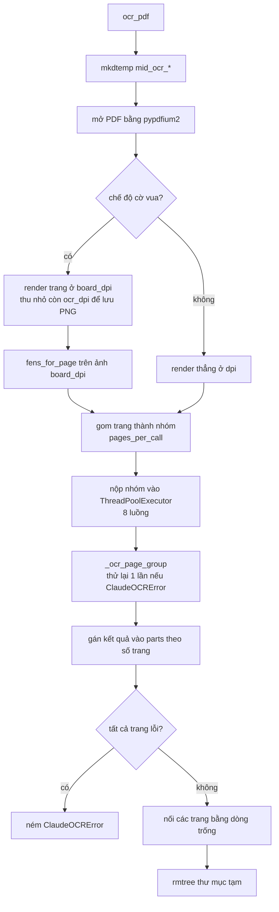
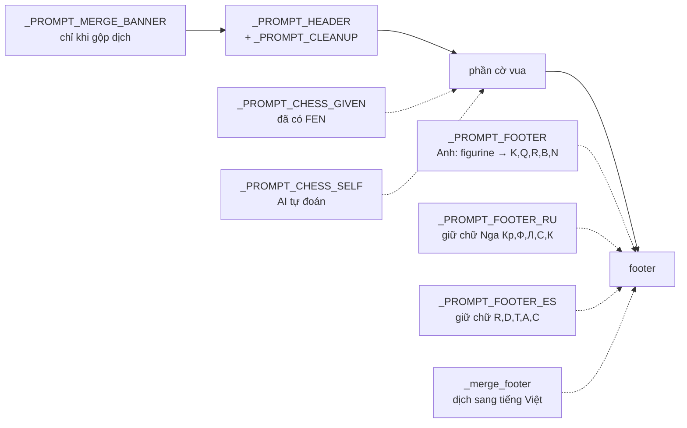

# Tính năng 01 — OCR PDF và ảnh scan bằng động cơ AI

> Tài liệu này mô tả mã nguồn tại commit `2c1df67b44` (2026-09-27).
> Tệp chính: `claude_ocr.py` (806 dòng). Tên tệp là di sản từ thời chỉ có Claude; hiện nó điều phối cả Antigravity.

> **Cập nhật 2026-11-21 (G2):** `ocr_pdf` nhận thêm các tham số tùy chọn `pages`, `done_pages`, `on_page`, `cancel` (điểm lưu theo trang, khoảng trang, Dừng thật); mặc định giữ hành vi cũ. Xem [13](13-cong-viec-nen.md).

---

# Phần A — Chức năng

## Bài toán

Sách cờ vua scan không có lớp chữ: mỗi trang chỉ là một tấm ảnh. Công cụ chuyển đổi thông thường
trả về trống. Tính năng này **nhờ một AI có khả năng nhìn ảnh** đọc từng trang và viết lại thành
Markdown có cấu trúc (tiêu đề, đoạn, bảng, danh sách).

## Người dùng nhận được gì

- Toàn văn cuốn sách dạng Markdown, đúng thứ tự trang.
- Tiêu đề chạy đầu trang, chân trang, số trang **bị lược bỏ**; dòng nào AI không chắc thì giữ lại và
  ghi chú `(cần kiểm tra)`.
- Ở mỗi sơ đồ bàn cờ, một khối ```` ```chessboard ```` chứa thế cờ (FEN) để xem được ngay trong Obsidian
  hay trình xem Markdown có plugin bàn cờ.
- Nước đi giữ đúng như sách in (`12.` `12...`, `!`, `?!`, `±`…); quân cờ in bằng hình (figurine) được đổi
  về chữ cái.
- Nếu một trang lỗi, trang đó được thay bằng dòng `*[Lỗi OCR trang N: …]*` — các trang khác vẫn ra bình thường.

## Ba chế độ đầu vào

| Chế độ | Khi nào | Hành vi |
|---|---|---|
| **Sách cờ vua** (Anh / Nga / Tây Ban Nha) | mặc định | OCR + nhận diện bàn cờ + quy tắc ký hiệu nước đi |
| **Tài liệu thường** | chọn tay | OCR thuần, không có phần cờ vua |
| **Ảnh lẻ** (jpg, png…) | tệp là ảnh | OCR một ảnh, có nhận diện bàn cờ nếu ở chế độ cờ vua |

---

# Phần B — Kỹ thuật

## 1. Đường vào và quyết định

`markitdown_gui.py:convert_file` (dòng 368) quyết định có OCR hay không (sơ đồ ở
[`../TONG-QUAN-KIEN-TRUC.md`](../TONG-QUAN-KIEN-TRUC.md) mục 3.4). Khi có, nó gọi
`_ocr_to_outputs` (dòng 322) → `claude_ocr.ocr_pdf` (PDF) hoặc `claude_ocr.ocr_image_file` (ảnh).

## 2. Thuật toán `ocr_pdf`



Chi tiết cần biết:

1. **Vẽ trang và nhận diện bàn cờ chạy tuần tự ở luồng chính**, còn lời gọi AI chạy song song ở 8
   luồng (`OCR_WORKERS = 8`, dòng 667). Nhóm trang được nộp vào pool ngay khi đủ `pages_per_call`
   trang, nên vẽ trang và gọi AI chồng lấn nhau.
2. **Hai độ phân giải.** `_render_page_pair` (dòng 432) vẽ một lần ở `board_dpi` (mặc định
   `BOARD_DPI = 400`), rồi thu nhỏ bằng LANCZOS xuống `ocr_dpi` (mặc định 200, GUI không đổi giá trị
   này) để lưu PNG gửi AI. Ảnh nét cao chỉ dùng cho mô hình bàn cờ. Ghi chú trong mã:
   *"Model bàn cờ chỉ nhìn ảnh <=512px nên 250 DPI thường đủ và nhanh hơn ~2.5x."*
3. Ở chế độ tài liệu thường, `_render_page` vẽ thẳng ở `dpi`, bỏ qua bước bàn cờ.
4. Kết quả từng trang rỗng → `*[Trang N: không trích được nội dung]*`.
5. Trang lỗi sau khi đã thử lại → `*[Lỗi OCR trang N: <lỗi>]*` và **không** làm hỏng cả sách; chỉ khi
   **toàn bộ** trang lỗi (`n_failed == n_pages`) mới ném lỗi kèm gợi ý kiểm tra phiên đăng nhập/hạn mức.
6. Tiến độ báo qua callback `progress(n_done, n_pages)`; `_stream_job` ở GUI biến nó thành dòng trạng thái.

## 3. Ghép prompt

Prompt là chuỗi ghép từ các hằng, để một quy tắc chỉ nằm ở một chỗ:



| Hằng | Dòng | Nội dung |
|---|---:|---|
| `_PROMPT_CLEANUP` | 30 | Loại header/footer/số trang; **không chắc thì giữ lại và ghi `(cần kiểm tra)`** |
| `_PROMPT_HEADER` | 42 | "Hãy đọc ảnh tài liệu tại đường dẫn: {path}" + yêu cầu OCR |
| `_PROMPT_CHESS_SELF` | 60 | AI tự đọc từng ô a1→h8, sinh FEN 6 trường, quyết lượt đi từ chú thích |
| `_PROMPT_CHESS_GIVEN` | 84 | Cho sẵn `{n}` FEN đã nhận diện; **chèn nguyên văn, không tự nhận diện lại** |
| `_PROMPT_BLOCK_RULES` | 50 | Khối phải đúng 1 dòng `fen:`, không nháy kép, không chữ thừa |
| `_PROMPT_FOOTER*` | 106–143 | Ký hiệu nước đi theo ngôn ngữ nguồn |
| `_PROMPT_MERGE_*` | 165–191 | Chế độ gộp OCR + dịch |

Điểm tinh tế được ghi ngay trong chú thích mã:

- **Đặt banner "ngôn ngữ đầu ra = TIẾNG VIỆT" ở ĐẦU prompt gộp**, vì footer dịch đặt cuối *"dễ bị bỏ qua ở
  chế độ nhiều trang hoặc effort thấp (model OCR xong rồi quên dịch)"* (dòng 161–164).
- Footer sách Nga giữ chữ Cyrillic để *"cả trang đồng nhất một bảng chữ cái, tránh đụng độ K (Vua, Latin từ
  figurine) với К (Mã, Cyrillic)"* (dòng 117–120).
- Chế độ gộp **tái dùng** các hằng `_CHESS_II_EN/RU/ES` và `_CHESS_TAIL` của `claude_translate.py` để giữ
  *"MỘT nguồn chân lý duy nhất"* cho quy tắc ký hiệu (dòng 158–160).

### Khi đã có FEN tính sẵn

Nếu `chessboard_fen` trả về danh sách FEN cho trang, prompt liệt kê `1. <fen>`, `2. <fen>`… theo thứ tự
đọc (trên→dưới, trái→phải) và bắt AI chèn đúng theo thứ tự đó. AI chỉ được sửa một thứ: **trường lượt đi**
(`w` → `b`) nếu chú thích hoặc nước kế tiếp dạng `1...` cho thấy Đen đi trước. Nếu trang có nhiều hình hơn
số FEN cho sẵn, hình thừa để AI tự nhận diện.

## 4. Gộp nhiều trang vào một lần gọi

`pages_per_call` (GUI giới hạn 1–3, `_pages_from_label` dòng 313) giảm số lần khởi động CLI. Model phải in
đúng dòng marker `<<<<<--- HET_TRANG --->>>>>` (`_PAGE_BREAK`, dòng 238) **giữa** các trang, không in ở đầu
hay cuối. `ocr_image_group` (dòng 604) tách lại bằng `re.split`:

```
parts    = tách theo marker, strip từng phần
nonempty = các phần không rỗng
if len(parts) == n:          chọn parts
elif len(nonempty) == n:     chọn nonempty
else:                        chọn nonempty nếu có, không thì parts
nếu thừa: gộp phần dư vào trang cuối       nếu thiếu: đệm chuỗi rỗng
nếu số phần ≠ n: chèn "*[Cảnh báo: model tách được số phần khác N trang…]*" vào trang đầu nhóm
```

Nhóm 1 trang đi thẳng vào `ocr_image_path`, không dùng marker.

## 5. Chọn `effort` tự động

Khi GUI để "Auto" (`effort=None`), `ocr_image_path` (dòng 593) và `ocr_image_group` (dòng 627) chọn:

```
effort = "medium"  nếu  translate_to == "vi"  hoặc  (chế độ cờ vua và có trang chưa có FEN)
         "low"     ngược lại
```

Lý do: đọc chữ chỉ là chép nên không cần suy nghĩ sâu; gộp dịch hoặc để AI tự đọc bàn cờ mới cần.

## 6. Hậu kiểm khối `chessboard`

`_normalize_chessboard_blocks` (dòng 330) chạy trên mọi kết quả ở chế độ cờ vua. Với mỗi khối khớp
`_CHESSBOARD_BLOCK_RE`:

1. Không có dòng `fen:` → giữ nguyên.
2. Bỏ dấu nháy và khoảng trắng thừa; tách thành các trường.
3. `_board_field_valid` (dòng 311): đúng 8 hàng, mỗi hàng cộng đủ 8 ô, ký tự thuộc `1-8pnbrqkPNBRQK`.
   **Sai → giữ khối cũ và chèn dòng** `*[Cảnh báo: FEN ở trên có thể sai, hãy đối chiếu lại với hình cờ]*`.
4. Trường lượt đi không phải `w`/`b` → coi phần đuôi là rác, chỉ giữ trường vị trí.
5. Thiếu trường → đệm từ `_FEN_DEFAULT_TAIL = ["w","-","-","0","1"]` cho đủ 6.
6. Đúng 1 `K` và 1 `k` → khối thường; ngược lại → thêm dòng `strict: false` (plugin Chessboard Viewer
   của Obsidian mới chịu hiển thị thế cờ thiếu Vua).

`extract_fens` (dòng 370) gom FEN từ mọi khối, theo thứ tự, để `_write_fen_file` ghi `_fen.txt`.

## 7. Chế độ gộp OCR + dịch

Khi `translate_to == "vi"`, prompt bắt AI vừa OCR vừa dịch. Vì model có thể "quên dịch", mỗi trang được
kiểm bằng `_ensure_translated` (dòng 557) → `claude_translate._looks_untranslated`. Nếu trông như chưa
dịch, **dịch lại bằng bước dịch riêng** (`translate_markdown_vn`, `effort="low"`); lỗi khi dịch lại thì giữ
nguyên văn. Chi phí phát sinh chỉ khi thực sự lỗi.

## 8. Gọi động cơ AI

`_run_engine_ocr` (dòng 535) rẽ nhánh theo `engine`:

| Động cơ | Lệnh thực thi | Ghi chú |
|---|---|---|
| Antigravity | `agy -p <prompt> --output-format json --dangerously-skip-permissions --disable-slash-commands --model M --effort E [--add-dir DIR]` | qua `ai_engine.run_agy_prompt`; đọc trường `response` hoặc `result` của JSON |
| Claude Code | `claude -p <prompt> --output-format json --tools Read --allowedTools Read --add-dir DIR --model M --effort E --setting-sources project --strict-mcp-config --no-session-persistence` | `cwd=img_dir`; đọc trường `result` |

Lý do các cờ của Claude (chú thích `_claude_fast_flags`, dòng 398): `--effort` ghi đè `effortLevel` trong
cài đặt người dùng — *"nếu đặt xhigh, model sẽ suy nghĩ hàng chục nghìn token cho mỗi trang, OCR chỉ là chép
chữ nên không cần"*; các cờ còn lại bỏ nạp cài đặt/plugin/MCP người dùng và ghi log phiên mỗi lần gọi.
Môi trường tiến trình con đặt `DISABLE_AUTOUPDATER=1` và `CLAUDE_CODE_DISABLE_NONESSENTIAL_TRAFFIC=1`.

Model đọc ảnh **qua công cụ `Read`** với đường dẫn ghi trong prompt — ảnh không được nhúng vào prompt
(trừ đường Gemini REST, xem mục lưu ý).

## 9. Ảnh lẻ

`ocr_image_file` (dòng 786) mở ảnh, nếu ở chế độ cờ vua thì gọi `_page_board_fens` để lấy FEN, rồi
`_ocr_image_with_retry` (thử lại 1 lần khi `ClaudeOCRError`).

## 10. Điểm cần lưu ý và hạn chế

**Thiết kế**
- Tên `ClaudeOCRError`, `claude_ocr.py`, `claude_translate.py` gây hiểu nhầm — chúng phục vụ **cả hai**
  động cơ. Đổi tên sẽ phải sửa import ở nhiều nơi (`markitdown_gui.py`, `infrastructure.py`, hai tệp test).
- Chỉ thử lại **một lần** và chỉ với `ClaudeOCRError`; không có backoff, không phân biệt hết hạn mức với
  lỗi tạm thời.
- Không có huỷ tác vụ thật: nút **Dừng** ở GUI chỉ huỷ sự kiện Gradio (xem [06](06-giao-dien-gradio.md)).

**Vận hành**
- 8 luồng × tiến trình `agy`/`claude` = tối đa 8 tiến trình con đồng thời cho **mỗi** PDF. Mã không đặt
  `concurrency_limit` cho sự kiện Chuyển đổi; theo mặc định Gradio cho mỗi sự kiện chạy một lượt một lúc
  (chưa xác minh trên bản 6.17.3), nên nhiều người dùng web có thể phải xếp hàng.
- Ảnh trang lưu trong thư mục tạm; nếu tiến trình chết đột ngột, thư mục `mid_ocr_*` không được dọn.

**Điều đáng ngờ** (suy ra từ mã, chưa chạy thử)
- `claude_ocr.py:600`: dòng `_ensure_translated(seg=out, …) if 'seg' in dir() else _ensure_translated(out, …)`.
  Hàm `_ensure_translated` không có tham số `seg`, và biến `seg` không tồn tại trong `ocr_image_path`, nên
  điều kiện luôn sai và nhánh `else` luôn chạy. Trông như mảnh vá sót lại; hành vi đúng nhưng khó đọc. Nên đơn giản hóa.
- `claude_ocr.py:393` định nghĩa `find_claude()` **riêng** (chỉ `shutil.which("claude")`), trùng tên với
  `ai_engine.find_claude()` (dò thêm `~/.local/bin/claude.exe`). `claude_translate` dùng bản đơn giản,
  `infrastructure` dùng bản đầy đủ → trên máy chỉ có `claude` ở `~/.local/bin`, kiểm tra kết nối báo "có
  CLI" nhưng OCR/dịch báo "không tìm thấy". Chưa chạy thử để xác nhận.
- Đường Gemini REST (`call_gemini_api_direct`) đính kèm **mọi ảnh trong `img_dir`**. Với `ocr_pdf`, `img_dir`
  là thư mục tạm chứa PNG của các trang đã vẽ tới lúc đó → mỗi lần gọi có thể gửi nhiều trang không liên quan.
  Xem [04](04-ai-engine.md).

## 11. Đường dẫn tham chiếu nhanh

| Muốn xem… | Mở |
|---|---|
| Vòng OCR cả PDF | **`claude_ocr.py`** `ocr_pdf` (689) |
| Ghép prompt một trang / nhiều trang | `_build_prompt` (207), `_build_prompt_multi` (271) |
| Tách kết quả nhiều trang | `ocr_image_group` (604) |
| Hậu kiểm khối bàn cờ | `_normalize_chessboard_blocks` (330) |
| Thử lại một lần | `_ocr_page_group` (670) |
| Cờ tối ưu tốc độ `claude` | `_claude_fast_flags` (398), `_claude_env` (414) |
| Điều phối theo engine | `_run_engine_ocr` (535) |
| Gọi từ GUI | `markitdown_gui.py` `_ocr_to_outputs` (322), `convert_file` (368) |
