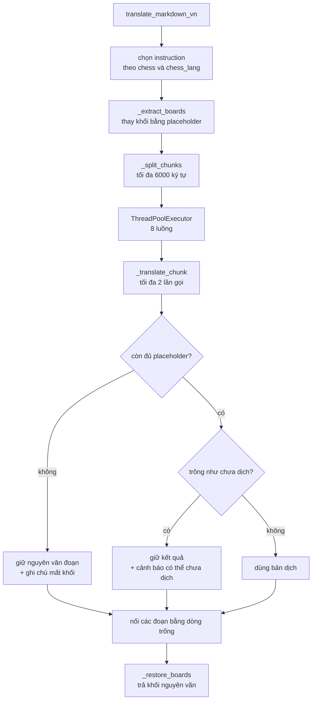

# Tính năng 02 — Dịch Markdown sang tiếng Việt

> Tài liệu này mô tả mã nguồn tại commit `2c1df67b44` (2026-09-27).
> Tệp chính: `claude_translate.py` (474 dòng).

> **Cập nhật 2026-11-22 (G3.3):** bảng thuật ngữ do người dùng soạn (`glossary.py`, `glossary.md`) được nối vào `instruction` của `translate_markdown_vn` và vào prompt OCR-gộp-dịch; khóa điểm lưu có dấu vân tay thuật ngữ. Xem [14](14-hieu-dinh-ket-qua.md).
> **Cập nhật 2026-11-21 (G2):** `translate_markdown_vn` nhận thêm `chunk_cache` (điểm lưu theo đoạn, khóa `chunk_cache_key`) và `cancel`; `_translate_chunk` chỉ lưu bản dịch sạch. Xem [13](13-cong-viec-nen.md).

---

# Phần A — Chức năng

## Bài toán

Sách cờ vua nước ngoài dùng ký hiệu nước đi khác nhau: sách Anh viết `Nf3`, sách Nga viết `Кf3`, sách
Tây Ban Nha viết `Cf3` — cả ba đều là "Mã đi f3". Người đọc Việt dùng `Mf3`. Tính năng này **dịch toàn
bộ văn bản** sang tiếng Việt **và đổi ký hiệu quân cờ** cho đúng, mà không được làm hỏng các thế cờ (FEN).

| Quân | Anh | Nga | Tây Ban Nha | **Việt** |
|---|---|---|---|---|
| Vua | K | Кр | R (Rey) | **V** |
| Hậu | Q | Ф | D (Dama) | **H** |
| Xe | R | Л | T (Torre) | **X** |
| Tượng | B | С | A (Alfil) | **T** |
| Mã | N | К | C (Caballo) | **M** |
| Tốt | không có ký hiệu | | | |

Định dạng nước đi đầu ra bắt buộc: `1.e4 e5` / `2.Mf3 Mc6` (có dấu chấm sau số nước, không có khoảng
trắng thừa; nước riêng của Đen: `1...e5`; nhập thành viết `0-0`, `0-0-0`).

## Cạm bẫy đã được xử lý

- **Sách Nga:** chữ `К` đứng một mình là **Mã**, còn `Кр` là **Vua** — phải kiểm `Кр` trước.
- **Sách Tây Ban Nha:** chữ `T` nguồn là **Xe** nên phải ra `X` (không được giữ `T`); chỉ chữ `A` (Alfil =
  Tượng) mới ra `T`. Bảng nguồn và bảng đích dùng chung vài chữ cái nên đổi máy móc sẽ sai.
- Tài liệu thường (không phải sách cờ) vẫn dịch được, chỉ không có quy tắc ký hiệu.

---

# Phần B — Kỹ thuật

## 1. Thuật toán `translate_markdown_vn`



### Bước 1 — Bảo vệ khối không được dịch

`_extract_boards` (dòng 197) thay từng khối bằng placeholder `⟦CHESSBOARD_n⟧` rồi lưu khối gốc vào danh sách:

| Chế độ | Khối được bảo vệ | Regex |
|---|---|---|
| Sách cờ vua | chỉ khối ```` ```chessboard ```` | `_CHESSBOARD_BLOCK_RE` |
| Tài liệu thường | **mọi** khối rào ``` (code, lệnh) | `_CODE_BLOCK_RE` |

Tên placeholder vẫn là `CHESSBOARD` ngay cả với code thường — chỉ là đặt tên, không phải lỗi.
Cuối cùng `_restore_boards` (dòng 213) thay ngược theo số thứ tự; placeholder không có trong danh sách được
để nguyên.

### Bước 2 — Chia đoạn

`_split_chunks(md, max_chars=6000)` (dòng 225) chia bằng `re.split(r"\n(?=## |\n)", md)` — tức cắt trước
heading `## ` hoặc trước dòng trống — rồi **gộp tham lam** các phần liên tiếp cho tới khi vượt 6000 ký tự.
Chú thích mã giải thích lý do cắt ở dòng trống: đầu ra của OCR không còn chèn `## Trang N`, nên không có
heading để cắt và cả sách dồn thành một đoạn khổng lồ. Một đoạn văn tự nó dài hơn 6000 ký tự giữ nguyên
thành một chunk, không cắt giữa chừng.

### Bước 3 — Dịch từng đoạn

`_translate_chunk` (dòng 384) gọi tối đa **2 lần** (`range(2)`); mỗi lần:

1. Gọi `_call_engine_translate`. `ClaudeOCRError` → ghi nhớ lỗi, thử lần nữa.
2. Nếu kết quả **không** trông như chưa dịch → dừng vòng.
3. Hết 2 lần vẫn chưa có kết quả → trả `chunk + "*[Lỗi dịch đoạn này: …]*"` (không ném lỗi, để không huỷ cả bản dịch).

Sau vòng lặp:

- Placeholder của chunk gốc **phải** là tập con của placeholder trong bản dịch; nếu mất thì giữ nguyên
  văn chunk gốc kèm `*[Đoạn này dịch bị mất khối bàn cờ/code nên giữ nguyên văn]*`.
- Vẫn trông như chưa dịch → giữ bản dịch nhưng thêm `*[Cảnh báo: đoạn này có thể chưa được dịch]*`.

### Bước 4 — Phát hiện "chưa dịch"

`_looks_untranslated` (dòng 359) không dùng nhận diện ngôn ngữ, chỉ đếm **mật độ dấu tiếng Việt**:

```
prose = text bỏ khối code và placeholder, chuyển chữ thường
total = số ký tự là chữ cái; viet = số ký tự thuộc _VI_DIACRITICS; cyr = số chữ Cyrillic (U+0400–U+04FF)
nếu total < 80              → False   (quá ngắn để kết luận)
nếu chess_lang == "ru" và cyr/total > 0.15 → True
trả về  viet/total < 0.02
```

`_VI_DIACRITICS` (dòng 348) là tập ký tự có dấu riêng của tiếng Việt (`ăâđêôơư` và các dạng có thanh).
Văn bản Việt thật có mật độ cao; Anh/Nga chưa dịch gần như bằng 0.

## 2. Ba bản instruction cờ vua

Được ghép từ ba mảnh để hai bản không lệch nhau khi sửa phần chung (chú thích dòng 32–35):

| Mảnh | Hằng | Nội dung |
|---|---|---|
| Đầu | `_CHESS_HEAD` (36) | Giới thiệu + mục I: giữ nguyên placeholder |
| Mục II (khác nhau) | `_CHESS_II_EN` (48) / `_CHESS_II_RU` (66) / `_CHESS_II_ES` (95) | Tên quân, bảng ký hiệu, figurine, thuật ngữ (chiếu, chiếu hết, ăn quân, nhập thành) |
| Đuôi | `_CHESS_TAIL` (120) | Mục III–VI: định dạng nước đi, cấu trúc heading, định dạng trung thực, output |

Quy tắc trong `_CHESS_TAIL` đáng chú ý:

- Heading: Chương → `#`; Biến/Mục → `##`; Ván cờ → `###` (`"Chapter 1"` → `# Chương 1`, `"Game 1"` → `### Ván 1`).
- **Định dạng trung thực:** *"chỗ nào bản gốc in đậm thì bản dịch giữ in đậm; bản gốc không in đậm thì
  TUYỆT ĐỐI không thêm"*.
- Chỉ trả về Markdown đã dịch, không lời dẫn.

Tài liệu thường dùng `TRANSLATE_INSTRUCTION_GENERAL` (dòng 162): không dịch tên riêng, thương hiệu, URL,
đường dẫn, mã, ký hiệu toán; thuật ngữ kỹ thuật không có từ Việt thông dụng thì giữ tiếng Anh.

## 3. Gọi động cơ

| Động cơ | Cách truyền nội dung | Hàm |
|---|---|---|
| Claude Code | Đoạn cần dịch đi qua **stdin**; instruction là đối số `-p` | `_call_claude` (256) |
| Antigravity | Instruction + đoạn dịch ghép thành **một prompt** đối số `-p` | `_call_agy` (313) |

Chú thích mã giải thích dùng stdin để *"tránh giới hạn độ dài command line trên Windows"*. Với `agy`, chunk
nằm thẳng trên dòng lệnh: 6000 ký tự + instruction vẫn dưới giới hạn 32.767 ký tự của Windows, nhưng một
đoạn văn dài hơn 6000 ký tự không thể cắt (xem Bước 2) — xem mục lưu ý.

`effort` mặc định `"low"` (dịch không cần suy nghĩ sâu). GUI cho chọn Thấp / Trung bình / Cao.

## 4. Gọi từ GUI

`markitdown_gui.py:_translate_to_vn` (dòng 992) kiểm `is_engine_available`, gọi
`translate_markdown_vn`, ghi tệp `<tên gốc>_vn.md`, trả `(đường dẫn, dòng trạng thái)`. Lỗi được bắt và
trả thành `⚠️ Lỗi dịch sang tiếng Việt: …`, **không** làm hỏng kết quả OCR đã có. Bước dịch riêng bị bỏ qua
khi đã chạy chế độ gộp OCR + dịch (nhận biết bằng chuỗi `"gộp 1 bước"` trong dòng trạng thái — xem lưu ý).

## 5. Điểm cần lưu ý và hạn chế

**Thiết kế**
- Kiểm tra "đã dịch chưa" chỉ dựa vào **dấu tiếng Việt** (ngưỡng 2%). Văn bản chỉ toàn ký hiệu, tên riêng
  hoặc dưới 80 chữ cái luôn được coi là "đã dịch".
- Không có bước kiểm tra **đúng ký hiệu**: nếu AI dịch sai `T` thành `T` (sách Tây Ban Nha) thì không có gì
  bắt lại. Chất lượng phụ thuộc hoàn toàn vào prompt.
- Chunk mất placeholder thì **bỏ cả bản dịch** của đoạn đó, giữ nguyên văn — người đọc thấy một đoạn tiếng
  nước ngoài giữa bản dịch, kèm ghi chú.

**Vận hành**
- Chỉ 2 lần thử mỗi chunk, không backoff.
- Nhiều chunk chạy song song 8 luồng: với sách dài dễ chạm hạn mức của gói thuê bao.

**Điều đáng ngờ** (suy ra từ mã, chưa chạy thử)
- Cách nhận biết "đã gộp OCR+dịch" bằng việc tìm chuỗi `"gộp 1 bước"` trong trạng thái
  (`markitdown_gui.py:1219`) phụ thuộc vào nhãn văn bản ở `_ocr_to_outputs:359`. Đổi câu chữ nhãn đó sẽ âm
  thầm khiến bước dịch riêng chạy thêm lần nữa.
- Dòng `_PLACEHOLDER_FMT` dùng ký tự `⟦ ⟧` (U+27E6/U+27E7); nếu một engine chuẩn hóa Unicode các ký tự này,
  placeholder có thể mất → đoạn bị giữ nguyên văn.

## 6. Đường dẫn tham chiếu nhanh

| Muốn xem… | Mở |
|---|---|
| Hàm dịch cả tài liệu | **`claude_translate.py`** `translate_markdown_vn` (422) |
| Dịch một đoạn + hậu kiểm | `_translate_chunk` (384) |
| Bảng ký hiệu Anh/Nga/Tây Ban Nha | `_CHESS_II_EN` (48), `_CHESS_II_RU` (66), `_CHESS_II_ES` (95) |
| Bảo vệ/khôi phục khối | `_extract_boards` (197), `_restore_boards` (213) |
| Chia đoạn | `_split_chunks` (225) |
| Phát hiện chưa dịch | `_looks_untranslated` (359) |
| Gọi từ GUI | `markitdown_gui.py` `_translate_to_vn` (992) |
| Kiểm thử round-trip bảo vệ khối | `_test_translate_roundtrip.py` |
