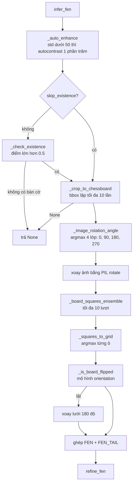

# Tính năng 03 — Nhận diện bàn cờ trong ảnh → FEN (ONNX, chạy cục bộ)

> Tài liệu này mô tả mã nguồn tại commit `2c1df67b44` (2026-09-27).
> Tệp chính: `chessboard_fen.py` (511 dòng). Mã là bản port từ dự án `ocrchessboard` (TypeScript) sang Python.

---

# Phần A — Chức năng

## Bài toán

Trong sách cờ vua, thế cờ là những hình vẽ bàn cờ 8×8. Muốn đưa vào Markdown, phải biến hình thành
chuỗi **FEN** (ví dụ `r1bqkbnr/pppp1ppp/2n5/4p3/4P3/5N2/PPPP1PPP/RNBQKB1R w KQkq - 0 3`). Nhờ FEN, trình
xem Markdown vẽ lại đúng bàn cờ, và các phần mềm khác có thể đọc thế cờ.

## Vì sao làm cục bộ

Nhận diện bằng mô hình ONNX chạy ngay trên CPU của máy chủ — **không tốn hạn mức** của gói thuê bao AI, và
nhanh. Chú thích đầu tệp nêu độ chính xác *"~94%"* — con số của dự án gốc, chưa được kiểm chứng lại ở đây.
AI chỉ còn việc đọc chữ và chèn FEN đúng chỗ.

## Kết quả cho người dùng

- Mỗi hình bàn cờ trên trang → một khối ```` ```chessboard ```` với FEN.
- Các thế cờ được gom vào `<tên>_fen.txt`, mỗi dòng một thế.
- Nếu tính năng không sẵn sàng (thiếu mô hình/thư viện), hệ thống **tự lùi** về cách để AI tự nhìn và đoán
  bàn cờ — chậm và kém chính xác hơn, nhưng không lỗi.

---

# Phần B — Kỹ thuật

## 1. Điều kiện chạy

`available()` (dòng 74) chỉ `True` khi đủ **cả** `onnxruntime`, `opencv` (`cv2`), và hai tệp
`fen.onnx` + `bbox.onnx` trong `MODELS_DIR`. Thiếu `chess` (python-chess) thì chỉ mất bước `refine_fen`.
Mô hình tùy chọn: `existence`, `rotation`, `orientation` — thiếu thì bước tương ứng được bỏ qua.

| Hằng | Giá trị | Ý nghĩa |
|---|---|---|
| `DEFAULT_MODELS_DIR` | `C:\Users\duongsinh\Documents\code\ocrchessboard\public\models` | **Đường dẫn cá nhân ngoài repo** |
| `MODELS_DIR` | `os.environ["OCRCHESS_MODELS_DIR"]` hoặc mặc định | đổi qua biến môi trường |
| `BBOX_IMAGE_SIZE` | 512 | cạnh ảnh đầu vào mô hình `existence`/`bbox` |
| `BOARD_PIXEL_WIDTH` | 256 | cạnh ảnh đầu vào `rotation`/`fen` |
| `PIECE_TYPES` | `P N B R Q K p n b r q k None` (13 lớp) | thứ tự lớp **phải khớp** `ocrchessboard/src/lib/chess-utils.ts` |
| `FEN_TAIL` | `w - - 0 1` | phần đuôi FEN mặc định |

## 2. Pipeline `infer_fen` (một ảnh đã chứa bàn cờ)



### Tiền xử lý tensor (`_to_tensor`, dòng 102)

Resize `size×size` (BILINEAR) → chia 255 → NCHW → **chuẩn hóa min–max trên toàn tensor** → **trừ trung bình**.
Ảnh phẳng (`min ≥ max`) cho tensor 0. Đây là bản port của `imageDataToTensorNchw`.

### Cắt vùng bàn cờ (`_crop_to_chessboard`, dòng 153)

1. Đệm trắng 5% mỗi cạnh.
2. Vòng lặp bbox chạy trên **bản thu nhỏ** (cạnh dài ≤ 1024) vì mô hình chỉ nhìn 512px; hội tụ rồi mới cắt
   ảnh gốc theo tọa độ quy đổi để giữ độ phân giải cho bước sau.
3. Mỗi vòng: mô hình `bbox` trả mặt nạ → `_mask_to_bbox` (dòng 132) lấy ngưỡng 0,5 và chọn **thành phần liên
   thông lớn nhất** (4-lân cận).
4. Nếu khung phủ **>70%** mỗi chiều → xong. Ngược lại nới khung thêm 12% (20% nếu ảnh gốc nhỏ hơn 420px) rồi
   lặp. Quá `max_tries = 10` vòng → `None`.

### Ensemble nhận diện quân (`_board_squares_ensemble`, dòng 236)

Chạy tối đa `num_tries = 10` lượt, cộng dồn xác suất `(64, 13)`:

- Lượt chẵn (0, 2, …): ảnh thường. Lượt lẻ: **đảo dấu tensor** và hoán đổi lớp trắng ↔ đen ở kết quả
  (`_flip_color_rows`) — tăng cường đối xứng màu.
- Từ lượt thứ 3 (chỉ số ≥ 2): `_augment` thêm nhiễu ngẫu nhiên `contrast 1,05–1,15`, `brightness 0,9–1,1`.
- **Dừng sớm** sau một số lần *chẵn* (giữ cân bằng cặp thường/đảo màu), khi đồng thời: đã ≥ `min_tries = 4`,
  lưới `argmax` không đổi so với lần kiểm trước, và mọi ô có biên độ tin cậy trung bình (top1 − top2) > `margin = 0,35`.
  Ảnh nét thường hội tụ sau ~4 lượt (chú thích mã).

### Xác định hướng (`_is_board_flipped`, dòng 281)

Lưới 8×8 → one-hot `(64,13)` → mô hình `orientation`. Kết luận "lật" khi `điểm − 0,2 > 0,5` (`no_rotate_bias = 0,2`).
Lật thì xoay lưới 180° (`_rotate_grid_180`).

### Ghép FEN và sửa lượt đi

`_grid_to_fen_board` (dòng 324) nén ô trống thành chữ số. `refine_fen` (dòng 343, port `fixSideToMove`): nếu
**bên không được đi** đang bị chiếu thì đảo lượt đi. Không thêm Vua thiếu — thế cờ thiếu Vua giữ nguyên
(sau đó hiển thị bằng `strict: false`). Lượt đi mặc định luôn là `w`; quyền nhập thành `-`.

## 3. Tìm các hình bàn cờ trong một trang: `detect_boards` (dòng 397)

Dùng OpenCV cổ điển, sau đó mô hình `existence` gác cổng:

```
gray → GaussianBlur(5,5) → adaptiveThreshold(GAUSSIAN_C, INV, 11, 2) → dilate 3×3
→ findContours(RETR_EXTERNAL) → boundingRect từng contour
lọc: cạnh ≥ 12% cạnh ngắn của trang · tỉ lệ w/h ∈ [0,75; 1,33] · không quá 90% trang
→ _dedupe_boxes: giữ box to trước; bỏ box giao > 50% diện tích của box nhỏ hơn
→ đệm 4% → _check_existence trên vùng cắt → _reading_order
```

`_reading_order` (dòng 457): sắp theo tâm dọc, gom cùng hàng khi lệch dọc `< 0,5 × chiều cao`, rồi trái → phải.
Thứ tự này **phải khớp** thứ tự mà prompt OCR yêu cầu AI chèn FEN.

## 4. `fens_for_page` (dòng 478) — điểm vào cho `claude_ocr`

1. `detect_boards` → các hộp.
2. Nhận diện các hộp **song song**, tối đa `min(4, số hộp)` luồng (`onnxruntime` thả GIL khi suy luận);
   thứ tự kết quả vẫn theo thứ tự đọc. `existence` đã kiểm ở bước 1 nên truyền `skip_existence=True`.
3. Hình nào thất bại thì **bị bỏ** (không có FEN thay thế).
4. Không tìm được hình nào qua contour → thử coi **cả trang là một bàn cờ** (ảnh chụp riêng một sơ đồ, hoặc
   sơ đồ không có viền); `existence` gác cổng.

`_get_session` (dòng 51) nạp mô hình **lười** và có khóa (`_sessions_lock`) vì `fens_for_page` gọi song song.
Mô hình thiếu → `None` được nhớ lại, không thử lại.

`claude_ocr._page_board_fens` (dòng 458) bọc toàn bộ: không sẵn sàng hoặc có lỗi → trả `None` (in stderr),
và prompt chuyển sang `_PROMPT_CHESS_SELF`.

## 5. Điểm cần lưu ý và hạn chế

**Thiết kế**
- **Mô hình không có trong repo và không có trong Docker image.** Mặc định trỏ vào thư mục của một máy
  cụ thể; phải đặt `OCRCHESS_MODELS_DIR` hoặc sao mô hình vào image. Đây là việc **đầu tiên** cần làm khi nhân bản.
- Thế cờ luôn ra `w - - 0 1`: quyền nhập thành và bắt tốt qua đường không bao giờ được suy ra ở bước này.
- `detect_boards` dựa vào tỉ lệ khung gần vuông; sơ đồ không có viền hoặc bị cắt lệch sẽ trượt, rồi lùi về
  thử cả trang (chỉ đúng khi trang chỉ có một sơ đồ).

**Vận hành**
- `_augment` dùng `np.random` không đặt hạt giống → cùng một ảnh có thể ra FEN hơi khác giữa các lần chạy khi
  ensemble không dừng sớm.
- Suy luận chạy CPU (`CPUExecutionProvider` cố định).

**Điều đáng ngờ**
- Chú thích `refine_fen` nói không thêm Vua thiếu, còn OCR hậu kiểm đặt `strict: false` cho thế thiếu Vua —
  hai nơi cùng chịu trách nhiệm về thế cờ thiếu Vua; chưa kiểm chứng chúng nhất quán trên dữ liệu thật.

## 6. Đường dẫn tham chiếu nhanh

| Muốn xem… | Mở |
|---|---|
| Pipeline một ảnh | **`chessboard_fen.py`** `infer_fen` (367) |
| Tìm nhiều bàn cờ trên trang | `detect_boards` (397), `_dedupe_boxes` (440), `_reading_order` (457) |
| Điểm vào từ OCR | `fens_for_page` (478); phía OCR: `claude_ocr.py` `_page_board_fens` (458) |
| Ensemble và dừng sớm | `_board_squares_ensemble` (236) |
| Sửa lượt đi | `refine_fen` (343) |
| Đổi thư mục mô hình | biến môi trường `OCRCHESS_MODELS_DIR` (dòng 38) |
| Trạng thái trên giao diện | `infrastructure.py` `get_infrastructure_status` (259) — nhưng xem [05](05-ha-tang-va-ket-noi.md), nó **không** gọi `available()` |
