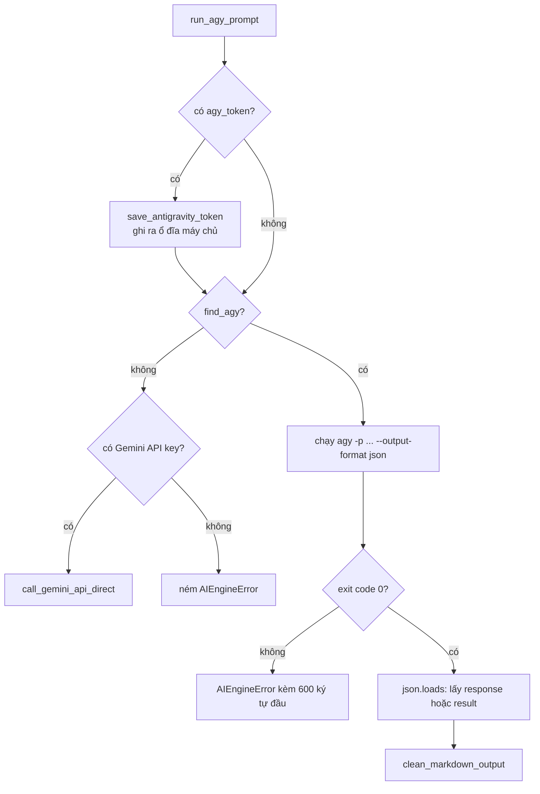

# Tính năng 04 — Động cơ AI (AI Engine): Antigravity, Claude Code, Gemini REST

> Tài liệu này mô tả mã nguồn tại commit `2c1df67b44` (2026-09-27).
> Tệp chính: `ai_engine.py` (362 dòng). Phần chọn engine trên giao diện: `markitdown_gui.py`.

---

# Phần A — Chức năng

## Bài toán

Phần mềm cần một "bộ não" để đọc ảnh và dịch. Thay vì mua khoá API tính tiền theo lượt, dự án dùng **gói
thuê bao tháng đã trả** (Google Antigravity / Gemini Advanced, Claude Pro/Max) bằng cách gọi thẳng chương
trình dòng lệnh chính chủ của nhà cung cấp — chương trình đó tự dùng phiên đăng nhập sẵn có.

## Ba đường kết nối

| Ưu tiên | Đường | Cần gì | Phù hợp |
|---|---|---|---|
| 1 (mặc định) | **Google Antigravity** — lệnh `agy` | CLI đã cài và đăng nhập | Máy cá nhân, VPS |
| 2 | **Claude Code** — lệnh `claude` | CLI đã cài và đăng nhập | Dự phòng khi không có `agy` |
| Dự phòng | **Gemini REST API** | Khoá `GEMINI_API_KEY` | Web/Docker không cài được CLI |

Nếu không có động cơ nào, ứng dụng **vẫn chạy** và chuyển đổi tài liệu thường; chỉ mất OCR và dịch.

## Người dùng chọn gì

Ở "Tùy chọn nâng cao → Công cụ AI (Engine)". Đổi engine thì danh sách model và toàn bộ preset tự tính lại.

---

# Phần B — Kỹ thuật

## 1. Hằng số và danh sách model

| Hằng | Giá trị |
|---|---|
| `ENGINE_ANTIGRAVITY` | `"antigravity"` |
| `ENGINE_CLAUDE` | `"claude"` |
| `ENGINE_LABELS` | nhãn hiển thị → giá trị, dùng cho `gr.Radio` |

| Danh sách | Model (giá trị) |
|---|---|
| `ANTIGRAVITY_OCR_MODELS` | `gemini-3.6-flash`, `gemini-3.7-flash`, `gemini-3.8-flash`, `gemini-3.1-pro`, `claude-sonnet-4-6`, `claude-opus-4-6-thinking` |
| `ANTIGRAVITY_TRANSLATE_MODELS` | như trên **trừ** `claude-opus-4-6-thinking` |
| `CLAUDE_OCR_MODELS` | `sonnet`, `haiku`, `opus` |
| `CLAUDE_TRANSLATE_MODELS` | `haiku`, `sonnet`, `opus` |

Nhãn hiển thị có phần mô tả (ví dụ `Gemini 3.7 Flash — Cân bằng & Nhanh (Mặc định)`), giá trị thật là token
đầu tiên (`_model_from_label`, `markitdown_gui.py:283`).

## 2. Tìm CLI

`find_agy` (dòng 66) thử lần lượt: `shutil.which("agy")` → `which("agy.exe")` → danh sách cố định
(`/usr/local/bin/agy`, `/usr/bin/agy`, `/root/.local/bin/agy`, `~/.local/bin/agy[.exe]`,
`~/.gemini/bin/agy[.exe]`, `%LOCALAPPDATA%\agy\bin\agy.exe`, `~\AppData\Local\agy\bin\agy.EXE`).

`find_claude` (dòng 102): `which("claude")` → `which("claude.exe")` → `~/.local/bin/claude.exe`.

## 3. Sẵn sàng và chọn mặc định

`is_engine_available` (dòng 127):

```
Antigravity: true nếu   find_agy()
                     hoặc agy_token không rỗng
                     hoặc tệp ~/.gemini/antigravity-cli/antigravity-oauth-token tồn tại và không rỗng
                     hoặc có Gemini API key (tham số hoặc GEMINI_API_KEY / GOOGLE_API_KEY)
Claude:      true nếu   find_claude()
                     hoặc claude_token không rỗng
                     hoặc tệp ~/.claude.json tồn tại và không rỗng
```

`get_default_engine` (dòng 158): Antigravity nếu sẵn sàng, không thì Claude nếu sẵn sàng, không thì vẫn trả
Antigravity.

## 4. `run_agy_prompt` (dòng 278)



Chi tiết:

- `effort` hợp lệ chỉ `low|medium|high`; giá trị khác → `low`. (GUI còn có `auto`, được xử lý trước đó ở
  `claude_ocr` thành `low`/`medium`.)
- Nếu có `img_dir`: thêm `--add-dir img_dir` và đặt `cwd=img_dir`.
- Thời gian tối đa `timeout` (mặc định 600 s); hết giờ → `AIEngineError`.
- Kết quả không phải JSON thì dùng nguyên văn `stdout`.
- `clean_markdown_output` (dòng 167): bóc lớp rào ```` ```markdown … ``` ```` hoặc ```` ```md … ``` ````
  bao ngoài, **trừ khi** nội dung bên trong lại bắt đầu bằng một khối rào khác (tránh cắt nhầm khối
  `chessboard` nằm sát biên).

## 5. Đường dự phòng Gemini REST

`call_gemini_api_direct` (dòng 203): `POST https://generativelanguage.googleapis.com/v1beta/models/<model>:generateContent?key=<key>`
với `temperature 0,2` và `maxOutputTokens 8192`.

`_map_gemini_api_model` (dòng 183) ánh xạ tên model của `agy` sang tên model REST:

| Tên đầu vào chứa | Kết quả |
|---|---|
| `flash` và `3.7`/`3-7` | `gemini-2.5-flash` |
| `flash` và `2.5` | `gemini-2.5-flash`; `2.0` → `gemini-2.0-flash`; `1.5` → `gemini-1.5-flash` |
| `flash` (khác) | `gemini-2.5-flash` |
| `pro` và `2.5` | `gemini-2.5-pro` |
| `pro` (khác, gồm `gemini-3.1-pro`) | `gemini-1.5-pro` |
| không chứa `flash`/`pro` (ví dụ `claude-*`) | `gemini-2.5-flash` |

Ảnh: nếu có `img_dir`, **đọc mọi tệp `.png/.jpg/.jpeg/.webp/.bmp` trong thư mục** (sắp theo tên) và đính vào
`inlineData` dạng base64, rồi mới thêm phần `text`.

## 6. Cách các lớp trên dùng module này

| Lớp | Cách dùng |
|---|---|
| `claude_ocr._run_engine_ocr` | Antigravity → `run_agy_prompt`; còn lại → `_run_claude_ocr` (không qua `ai_engine`) |
| `claude_translate._call_engine_translate` | tương tự |
| `infrastructure` | `find_agy`, `find_claude` để kiểm tra kết nối/trạng thái |
| `markitdown_gui` | `is_engine_available`, `get_default_engine`, các danh sách model |

Lưu ý: **đường Claude Code không nằm trong `ai_engine.py`** — nó nằm rải trong `claude_ocr._run_claude_ocr`
và `claude_translate._call_claude`. `ai_engine.py` chỉ có Antigravity + Gemini REST. Một engine mới nên có
một hàm `run_<engine>_prompt` trong `ai_engine.py` (xem [`../NHAN-BAN-VA-MO-RONG.md`](../NHAN-BAN-VA-MO-RONG.md)).

## 7. Điểm cần lưu ý và hạn chế

**Thiết kế**
- `ai_engine.py` không chứa Claude (xem trên) → hai cách gọi CLI khác kiểu nhau, dễ lệch khi sửa.
- Docstring đầu tệp liệt kê 3 phương thức nhưng thứ tự khác với ưu tiên thật (Gemini REST đứng thứ 2 ở
  docstring, nhưng chỉ là dự phòng của Antigravity trong mã).
- Bảng model ở `GUI_README.md` ghi đã *"đối chiếu với `agy models` thực tế"*; danh sách `gemini-3.x` là dữ
  liệu của nhà cung cấp tại thời điểm viết, sẽ cũ theo thời gian.

**Vận hành**
- `--dangerously-skip-permissions` được truyền cho mọi lần gọi `agy`, tức agent không hỏi quyền trước khi
  dùng công cụ. Ở bước **dịch**, `_call_agy` đưa **nguyên văn nội dung tài liệu** (chunk Markdown) vào chính
  prompt. Nếu tài liệu do người lạ tải lên chứa câu lệnh giả dạng chỉ dẫn (prompt injection), agent chạy không
  hỏi quyền có thể làm theo. Đây là suy luận từ cách ghép prompt, chưa thử tấn công thật; nên cân nhắc
  khi mở web ra công khai.
- `is_engine_available(ENGINE_CLAUDE)` trả `True` chỉ vì tồn tại tệp `~/.claude.json`, kể cả khi **không có
  lệnh `claude`** → giao diện tưởng sẵn sàng, đến lúc chạy mới lỗi "không tìm thấy Claude Code".
- Tương tự Antigravity: có tệp token nhưng không có `agy` → `True`, nhưng `run_agy_prompt` chỉ lùi về REST
  khi có API key; không có key thì lỗi.

**Điều đáng ngờ** (suy ra từ mã, chưa chạy thử)
- `_map_gemini_api_model("gemini-3.1-pro")` cho ra `gemini-1.5-pro`, một model cũ hơn nhiều; và
  `gemini-3.7/3.6/3.8-flash` đều thành `gemini-2.5-flash`. Nghĩa là dự phòng REST **không** chạy đúng model
  người dùng chọn. Chú thích trong mã gọi đó là *"Fallback hoặc chuẩn model REST"*.
- Đường REST đính mọi ảnh trong `img_dir`. Ở luồng `ocr_pdf`, thư mục này là thư mục tạm chứa PNG các trang
  đã vẽ → mỗi lần gọi có thể gửi cả các trang khác (tốn token, có thể trả nội dung của trang sai). Với
  `agy`/`claude` thì không có vấn đề này vì ảnh được đọc theo đường dẫn ghi trong prompt.
- `maxOutputTokens: 8192` có thể cắt cụt kết quả của một trang dày chữ hoặc nhóm 2–3 trang.

## 8. Đường dẫn tham chiếu nhanh

| Muốn xem… | Mở |
|---|---|
| Thêm/đổi model | **`ai_engine.py`** dòng 32–59 (bốn danh sách) |
| Tìm CLI | `find_agy` (66), `find_claude` (102) |
| Logic sẵn sàng | `is_engine_available` (127), `get_default_engine` (158) |
| Gọi `agy` | **`ai_engine.py`** `run_agy_prompt` (278) |
| Dự phòng REST | `call_gemini_api_direct` (203), `_map_gemini_api_model` (183) |
| Preset theo engine | `markitdown_gui.py` `_PRESET_OPTS_AGY` (1348), `_PRESET_OPTS_CLAUDE` (1357) |
| Gọi Claude Code | `claude_ocr.py` `_run_claude_ocr` (473), `claude_translate.py` `_call_claude` (256) |
