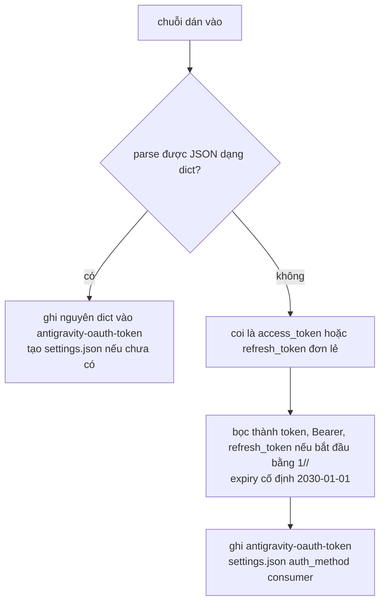

# Tính năng 05 — Hạ tầng và kiểm tra kết nối (Infrastructure Center)

> Tài liệu này mô tả mã nguồn tại commit `2c1df67b44` (2026-09-27).
> Tệp chính: `infrastructure.py` (576 dòng). Phần Dropbox của tệp này ở [07](07-dong-bo-dropbox.md).
> Kế hoạch gốc: `docs/plans/2026-09-17-infrastructure-setup-and-conversion-flow.md`.

---

# Phần A — Chức năng

## Bài toán

Khi chạy trên web, người dùng không thể mở terminal để cài hay đăng nhập `agy`/`claude`. Thẻ
**⚙️ Cài đặt Hạ tầng & API** cho họ:

1. Xem **bảng trạng thái** một cái nhìn: Antigravity, Claude Code, khoá Gemini, mô-đun nhận diện bàn cờ, môi
   trường đang chạy (Docker hay máy cá nhân).
2. **Dán token phiên** của gói thuê bao (Antigravity / Claude) để máy chủ dùng thay họ.
3. **Bấm "Kiểm tra kết nối"** cho từng dịch vụ và thấy ngay ✅/⚠️/❌ kèm độ trễ.
4. Cấu hình **Dropbox** (xem [07](07-dong-bo-dropbox.md)).

Toàn bộ cài đặt này được nhớ trong trình duyệt của người dùng (`localStorage`), tải lại trang không phải nhập lại.

---

# Phần B — Kỹ thuật

## 1. Các hàm và trách nhiệm

| Hàm | Dòng | Việc | Trả về |
|---|---:|---|---|
| `test_gemini_connection(api_key)` | 23 | `GET …/v1beta/models?key=…`, timeout 10 s, đếm số model chứa `gemini` | `(ok, thông điệp, ms)` |
| `test_claude_cli_connection(claude_token)` | 63 | chạy `claude -p "Say 'OK' in one word" --disable-slash-commands --no-session-persistence`, timeout 15 s | `(ok, thông điệp, ms)` |
| `save_antigravity_token(token_data)` | 142 | ghi token ra `~/.gemini/antigravity-cli/` | `bool` |
| `test_antigravity_cli_connection(agy_token)` | 189 | chạy `agy -p "Say 'OK' in one word" … --output-format json`, timeout 20 s | `(ok, thông điệp, ms)` |
| `get_infrastructure_status(...)` | 259 | quét trạng thái toàn hệ thống | `dict` |
| `render_infrastructure_html(...)` | 531 | vẽ bảng trạng thái thành HTML | `str` |
| Dropbox (4 hàm) | 317–528 | xem tài liệu 07 | |

Cả ba hàm `test_*_connection` dùng `subprocess.run` với `creationflags=CREATE_NO_WINDOW` để không bật cửa
sổ console trên Windows.

## 2. Định dạng token Antigravity

`save_antigravity_token` (dòng 142) nhận **một chuỗi** và tự phân loại:



Tệp đích: `~/.gemini/antigravity-cli/antigravity-oauth-token` và `settings.json` (`{"auth_method": "consumer"}`
hoặc lấy từ JSON đã dán). `settings.json` chỉ được tạo **nếu chưa tồn tại**.

Hàm này được gọi trực tiếp ở **ba nơi**: `test_antigravity_cli_connection`, `get_infrastructure_status` và
`run_agy_prompt`; `render_infrastructure_html` gọi nó gián tiếp qua `get_infrastructure_status`. Vì ô token có
sự kiện `.change` vẽ lại bảng, nghĩa là **mỗi lần gõ/đổi token, mỗi lần render bảng trạng thái và mỗi lần
gọi AI đều ghi lại tệp token** (khi `agy_token` không rỗng).

## 3. `get_infrastructure_status` (dòng 259)

```
has_agy_cli        = bool(find_agy())
has_agy_token_file = tệp ~/.gemini/antigravity-cli/antigravity-oauth-token tồn tại  hoặc  có agy_token
has_claude_cli     = bool(find_claude())
has_claude_token   = có token (tham số) hoặc env CLAUDE_CODE_SESSION_ACCESS_TOKEN / ANTHROPIC_SESSION_KEY
has_gemini_key     = có key (tham số) hoặc env GEMINI_API_KEY / GOOGLE_API_KEY
antigravity.ready  = has_agy_cli  và  has_agy_token_file
claude.ready       = has_claude_cli  và  (has_claude_token  hoặc  không chạy trong Docker)
is_docker          = env DOCKER  hoặc  tồn tại /.dockerenv
chessboard_onnx    = "import chessboard_fen" thành công
```

Hai điểm khác thường đáng ghi nhớ:
- **`chessboard_onnx.available` chỉ kiểm `import chessboard_fen` thành công** — không gọi
  `chessboard_fen.available()`. Vì `chessboard_fen` import an toàn kể cả khi thiếu mô hình, bảng trạng thái có
  thể hiện "Sẵn sàng (ONNX FEN)" trong khi mô hình `fen.onnx`/`bbox.onnx` không có và OCR thực tế lùi về để AI
  tự đoán bàn cờ. (Suy ra từ mã; chưa chạy thử.)
- Ngoài Docker, `claude.ready` chỉ cần có CLI; trong Docker cần thêm token.

## 4. Giao diện

`render_infrastructure_html` (dòng 531) sinh HTML với biến CSS `--c-*` của giao diện (nên phụ thuộc theme của
`markitdown_gui.py`). Mỗi trạng thái là một huy hiệu xanh (`#1FA98F`) hoặc vàng (`#d97706`). Ở `markitdown_gui.py`:

| Thành phần | Sự kiện |
|---|---|
| Nút kiểm tra Antigravity / Claude / API key | `.click` → gọi hàm `test_*` **và** vẽ lại bảng |
| Ô nhập token/khoá | `.change` → chỉ vẽ lại bảng |
| Nút kiểm tra Dropbox | `.click` → `test_dropbox_connection` |

## 5. Điểm cần lưu ý và hạn chế

**Thiết kế**
- Toàn bộ thông báo lỗi/hướng dẫn nằm cứng trong chuỗi, có chứa đường dẫn `C:\Users\duongsinh\.claude.json`
  (dòng 123) — cần thay khi nhân bản cho tài khoản khác.
- **Đã xử lý (2026-10-13):** trước đây `test_claude_cli_connection`/`_claude_env` truyền token vào **ba**
  biến môi trường không chính thức `CLAUDE_CODE_SESSION_ACCESS_TOKEN`, `ANTHROPIC_SESSION_KEY` và
  **`ANTHROPIC_API_KEY`**. Đối chiếu tài liệu chính thức Claude Code CLI xác nhận: `ANTHROPIC_API_KEY` có
  độ ưu tiên xác thực **cao hơn** biến đúng `CLAUDE_CODE_OAUTH_TOKEN`, nên set nó bằng cookie `sessionKey`
  (không phải API key thật) khiến CLI luôn thử xác thực sai kiểu — đây là nghi vấn "chưa xác minh" trước
  đó, nay đã xác nhận là lỗi thật. Đã sửa: chỉ set đúng `CLAUDE_CODE_OAUTH_TOKEN`, dùng token sinh bởi
  lệnh chính thức `claude setup-token` (sống ~1 năm) thay cho cookie `sessionKey` (hết hạn nhanh, phải lấy
  lại tay). Xem `claude_ocr.py:_claude_env`, `infrastructure.py:test_claude_cli_connection`.
- Có thêm nút "Đăng nhập Claude Code" ngay trên giao diện (`claude_login_bridge.py`) để lấy token mới mà
  không cần SSH — xem [12](12-dang-nhap-claude-code.md).

**Vận hành / bảo mật**
- **Token ghi ra ổ đĩa máy chủ, dùng chung.** `~/.gemini/antigravity-cli/` là thư mục của **người dùng hệ điều
  hành chạy tiến trình**, không phải của người dùng web. Một người dán token → mọi người dùng web sau đó cùng
  dùng phiên đó (và người sau ghi đè người trước). Web không có đăng nhập. Chỉ an toàn nếu web chạy trong
  mạng tin cậy, hoặc một người dùng một máy chủ.
- Token được lưu thô trong `localStorage` của trình duyệt (xem [06](06-giao-dien-gradio.md)).
- Token JSON dạng `expiry: 2030-01-01` là **giá trị bịa** khi người dùng chỉ dán một access token trần; CLI có
  thể không làm mới được nó.

**Điều đáng ngờ**
- `test_antigravity_cli_connection` coi mọi `returncode == 0` là thành công, nhưng không đọc nội dung phản
  hồi; một phiên hết hạn mà CLI vẫn thoát 0 sẽ báo ✅. Chưa kiểm chứng hành vi của `agy`.

## 6. Đường dẫn tham chiếu nhanh

| Muốn xem… | Mở |
|---|---|
| Bảng trạng thái | **`infrastructure.py`** `get_infrastructure_status` (259) |
| Vẽ HTML | `render_infrastructure_html` (531) |
| Lưu token Antigravity | `save_antigravity_token` (142) |
| Kiểm tra từng dịch vụ | `test_gemini_connection` (23), `test_claude_cli_connection` (63), `test_antigravity_cli_connection` (189) |
| Nối vào giao diện | `markitdown_gui.py` dòng 1497–1651 (bố cục), 1875–1907 (sự kiện) |
