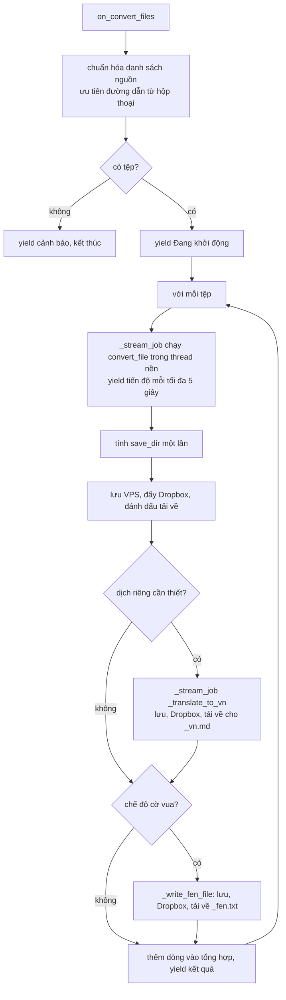

# Tính năng 06 — Giao diện web Gradio và điều phối chuyển đổi

> Tài liệu này mô tả mã nguồn tại commit `2c1df67b44` (2026-09-27).
> Tệp chính: `markitdown_gui.py` (1.985 dòng), `pick_files.py` (24 dòng).
> Thiết kế giao diện gốc: `design_handoff_markitdown_gui/README.md` (bản HTML tham chiếu, Phương án A đã chốt).

---

# Phần A — Chức năng

## Người dùng làm gì trên màn hình

Màn hình hai cột dưới một thanh tiêu đề xanh navy:

**Cột trái — nhập liệu và điều khiển**
1. **Ba thẻ nhập:** *Từ tệp* (kéo thả, nhiều tệp, hoặc nút chọn tệp từ máy Windows), *Từ URL* (YouTube,
   Wikipedia, RSS, trang web), *⚙️ Cài đặt Hạ tầng & API*.
2. **Chế độ xử lý** — bốn thẻ lớn: sách cờ vua ký hiệu Anh / Nga / Tây Ban Nha, hoặc tài liệu thường.
3. **Mức chất lượng** — ba nút: *Tiết kiệm*, *Cân bằng*, *Chính xác*. Chọn một nút là hệ thống tự đặt
   model, effort, DPI, số trang mỗi lần gọi, gộp/tách OCR-dịch.
4. **Nút Chuyển đổi** (đổi thành **⏹ Dừng** khi đang chạy) và **Tùy chọn nâng cao** để chỉnh tay.

**Cột phải — kết quả:** dòng trạng thái, tab *Xem trước* (bàn cờ được vẽ thật từ FEN), tab *Mã .md*, danh
sách nút tải về từng tệp (kèm "Tải tất cả .zip" khi có từ hai tệp).

## Trải nghiệm đáng chú ý

- **Phản hồi tức thì:** vừa bấm là đổi ngay sang `🚀 Đang khởi động…`, rồi `⏳ Đang xử lý 2/5: tên.pdf — trang 7/120 · 43s…`.
- **Tệp xong tới đâu hiện tới đó**, có thể tải ngay trong lúc các tệp sau còn chạy.
- **Bàn cờ hiện ngay trong xem trước** — khối ```` ```chessboard ```` được JavaScript thay bằng bàn cờ
  256 px với quân cờ SVG của Cờ vua Dương Sinh.
- **Sáng/tối** bằng nút trên thanh tiêu đề; nhớ lựa chọn.
- **Nhớ mọi thiết lập** giữa các lần mở (chế độ, preset, engine, thư mục, khoá/token, cấu hình Dropbox).

## Bảng preset

Giá trị thật từ `_PRESET_OPTS_AGY` (dòng 1348) và `_PRESET_OPTS_CLAUDE` (dòng 1357):

| Preset | Engine | Gộp OCR+dịch | Model OCR | Effort OCR | Model dịch | Effort dịch | DPI bàn cờ | Trang/lần |
|---|---|:-:|---|---|---|---|---:|---:|
| Tiết kiệm | Antigravity | ✅ | `gemini-3.6-flash` | low | `gemini-3.6-flash` | low | 250 | 2 |
| Cân bằng | Antigravity | ✅ | `gemini-3.8-flash` | auto | `gemini-3.8-flash` | low | 250 | 1 |
| Chính xác | Antigravity | ❌ | `gemini-3.1-pro` | high | `gemini-3.1-pro` | medium | 400 | 1 |
| Tiết kiệm | Claude Code | ✅ | `haiku` | low | `haiku` | low | 250 | 2 |
| Cân bằng | Claude Code | ✅ | `sonnet` | auto | `haiku` | low | 250 | 1 |
| Chính xác | Claude Code | ❌ | `opus` | high | `sonnet` | medium | 400 | 1 |

Ghi chú vận hành (từ `GUI_README.md`): `gemini-3.1-pro` trên `agy` chỉ có hai mức effort thật là **high** và
**low** (không có **medium**), nên preset "Chính xác" đặt `medium` cho dịch có thể không đúng ý.

---

# Phần B — Kỹ thuật

## 1. Cấu trúc tệp `markitdown_gui.py`

| Khối | Dòng | Nội dung |
|---|---:|---|
| Import, thư mục xuất | 12–47 | `_OUTPUT_DIR = <tmp>/markitdown_gui_output` |
| Hàm tệp/ghi | 50–216 | `_safe_filename`, `_write_md`, `_write_fen_file`, `_zip_all`, `_download_panel`, `_autosave`, `_resolve_save_dir` |
| Lõi chuyển đổi | 219–475 | `_convert`, `_ocr_to_outputs`, `convert_file`, `convert_url`, chuyển nhãn → giá trị |
| Giao diện tĩnh | 484–981 | tài nguyên SVG, `_SCRIPT` (JavaScript), `CSS`, `TOPBAR_HTML`, `MODE_CARDS_HTML` |
| Điều phối | 986–1345 | `_translate_to_vn`, `_stream_job`, `on_pick_files`, `on_convert_files`, `on_convert_url`, `on_clear` |
| Preset và lưu tùy chọn | 1347–1452 | `_apply_preset`, `_load_prefs`, `_save_prefs` |
| `build_ui` | 1454–1968 | bố cục và nối sự kiện |
| Khởi chạy | 1971–1983 | `launch(...)` |

## 2. Luồng `on_convert_files` (dòng 1101)

Đây là generator trả bốn đầu ra `(preview, raw, downloads, status)` mỗi lần `yield`.



### 2.1 `_stream_job` — giữ kết nối sống

Vì OCR một sách có thể chạy hàng chục phút, `_stream_job` (dòng 1026) chạy hàm nặng trong **thread nền
daemon** và cho generator chính `yield` một dòng tiến độ **ít nhất mỗi 5 giây** (`q.get(timeout=5)`), để
kết nối SSE của Gradio không rớt. Callback tiến độ đẩy `(i, n)` vào hàng đợi; các tin dồn lại được gộp,
chỉ giữ tin mới nhất. Kết thúc, hàm trả kết quả qua `StopIteration.value` (`return out.get("result")`),
còn lỗi trong thread được ném lại ở luồng chính.

Các `yield` tiến độ dùng `gr.skip()` cho ba ô đầu để **không gửi lại** toàn bộ xem trước — giảm tải trên
mạng.

### 2.2 Xác định thư mục lưu bản sao (`_resolve_save_dir`, dòng 205)

| Mục "Nơi lưu" | Tệp chọn bằng hộp thoại (đường dẫn thật) | Tệp kéo thả |
|---|---|---|
| Cùng thư mục với file gốc | thư mục của tệp gốc | **lùi về thư mục tùy chọn**, kèm ghi chú |
| Thư mục tùy chọn | thư mục tùy chọn | thư mục tùy chọn |

Lý do: trình duyệt chỉ đưa cho máy chủ bản sao đã tải lên ở đường dẫn tạm của Gradio, không có đường dẫn gốc.
`_autosave` (dòng 182) không ghi đè tệp có sẵn (thêm hậu tố `_2`, `_3`…).

### 2.3 Đặt tên tệp và tránh đè

`_write_md` và `_write_fen_file` thêm hậu tố `_2`, `_3`… khi tên đã nằm trong `used_paths` — chỉ là
`done_paths` của **lô hiện tại**. Với tệp `.md` ở chế độ thường, tên lấy từ `result.title` nếu tài liệu có tiêu đề
(dòng 237–239), nên hai tệp khác nhau có thể trùng tiêu đề.

## 3. Nút chọn tệp từ máy

`on_pick_files` (dòng 1079) chạy `pick_files.py` như **tiến trình con** (tkinter `askopenfilenames`, cửa sổ
luôn ở trên cùng, timeout 300 s). Lý do trong docstring của `pick_files.py`: tránh xung đột tkinter với luồng
nền mà Gradio dùng chạy event handler, và khởi động nhanh (không kéo `gradio`/`markitdown`). Chỉ hoạt động khi
`sys.platform == "win32"` và không có biến `DOCKER`; ngược lại trả thông báo hướng dẫn kéo thả.
Đường dẫn trả về được lưu vào `gr.State` (`picked_state`) và **ưu tiên hơn** tệp kéo thả (`raw_sources = picked_paths if picked_paths else file_paths`).
Kéo thả tệp mới (`file_in.change`) sẽ **xóa** lựa chọn từ hộp thoại.

## 4. Nhớ tùy chọn — `gr.BrowserState`

`prefs = gr.BrowserState({...})` (dòng 1812) lưu 13 khóa vào `localStorage` trình duyệt:
`preset, mode, dir, engine, api_key, claude_token, agy_token, auto_download, dropbox_token,
dropbox_app_key, dropbox_app_secret, dropbox_folder, dropbox_sync`.

Chuỗi khởi động khi tải trang (`demo.load`): `_load_prefs` → `_apply_preset` → JS `midSyncModeCards()`.
Mỗi thay đổi ở 13 thành phần kích hoạt `_save_prefs`. `_apply_preset` chạy lại mỗi khi đổi preset/chế độ/engine và
**đặt lại** `force_ocr = (là chế độ cờ vua)`, `translate_vn = True`, `autosave_on = True`,
`auto_download_on = True`, `dropbox_sync_on = True` cùng model/effort/DPI/trang mỗi lần — ghi đè lựa chọn tay.

## 5. Lớp JavaScript (`_SCRIPT`, dòng 516)

Nhúng vào `<head>`, dùng `MutationObserver` chạy lại mỗi lần DOM đổi:

| Hàm | Việc |
|---|---|
| `midToggleTheme` | đặt `data-mid-theme` trên `<body>`, lưu `localStorage["mid-theme"]` |
| `midSelectMode(idx)` | bấm thẻ chế độ (HTML) → `.click()` vào radio ẩn `#mid-mode-radio` để backend nhận |
| `midSyncModeCards` | đồng bộ class `active` của thẻ theo radio ẩn (cần khi giá trị đặt từ backend) |
| `midRenderBoards` | tìm `pre code` có class `chessboard` hoặc bắt đầu bằng `fen:` trong `#mid-preview`, thay bằng bàn cờ 256 px; quân là SVG nhúng dạng data URI (`window.MID_PIECES`) |
| `midTriggerAutoDownloads` | với `.dl-list[data-auto-download="1"]`, mỗi liên kết mới được bấm tự động, cách nhau 350 ms; nhớ URL đã tải trong `midDownloadedUrls` để không tải lặp |

Hai thứ này là **cầu nối HTML ↔ Gradio**: giao diện thiết kế dùng thẻ HTML tùy biến, còn logic nằm ở các
thành phần Gradio ẩn (`.mid-hidden`, `.mid-plumbing`).

## 6. Sự kiện trong `build_ui`

| Sự kiện | Kết quả |
|---|---|
| `preset/mode/engine_select .change` | `_apply_preset` → 13 đầu ra (`preset_outputs`) |
| `btn_file.click` | `_set_running(True)` → `on_convert_files` (`show_progress="full"`) → `_set_running(False)` |
| `btn_url.click`, `url_in.submit` | tương tự, gọi `on_convert_url` |
| `btn_stop.click` | `_set_running(False)`, `cancels=[proc, ev_url, ev_urls]` |
| `btn_clear.click` | `on_clear` (xóa kết quả và tệp đã chọn) |
| Các nút kiểm tra kết nối | xem [05](05-ha-tang-va-ket-noi.md), [07](07-dong-bo-dropbox.md) |

`enable_plugins` và `use_ocr` là hai `gr.Checkbox(visible=False)` cố định: `enable_plugins=False`,
`use_ocr=True`.

## 7. Khởi chạy (dòng 1971)

```
server_name = GRADIO_SERVER_NAME hoặc ("127.0.0.1" nếu Windows và không phải Docker, ngược lại "0.0.0.0")
server_port = PORT hoặc GRADIO_SERVER_PORT hoặc 7860
inbrowser   = GRADIO_INBROWSER (mặc định true nếu Windows và không Docker)
launch(theme=THEME, css=CSS, head=HEAD, allowed_paths=[_OUTPUT_DIR, _ASSETS_DIR])
```

`allowed_paths` cho phép Gradio phục vụ tệp kết quả qua `/gradio_api/file=<đường dẫn>`. Giao diện
không truyền `share=True`, không đặt xác thực.

## 8. Điểm cần lưu ý và hạn chế

**Thiết kế**
- Tệp 1.985 dòng gộp mọi thứ: hàm nghiệp vụ, hàng trăm dòng CSS/JS trong chuỗi Python, và bố cục. Muốn
  nhân bản giao diện với bộ nhận diện khác thì chủ yếu sửa các khối `CSS`, `TOPBAR_HTML`, `MODE_CARDS_HTML`, `assets/`.
- Khối `on_convert_files` lặp lại thủ công ba lần logic "lưu VPS + Dropbox + tải về" cho `.md`, `_vn.md`, `_fen.txt`.
- `_PRESET_HINTS` (dòng 977) còn **nội dung của thời chỉ có Claude** (`haiku · effort thấp…`, `sonnet · auto · dịch riêng`).
  Nó chỉ dùng làm giá trị khởi tạo của ô gợi ý; ngay khi `_apply_preset` chạy thì ô này bị ghi đè bằng giá trị đúng.
  `sonnet · auto · dịch riêng` cho preset Cân bằng cũng **lệch với thực tế** (`merge=True`, tức gộp OCR+dịch).
- Nhãn hiển thị Effort OCR có `Auto`, trong khi bước dịch không có `Auto`.

**Vận hành**
- **Nút Dừng không dừng thật:** `cancels=[…]` hủy sự kiện Gradio, nhưng công việc chạy trong **thread daemon
  riêng** (`_stream_job`) và các tiến trình `agy`/`claude` con vẫn tiếp tục cho tới khi xong hoặc hết
  timeout 600 s. (Suy ra từ mã, chưa chạy thử: thread không có cơ chế nhận tín hiệu hủy.)
- **Thư mục xuất dùng chung mọi người dùng:** `_OUTPUT_DIR` cố định trong thư mục tạm, tên tệp lấy từ tên
  sách; `markitdown_ketqua.zip` là **một tên cố định** ("mỗi lần gọi ghi đè"). Hai người dùng cùng lúc → tệp và
  zip đè lẫn nhau, và tệp của người này có thể tải được bằng đường dẫn `/gradio_api/file=…` của người kia.
- Thư mục `markitdown_gui_output` không bao giờ được dọn.
- Đầu ra "tải về" là liên kết `<a download>` tự bấm; trình duyệt có thể chặn tải nhiều tệp tự động.

**Bảo mật**
- **Không có xác thực.** Ai vào được URL đều dùng được phiên AI đã cấu hình trên máy chủ, và có thể ghi tệp
  `.md` vào thư mục bất kỳ mà tiến trình có quyền ghi thông qua ô "Thư mục tùy chọn trên VPS" (`_autosave`
  không giới hạn thư mục đích).
- **Khoá và token lưu thô trong `localStorage`** và truyền qua websocket của Gradio: API key Gemini, token
  Claude/Antigravity, Dropbox token, **App Secret**. XSS hoặc máy dùng chung sẽ lộ chúng.
- `CSS`/`HEAD` nạp Google Fonts từ CDN (`fonts.googleapis.com`) → cần Internet ở phía trình duyệt.

**Điều đáng ngờ**
- `_convert_btn_label(n)` đổi nhãn nút thành `Chuyển đổi N tệp`, nhưng `_on_files_change` và nút chọn tệp cùng
  ghi vào `btn_file`; chưa kiểm chứng nhãn có bị kẹt sau khi bấm Dừng/Xóa.

## 9. Đường dẫn tham chiếu nhanh

> Từ 2026-11-21 (G0.3) tệp đã tách; tìm theo tên hàm trong các tệp dưới đây.

| Muốn xem… | Mở |
|---|---|
| Luồng bấm nút | `markitdown_gui.py` `on_convert_files` |
| Quyết định OCR hay thường | `pipeline.py` `convert_file` (trả `ConvertResult`, có cờ `translated`) |
| Đưa kết quả ra thư mục tự lưu / Dropbox / tải về | `pipeline.py` `_publish_output` |
| Chạy nền + giữ kết nối | `markitdown_gui.py` `_stream_job` |
| Preset | `presets.py` `_PRESET_OPTS_AGY`, `_PRESET_OPTS_CLAUDE`, `_apply_preset` |
| Nhớ tùy chọn | `presets.py` `_load_prefs`, `_save_prefs`; `prefs` trong `build_ui` |
| JS (bàn cờ, theme, tự tải) | `assets/ui/app.js` (nạp bởi `ui_theme.HEAD`) |
| Đổi màu/thương hiệu | `assets/ui/app.css` (`ui_theme.CSS`), `ui_theme.TOPBAR_HTML` |
| Danh sách tải về (HTML) | `ui_render.py` `_download_panel` |
| Khởi chạy | `markitdown_gui.py` khối `if __name__ == "__main__"` |
| Thiết kế gốc | `design_handoff_markitdown_gui/README.md` |
