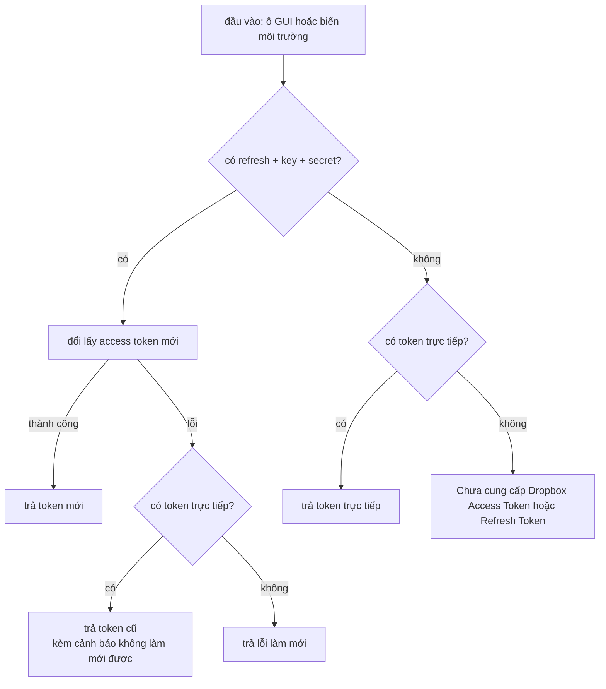

# Tính năng 07 — Đồng bộ tự động lên Dropbox

> Tài liệu này mô tả mã nguồn tại commit `2c1df67b44` (2026-09-27).
> Mã: `infrastructure.py` dòng 317–528, nối vào `markitdown_gui.py`. Hướng dẫn người dùng: `docs/DROPBOX_GUIDE.md`.
> Kế hoạch gốc: `docs/plans/2026-09-27-dropbox-sync-integration.md`. Commit: `2c1df67`.

---

# Phần A — Chức năng

## Bài toán

Kết quả chuyển đổi cần được các phần mềm và dịch vụ khác trong quy trình (bot AI, kho tri thức…) lấy đi
mà không ai phải nhặt tay. Dropbox làm điểm trung chuyển: chuyển đổi xong, mỗi tệp tự lên thư mục
`/MarkItDown` của tài khoản đã cấu hình.

## Ba luồng song song, độc lập

| Luồng | Bật bằng | Ý nghĩa |
|---|---|---|
| ⚡ Tải về máy | "Tự động tải về máy tính (Trình duyệt)" | Trình duyệt tự tải từng tệp |
| 💾 Lưu bản sao máy chủ | "Lưu bản sao trên máy chủ (VPS)" | Copy cạnh tệp gốc hoặc vào thư mục chỉ định |
| ☁️ Dropbox | "Tự động đồng bộ lên Dropbox" | Đẩy lên đám mây |

Tắt luồng nào thì luồng đó không chạy; ba luồng không phụ thuộc nhau. Một tệp Dropbox lỗi **không** làm hỏng
chuyển đổi — chỉ thêm dòng `⚠️ [Dropbox] …` vào trạng thái.

Các tệp được đồng bộ: `<tên>.md`, `<tên>_vn.md` và `<tên>_fen.txt`.

## Cách xác thực

| Cách | Cần điền | Độ bền |
|---|---|---|
| Access Token trực tiếp | ô Token | Ngắn (Dropbox cấp token hết hạn sau vài giờ) |
| **Refresh Token + App Key + App Secret** (khuyên dùng) | cả ba ô | Tự làm mới, không hết hạn |

Cùng **một ô Token** dùng cho cả hai kiểu: nếu có thêm App Key và App Secret thì giá trị trong ô được hiểu là
Refresh Token, ngược lại là Access Token.

---

# Phần B — Kỹ thuật

## 1. Các hàm

| Hàm | Dòng | Việc |
|---|---:|---|
| `get_dropbox_token_from_refresh(rf, key, secret)` | 317 | `POST https://api.dropboxapi.com/oauth2/token` (`grant_type=refresh_token`), timeout 12 s → `(access_token, lỗi)` |
| `resolve_dropbox_token(token, refresh, key, secret)` | 363 | phân giải token dùng được |
| `test_dropbox_connection(...)` | 389 | `users/get_current_account` (+ `users/get_space_usage` không bắt buộc) |
| `upload_to_dropbox(file_path, target_folder, ...)` | 466 | `POST https://content.dropboxapi.com/2/files/upload` |

## 2. Phân giải token (`resolve_dropbox_token`)

Mỗi giá trị lấy từ **tham số GUI trước, rồi mới tới biến môi trường** `DROPBOX_ACCESS_TOKEN`,
`DROPBOX_REFRESH_TOKEN`, `DROPBOX_APP_KEY`, `DROPBOX_APP_SECRET` (dòng 368–371).

**Mỗi lần upload đều đổi refresh token lấy access token mới** (không có bộ nhớ đệm): một cuốn sách ba tệp
sinh ba lần gọi OAuth. Chấp nhận được về đúng đắn, chỉ tốn thêm độ trễ.

## 3. Upload (`upload_to_dropbox`)

1. Tệp cục bộ phải tồn tại; đọc **toàn bộ vào bộ nhớ** (`f.read()`).
2. Chuẩn hóa thư mục đích: mặc định `/MarkItDown`; thêm `/` ở đầu, bỏ `/` ở cuối (trừ thư mục gốc `/`).
3. `remote_path = <thư mục>/<tên tệp>`.
4. Gọi `files/upload` với `Dropbox-API-Arg`:
   `{"path": remote_path, "mode": "overwrite", "autorename": false, "mute": false, "strict_conflict": false}`.
5. Timeout 30 s; HTTP 200 → `(remote_path, None)`.
6. Lỗi HTTP → `(None, "Lỗi tải lên Dropbox (<mã>): <error_summary>")`; lỗi mạng → thông điệp riêng.

**Chế độ ghi đè:** cùng tên trên Dropbox → bị ghi đè âm thầm.

## 4. Nối vào luồng chuyển đổi

Trong `on_convert_files` (`markitdown_gui.py:1101`), việc đẩy lên Dropbox được **lặp lại thủ công ba lần**
(khối gần giống nhau, dòng 1202–1211, 1261–1270, 1284–1293): cho `.md`, cho `_vn.md`, cho `_fen.txt`. Mỗi khối
cũng có khối lưu VPS và khối "tải về máy" tương tự. `on_convert_url` (dòng 1322) chỉ đẩy `.md`. Việc upload
chạy **đồng bộ trong generator** — trong lúc chờ, giao diện không có tiến độ mới cho tệp đó.

Truyền tham số: ô Token của GUI (`dropbox_token_in`) được truyền **hai lần** — vừa làm `token` vừa làm
`refresh_token` (dòng 1928, 1942, 1955, 1904); `resolve_dropbox_token` tự chọn cách dùng.

## 5. Điểm cần lưu ý và hạn chế

**Thiết kế**
- **`DROPBOX_TARGET_FOLDER` chỉ có trong tài liệu, không có trong mã.** `docs/DROPBOX_GUIDE.md:81` và kế
  hoạch 2026-09-27 nhắc biến này, nhưng không có dòng nào trong `*.py` đọc nó. Thư mục đích lấy từ ô GUI
  (mặc định `/MarkItDown`). Hoặc thêm hỗ trợ, hoặc xóa khỏi tài liệu.
- Gói `dropbox` được cài trong Dockerfile nhưng **không được import ở đâu** — mã gọi REST thuần bằng `urllib`.
  Kế hoạch có nhắc "fallback REST thuần nếu chưa cài thư viện", thực tế chỉ có nhánh REST. Có thể bỏ khỏi Dockerfile.
- Đường dẫn khối đồng bộ bị lặp ba lần → sửa quy tắc phải sửa ba chỗ. Nên rút thành một hàm.

**Vận hành**
- **Tải một phát (`files/upload`)** đọc cả tệp vào RAM; Dropbox giới hạn kích thước mỗi lần gọi `/upload` (theo
  tài liệu API của Dropbox là 150 MB — ngoài repo, cần đối chiếu lại). Tệp `.md` của sách thường nhỏ hơn nhiều.
- Không có thử lại và không có hàng đợi: mạng rớt giữa chừng → tệp đó không lên, chỉ có dòng cảnh báo.
- Cùng tên tệp nguồn từ hai người dùng → ghi đè lẫn nhau trên Dropbox. Tên phía Dropbox lấy từ
  `os.path.basename(file_path)` của tệp đã `_write_md`, có hậu tố `_2`, `_3` **chỉ trong cùng một lô**.
- `dropbox_sync_on` mặc định **bật** trong `_apply_preset`, và `_apply_preset` chạy lại mỗi khi đổi preset/
  chế độ/engine (đặt lại `dropbox_sync_on=True`, cả `autosave_on`, `auto_download_on`). Người dùng tắt tay rồi đổi preset sẽ thấy nó bật lại.

**Bảo mật**
- Token, App Key, App Secret lưu thô trong `localStorage` và truyền qua kết nối Gradio; nên dùng HTTPS.
- Tài liệu nên khuyến nghị **App folder** thay vì **Full Dropbox** để hạn chế phạm vi quyền.

## 6. Đường dẫn tham chiếu nhanh

| Muốn xem… | Mở |
|---|---|
| Tải lên | **`infrastructure.py`** `upload_to_dropbox` (466) |
| Phân giải token | `resolve_dropbox_token` (363), `get_dropbox_token_from_refresh` (317) |
| Kiểm tra kết nối | `test_dropbox_connection` (389) |
| Nối vào chuyển đổi tệp | **`markitdown_gui.py`** `on_convert_files` (1101) |
| Nối vào chuyển đổi URL | `on_convert_url` (1322) |
| Ô cấu hình | `markitdown_gui.py` 1599–1651 |
| Hướng dẫn tạo Dropbox App | `docs/DROPBOX_GUIDE.md` |
| Kiểm thử | `_test_dropbox_sync.py` |
