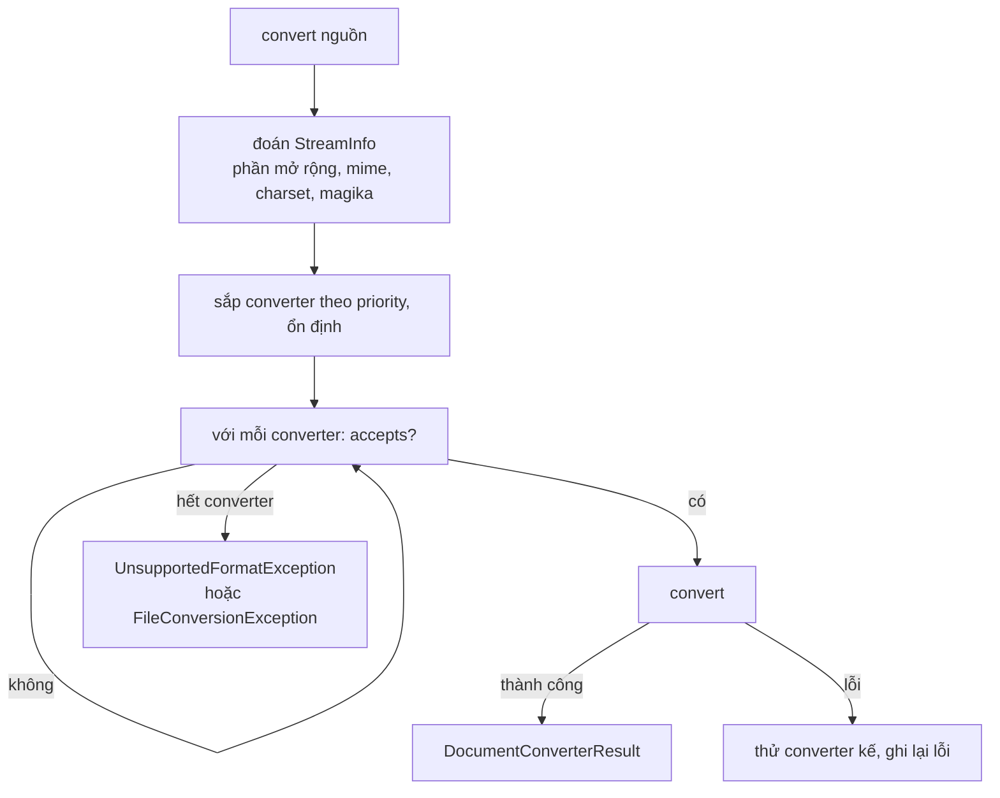

# Tính năng 08 — Lõi thư viện MarkItDown (upstream Microsoft)

> Tài liệu này mô tả mã nguồn tại commit `2c1df67b44` (2026-09-27).
> Gói: `packages/markitdown` (phiên bản `0.1.8b3`). Đây là mã **upstream**; fork chỉ merge từ
> `microsoft/markitdown` (remote `upstream`), không sửa lõi. Tài liệu gốc: `packages/markitdown/README.md`, `README.md`.

---

# Phần A — Chức năng

## Là gì

Thư viện Python (và lệnh `markitdown`) đổi nhiều loại tệp sang Markdown để đưa cho mô hình ngôn ngữ đọc.
Ưu tiên giữ **cấu trúc** (tiêu đề, danh sách, bảng, liên kết) hơn là vẻ ngoài.

## Định dạng hỗ trợ

PDF · Word (.docx) · PowerPoint (.pptx) · Excel (.xlsx, .xls) · ảnh (metadata EXIF, mô tả bằng LLM nếu cấu
hình) · âm thanh (metadata + phiên âm) · HTML · văn bản (CSV, JSON, XML, txt) · ZIP (đệ quy) · YouTube ·
EPUB · Jupyter (`.ipynb`) · RSS/Atom · Wikipedia · Bing SERP · Outlook `.msg`.

## Vai trò trong dự án Cờ vua Dương Sinh

Ứng dụng web dùng lõi này ở **đường "tài liệu thường"** (`_convert` trong `markitdown_gui.py`, dòng 219):
`MarkItDown(enable_plugins=False).convert(nguồn)`. Với sách cờ vua scan, lõi trả về trống (không có lớp chữ)
và hệ thống chuyển sang OCR bằng AI (xem [01](01-ocr-pdf-anh.md)). Với PDF có lớp chữ, hoặc Word/Excel/PPT/HTML/URL,
lõi làm toàn bộ việc.

---

# Phần B — Kỹ thuật

## 1. Lớp `MarkItDown` (`_markitdown.py`, 851 dòng)

| Phương thức | Việc |
|---|---|
| `__init__(enable_builtins, enable_plugins, **kwargs)` | dựng đối tượng; cấu hình LLM, exiftool, Azure… |
| `enable_builtins(**kwargs)` | đăng ký các converter có sẵn |
| `enable_plugins(**kwargs)` | nạp plugin qua entry point `markitdown.plugin` |
| `convert(source)` | điểm vào chung: đường dẫn, URL, hoặc luồng nhị phân |
| `convert_local` / `convert_stream` / `convert_url` / `convert_uri` / `convert_response` | các điểm vào hẹp hơn |
| `register_converter(converter, priority)` | đăng ký thêm converter |

## 2. Cơ chế ưu tiên converter

Số **nhỏ chạy trước**. Hằng số (dòng 101–107): `PRIORITY_SPECIFIC_FILE_FORMAT = 0.0` (định dạng cụ thể như
`.docx`, `.pdf`, trang Wikipedia) và `PRIORITY_GENERIC_FILE_FORMAT = 10.0` (bắt hầu hết, ví dụ `text/*`).

Trước mỗi lần chuyển đổi, danh sách được **sắp lại bằng sắp xếp ổn định** (dòng 617), nên converter cùng
mức ưu tiên giữ nguyên thứ tự đăng ký; đăng ký sau thì được thử **trước** (`insert(0, …)` ở dòng 738).
Nhờ vậy plugin có thể chèn converter ở bất kỳ mức nào (chú thích `register_converter`: "một plugin với ưu tiên
9 sẽ chạy trước generic"). Plugin OCR dùng `-1.0` để chạy **trước cả built-in**.

`_get_stream_info_guesses` (dòng 741) kết hợp gợi ý (phần mở rộng, MIME, Content-Disposition), phát hiện
nội dung bằng **Magika** và phát hiện charset bằng `charset-normalizer` (đọc mẫu ở `_read_charset_sample`,
dòng 73). Commit `75e7114` ("avoid splitting UTF-8 characters during charset detection") vá lỗi cắt giữa ký tự UTF-8.

## 3. Converter có sẵn

Sinh bằng script từ `packages/markitdown/src/markitdown/converters/` (tên lớp trích bằng regex):

| Tệp | Dòng | Lớp |
|---|---:|---|
| `_pdf_converter.py` | 589 | `PdfConverter` |
| `_cu_converter.py` | 570 | `ContentUnderstandingFileType`, `ContentUnderstandingConverter` |
| `_rss_converter.py` | 488 | `RssConverter` |
| `_pptx_converter.py` | 364 | `PptxConverter` |
| `_outlook_msg_converter.py` | 349 | `OutlookMsgConverter` |
| `_doc_intel_converter.py` | 258 | `DocumentIntelligenceFileType`, `DocumentIntelligenceConverter` |
| `_youtube_converter.py` | 256 | `YouTubeConverter` |
| `_xlsx_converter.py` | 252 | `XlsxConverter`, `XlsConverter` |
| `_epub_converter.py` | 185 | `EpubConverter` |
| `_markdownify.py` | 179 | `_CustomMarkdownify` (dùng chung bởi HTML) |
| `_docx_converter.py` | 143 | `DocxConverter` |
| `_image_converter.py` | 138 | `ImageConverter` |
| `_csv_converter.py` | 133 | `CsvConverter` |
| `_zip_converter.py` | 130 | `ZipConverter` |
| `_bing_serp_converter.py` | 120 | `BingSerpConverter` |
| `_html_converter.py` | 110 | `HtmlConverter` |
| `_ipynb_converter.py` | 103 | `IpynbConverter` |
| `_audio_converter.py` | 101 | `AudioConverter` |
| `_wikipedia_converter.py` | 91 | `WikipediaConverter` |
| `_plain_text_converter.py` | 66 | `PlainTextConverter` |
| `_exiftool.py`, `_transcribe_audio.py`, `_llm_caption.py`, `__init__.py` | 57, 58, 50, 54 | tiện ích, không có lớp converter |

Tổng 24 tệp `.py` trong thư mục `converters/` (gồm `__init__.py`); hai converter đám mây (`Document Intelligence`,
`Content Understanding`) chỉ đăng ký **khi truyền endpoint** vào `MarkItDown(...)` (dòng ~255–300 của `_markitdown.py`) và được đặt ở đầu ngăn xếp.
`PlainTextConverter`, `ZipConverter`, `HtmlConverter` dùng mức generic (10.0).

## 4. Tiện ích chuyển đổi (`converter_utils/`)

`_image.py`, `_xlsx_images.py`, `docx/` (`pre_process.py`, `_images.py`, và `math/` gồm `omml.py`, `latex_dict.py` —
đổi công thức OMML của Word sang LaTeX). Có bộ kiểm thử riêng cho công thức (`test_docx_math*.py`, `test_docx_omml.py`).

## 5. CLI (`__main__.py`, 286 dòng)

Lệnh `markitdown` khai báo qua `[project.scripts]`. Các cờ (liệt kê bằng `grep` trên `add_argument`):
`-v/--version`, `-o/--output`, `-x/--extension`, `-m/--mime-type`, `-c/--charset`,
`-d/--use-docintel`, `--use-cu/--use-content-understanding`, `-e/--endpoint`, `--cu-endpoint`,
`--cu-analyzer`, `--cu-file-types`, `-p/--use-plugins`, `--list-plugins`, `--keep-data-uris`; đối số vị trí
cuối là tên tệp (`nargs="?"`, không có thì đọc stdin).

## 6. Phụ thuộc và extras (`pyproject.toml`)

Lõi tối thiểu: `beautifulsoup4`, `requests`, `markdownify`, `magika~=0.6.1`, `charset-normalizer`,
`defusedxml`. Nhóm `[all]` thêm: `python-pptx`, `mammoth~=1.11.0`, `pandas`, `openpyxl`, `xlrd`, `lxml`,
`pdfminer.six>=20251230`, `pdfplumber>=0.11.9`, `olefile`, `pydub`, `SpeechRecognition`,
`youtube-transcript-api~=1.0.0`, `azure-ai-documentintelligence`, `azure-ai-contentunderstanding>=1.2.0b1`, `azure-identity`.
Từng nhóm nhỏ: `pptx, docx, xlsx, xls, pdf, outlook, audio-transcription, youtube-transcription,
az-doc-intel, az-content-understanding`.

## 7. Bảo mật

`README.md` mở đầu bằng cảnh báo: MarkItDown **thực hiện I/O với quyền của tiến trình hiện tại**, như `open()`
hay `requests.get()`; nên dùng hàm `convert_*` hẹp nhất có thể trong môi trường không tin cậy. Commit gần
đây từ chối đường dẫn UNC và thiết bị Windows (`e99a726`). Ứng dụng web của fork gọi `md.convert(source)` với
`source` là đường dẫn tệp Gradio đã tải lên hoặc URL người dùng nhập — nghĩa là nhập URL nội bộ (ví dụ
`http://169.254.169.254/…` hoặc địa chỉ mạng riêng) sẽ khiến **máy chủ** truy cập địa chỉ đó (SSRF). Đây là suy luận
từ cách gọi, chưa thử.

## 8. Kiểm thử

Chạy bằng `hatch test` trong `packages/markitdown` (35 tệp `test_*.py`, 10.424 dòng gồm dữ liệu kiểm thử
và `_test_vectors.py`); dữ liệu mẫu ở `tests/test_files/` (PDF, DOCX, PPTX, XLSX, EPUB, âm thanh, RSS, ZIP…).
CI: `.github/workflows/tests.yml` chạy ba job — `tests` (markitdown), `ocr-tests` (markitdown-ocr),
`mcp-tests` (markitdown-mcp) — trên Ubuntu với Python 3.10–3.13, cộng Windows và Windows ARM với 3.12.

## 9. Điểm cần lưu ý và hạn chế

- Đây là **mã upstream**: mọi thay đổi ở đây gây xung đột khi `git merge upstream/main`. Lịch sử fork đã merge
  từ upstream hai lần (`46d5350`, `ba0a8ad`). Ưu tiên đặt mã riêng của fork ở thư mục gốc hoặc viết **plugin** thay vì sửa lõi.
- Converter `Bing SERP`, `Wikipedia`, `YouTube` phụ thuộc cấu trúc HTML/dịch vụ bên ngoài — dễ hỏng theo thời gian.
- `README.md` gốc ở thư mục repo là README **của upstream** (cảnh báo bảo mật, hướng dẫn cài đặt), dù repo đã có
  bản tùy biến; phần mô tả riêng của fork nằm ở `GUI_README.md` và `README.md` (đoạn đầu do tài liệu này thêm).

## 10. Đường dẫn tham chiếu nhanh

| Muốn xem… | Mở |
|---|---|
| Lớp chính | **`packages/markitdown/src/markitdown/_markitdown.py`** |
| Giao diện converter | `_base_converter.py` (`DocumentConverter`, `DocumentConverterResult`) |
| Thông tin luồng | `_stream_info.py` (`StreamInfo`) |
| Ngoại lệ | `_exceptions.py` |
| Thêm converter mới | mẫu tại `packages/markitdown-sample-plugin/src/markitdown_sample_plugin/_plugin.py` |
| PDF | `converters/_pdf_converter.py` |
| Công thức Word | `converter_utils/docx/math/omml.py` |
