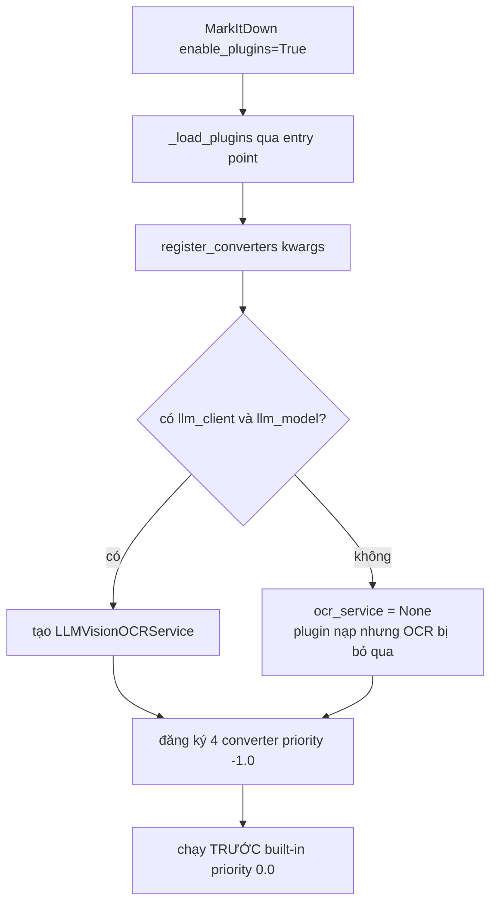

# Tính năng 09 — Plugin OCR, máy chủ MCP và plugin mẫu (gói con upstream)

> Tài liệu này mô tả mã nguồn tại commit `2c1df67b44` (2026-09-27).
> Ba gói dưới `packages/`, đều là mã **upstream** (Microsoft/AutoGen); ứng dụng web của fork **không** dùng chúng.
> Tài liệu gốc của từng gói: `packages/<gói>/README.md`.

---

# Phần A — Chức năng

| Gói | Làm gì | Dùng khi |
|---|---|---|
| **`markitdown-ocr`** | Khi chuyển PDF/Word/PowerPoint/Excel, **đọc chữ trong ảnh nhúng** bằng mô hình thị giác (LLM vision) và chèn vào đúng vị trí trong Markdown. PDF scan toàn trang thì OCR cả trang. | Bạn có một OpenAI-tương-thích client (`gpt-4o`, `gemini-2.0-flash`…) và muốn dùng thư viện MarkItDown như một thư viện Python |
| **`markitdown-mcp`** | Mở MarkItDown thành một **công cụ MCP** (`convert_to_markdown(uri)`) để Claude Desktop hay agent khác gọi | Cắm vào trợ lý AI cục bộ |
| **`markitdown-sample-plugin`** | Ví dụ tối giản một plugin: đọc tệp **RTF** | Tham khảo khi tự viết converter mới |

**Khác biệt quan trọng với OCR của fork:** OCR của fork (`claude_ocr.py`, [tài liệu 01](01-ocr-pdf-anh.md))
dùng CLI thuê bao, chuyên cho sách cờ vua, có FEN và dịch. `markitdown-ocr` dùng client API tính tiền theo lượt,
tổng quát cho mọi tài liệu văn phòng, không biết gì về cờ vua. Hai hệ thống **độc lập**.

---

# Phần B — Kỹ thuật

## 1. `markitdown-ocr` (`0.1.1b2`, 863 dòng `src` + 2.149 dòng test)

### Cơ chế plugin

`pyproject.toml` khai báo entry point `markitdown.plugin: ocr = "markitdown_ocr"`. Khi
`MarkItDown(enable_plugins=True, llm_client=…, llm_model=…)`, lõi nạp mô-đun và gọi
`register_converters(markitdown, **kwargs)` (`_plugin.py`):



Bốn converter đăng ký với `PRIORITY_OCR_ENHANCED = -1.0` (chú thích: *"effectively replaces the built-in
converters when plugin is installed"*):

| Converter | Tệp | Dòng | Cách làm |
|---|---|---:|---|
| `PdfConverterWithOCR` | `_pdf_converter_with_ocr.py` | 422 | Viết lại logic PDF: dùng `pdfplumber` gom chữ theo vị trí Y, lấy ảnh nhúng bằng PyMuPDF, chèn văn bản OCR đan xen theo vị trí; nếu toàn bộ trang không có chữ → `_ocr_full_pages` (vẽ trang ở 300 DPI, OCR cả trang) |
| `DocxConverterWithOCR` | `_docx_converter_with_ocr.py` | 71 | **Kế thừa** `DocxConverter`, ghi đè hook `_image_to_html`; yêu cầu `markitdown>=0.1.8b3`; có bộ nhớ đệm ảnh lặp cục bộ theo từng tài liệu (`_docx_ocr_cache`) |
| `PptxConverterWithOCR` | `_pptx_converter_with_ocr.py` | 70 | Kế thừa converter lõi, tái dùng đường ảnh |
| `XlsxConverterWithOCR` | `_xlsx_converter_with_ocr.py` | 70 | Kế thừa converter lõi |

Commit `945314a` ("Refactor Office OCR converters to reuse core conversion pipelines", #2506) chuyển DOCX/PPTX/XLSX
từ chép logic sang **kế thừa lõi** — chỉ PDF vẫn tự cài đặt riêng.

### `LLMVisionOCRService` (`_ocr_service.py`, 127 dòng)

`extract_text(image_stream, prompt, stream_info)`:
1. Đưa con trỏ về đầu luồng; xác định MIME (từ `stream_info`, hoặc đoán bằng Pillow, mặc định `image/png`).
2. Mã hóa base64 thành `data:<mime>;base64,…`.
3. Gọi `client.chat.completions.create(model, messages=[{text prompt}, {image_url}])`.
4. Trả `OCRResult(text, backend_used="llm_vision", error)`; mọi ngoại lệ được bắt, đóng gói vào `error` — **không ném ra**.

Prompt mặc định: *"Extract all text from this image. Return ONLY the extracted text, maintaining the original
layout and order. Do not add any commentary or description."* Có thể ghi đè qua `llm_prompt`.
`_extract_text_with_metadata` truyền `stream_info` nếu chữ ký hàm hỗ trợ (kiểm bằng `inspect.signature(...).bind`),
ngược lại lùi về gọi cũ — tương thích dịch vụ OCR tự viết.

### Phụ thuộc

`markitdown>=0.1.8b3`, `pdfminer.six>=20251230`, `pdfplumber>=0.11.9`, **`PyMuPDF>=1.24.0`**, `mammoth`,
`python-docx`, `python-pptx`, `pandas`, `openpyxl`, `Pillow>=9.0.0`; `openai>=1.0.0` là tùy chọn `[llm]`.
Ghi chú vận hành: **PyMuPDF** có giấy phép AGPL/thương mại (thông tin của bên thứ ba, ngoài repo) — cân nhắc trước
khi đưa vào sản phẩm thương mại.

### Kiểm thử

`packages/markitdown-ocr/tests/` (9 tệp `.py`, 2.149 dòng) + `ocr_test_data/` (PDF/DOCX/PPTX/XLSX mẫu: ảnh
đầu/giữa/cuối, nhiều trang, bố cục phức tạp, PDF scan hóa đơn/biên bản/báo cáo). CI: job `ocr-tests`,
chạy `pytest` sau `pip install ./packages/markitdown ./packages/markitdown-ocr pytest`.

## 2. `markitdown-mcp` (`0.0.1a7`, 152 dòng `src` + 611 dòng test)

Một công cụ duy nhất (`__main__.py`):

```python
@mcp.tool()
async def convert_to_markdown(uri: str) -> str   # http:, https:, file:, data:
```

Kết nối: `MarkItDown(enable_plugins=check_plugins_enabled()).convert_uri(uri).markdown`, trong đó
`check_plugins_enabled` đọc biến `MARKITDOWN_ENABLE_PLUGINS` (`true|1|yes`). Lỗi được đổi thành `ToolError` với
thông điệp **đã lọc** (SDK 2.x chỉ lộ nội dung `ToolError`; `OSError` dùng `os.strerror(errno)` để không lộ
đường dẫn thật; chú thích: *"str(exc) embeds the resolved path; errno's fixed strerror does not"*).

| Chế độ | Lệnh | Ghi chú |
|---|---|---|
| STDIO (mặc định) | `markitdown-mcp` | dùng cho Claude Desktop |
| Streamable HTTP + SSE | `markitdown-mcp --http [--host H] [--port P]` | mặc định `127.0.0.1:3001`; `--sse` là bí danh cũ |

Ràng buộc: `--host`/`--port` chỉ hợp lệ khi có `--http`. Bind ra ngoài `127.0.0.1`/`localhost` sẽ in **cảnh báo
lớn** ra stderr: máy chủ *"has NO authentication and runs with your user's privileges"*.
`create_starlette_app` gộp hai ứng dụng con (`sse_app`, `streamable_http_app(json_response=True, stateless_http=True)`)
vào một Starlette và chạy `lifespan` của cả hai. Dockerfile (`python:3.13-slim-trixie`, chạy `nobody:nogroup`,
`MARKITDOWN_ENABLE_PLUGINS=True`, `WORKDIR /workdir`).

## 3. `markitdown-sample-plugin` (`0.1.0a1`, 88 dòng)

`_plugin.py` (71 dòng) là **mẫu chuẩn để viết plugin** — mọi plugin mới nên bắt chước:

```python
__plugin_interface_version__ = 1                 # bắt buộc, phiên bản giao diện plugin

def register_converters(markitdown: MarkItDown, **kwargs):
    markitdown.register_converter(RtfConverter())   # ưu tiên mặc định 0.0

class RtfConverter(DocumentConverter):
    def accepts(self, file_stream, stream_info, **kwargs) -> bool: ...   # theo đuôi .rtf hoặc MIME text/rtf
    def convert(self, file_stream, stream_info, **kwargs) -> DocumentConverterResult: ...   # striprtf
```

Phụ thuộc `striprtf`. Đăng ký entry point trong `pyproject.toml` (giống OCR). Test: `test_converter` (gọi trực
tiếp) và `test_markitdown` (nạp qua `MarkItDown(enable_plugins=True)`).

## 4. Điểm cần lưu ý và hạn chế

**Thiết kế**
- **`enable_plugins` của ứng dụng web luôn `False`** → `markitdown-ocr` **không hoạt động** trong giao diện
  hiện tại, dù Dockerfile cài nó (`pip install /app/packages/markitdown-ocr`). Cài thừa, hoặc là chuẩn bị cho
  mục đích khác — chưa rõ ý định.
- `PdfConverterWithOCR` tự viết lại việc đọc PDF thay vì kế thừa, nên khi lõi sửa lỗi PDF (ví dụ `test_pdf_tables.py`,
  `test_pdf_masterformat.py`) plugin không tự hưởng.
- Nếu không truyền `llm_client`, plugin vẫn nạp nhưng **âm thầm** bỏ OCR (README: *"OCR is silently skipped"*) —
  dễ nhầm rằng đã bật.

**Điều đáng ngờ**
- `packages/markitdown-ocr/README.md` mô tả lệnh `markitdown document.pdf --use-plugins --llm-client openai --llm-model gpt-4o`,
  nhưng danh sách `add_argument` trong `packages/markitdown/src/markitdown/__main__.py` **không có** cờ
  `--llm-client`/`--llm-model` (chỉ có `--use-plugins`). Tài liệu và CLI có thể lệch nhau. Chưa chạy lệnh để xác nhận.

**Vận hành**
- MCP không có xác thực; không bao giờ bind ra ngoài localhost. Ai gọi được `convert_to_markdown` đều đọc được
  mọi tệp `file:` mà người chạy máy chủ đọc được, và truy cập mạng thay họ.

## 5. Đường dẫn tham chiếu nhanh

| Muốn xem… | Mở |
|---|---|
| Đăng ký plugin OCR | `packages/markitdown-ocr/src/markitdown_ocr/_plugin.py` |
| Dịch vụ OCR bằng LLM | `_ocr_service.py` |
| PDF có OCR | **`_pdf_converter_with_ocr.py`** |
| Công cụ MCP | **`packages/markitdown-mcp/src/markitdown_mcp/__main__.py`** |
| Mẫu plugin | **`packages/markitdown-sample-plugin/src/markitdown_sample_plugin/_plugin.py`** |
| Test MCP | `packages/markitdown-mcp/tests/` (`test_stdio_protocols.py`, `test_http_transports.py`, `test_tool_errors.py`) |
