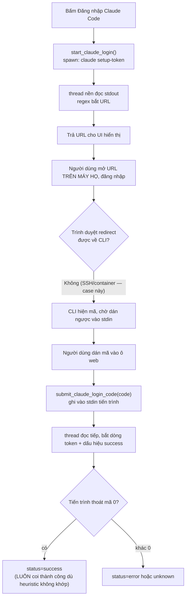

# Tính năng 12 — Đăng nhập Claude Code CLI bền vững (OAuth token 1 năm)

> Tài liệu này mô tả mã nguồn thêm vào ngày 2026-10-13.
> Tệp chính: `claude_login_bridge.py` (file mới). Liên quan: `claude_ocr.py:_claude_env`, `infrastructure.py`,
> `markitdown_gui.py` (tab "⚙️ Cài đặt Hạ tầng & API").

---

# Phần A — Chức năng

## Bài toán

Trước đây, để dùng gói thuê bao Claude Pro/Max cho OCR, người dùng phải tự lấy cookie `sessionKey` từ
claude.ai (F12 → Application → Cookies) dán vào ô trên web — cookie này hết hạn nhanh, phải lặp lại
thường xuyên, và (như phát hiện ở [05](05-ha-tang-va-ket-noi.md)) mã nguồn cũ còn đặt nó vào biến môi
trường sai (`ANTHROPIC_API_KEY`) khiến CLI xác thực sai kiểu, gây lỗi OCR hàng loạt.

## Người dùng nhận được gì

- Một nút **"🔐 Đăng nhập Claude Code"** ngay trên tab "Cài đặt Hạ tầng & API": bấm vào, web hiện link
  đăng nhập, mở link đó trên trình duyệt của bạn (không phải trên server), đăng nhập bằng tài khoản
  Claude Pro/Max, dán mã xác nhận ngược lại ô trên web nếu được yêu cầu.
- Token sinh ra (từ lệnh chính thức `claude setup-token`) **sống khoảng 1 năm** — thay vì phải lấy lại
  cookie mỗi vài ngày, giờ chỉ cần làm lại việc này khoảng 1 lần/năm.
- Token tự điền vào ô "Claude Code OAuth Token" để dùng ngay trong phiên hiện tại; web cũng hiện rõ
  chuỗi token để người dùng tự copy dán vào biến môi trường `CLAUDE_CODE_OAUTH_TOKEN` trong cấu hình
  Dokploy, giúp token này **sống qua mọi lần deploy lại** mà không cần thao tác gì trên web nữa.
- Vẫn giữ cách cũ (SSH vào server chạy `claude setup-token` tay) làm phương án dự phòng nếu nút trên web
  gặp sự cố.

---

# Phần B — Kỹ thuật

## 1. Vì sao tách file riêng, không gộp vào `infrastructure.py`

`infrastructure.py` là tập hợp các hàm **chạy-xong-là-xong** (mỗi `test_*_connection` là một
`subprocess.run` chặn, không giữ trạng thái). Luồng đăng nhập cần một tiến trình `claude setup-token`
**sống xuyên nhiều HTTP request** của Gradio (mở link → chờ người dùng đăng nhập trên trình duyệt riêng
→ dán mã lại ở một request khác) — nên cần một singleton cấp module (khoá bằng `threading.Lock`), khác
hẳn bản chất với các hàm còn lại.

## 2. Luồng xử lý

## 3. Singleton trạng thái (`claude_login_bridge.py`)

Biến module `_STATE` (bảo vệ bởi `_LOCK`) giữ: `proc` (Popen đang chạy), `master_fd` (đầu "cha" của
pty), `session_id` (uuid, phân biệt phiên cũ/mới — thread đọc cũ tự rút lui ngay khi phát hiện
`session_id` đã đổi), `status` (`idle|starting|waiting_code|working|success|error|unknown`), `url`,
`token`, `error`, `lines` (tối đa 200 dòng log gần nhất), và một `watchdog` (`threading.Timer`) tự dọn
tiến trình bỏ dở sau `IDLE_TIMEOUT_S = 300` giây không ai tương tác.

**Đã kiểm chứng thật trên VPS (2026-10-13), hai phát hiện bắt buộc phải sửa so với bản thiết kế ban đầu:**

1. **CLI `claude` block-buffer stdout khi không phải TTY.** Spawn bằng `subprocess.PIPE` thường (không
   pty) khiến `claude setup-token` chạy nhưng không in ra byte nào — treo vô thời hạn, `_reader_loop`
   không bao giờ thấy gì. Phải cấp pseudo-terminal thật bằng `pty.openpty()` cho stdin/stdout/stderr của
   tiến trình con (`_spawn_claude_setup_token`); `subprocess.PIPE` chỉ còn là fallback để đọc code trên
   Windows (không chạy đúng ở đó).
2. **pty mặc định 80 cột làm URL đăng nhập (dài >200 ký tự) bị ngắt dòng giữa chừng**, khiến regex chỉ
   bắt được đoạn đầu URL. Phải set kích thước cửa sổ pty rộng bất thường (`fcntl.ioctl(...,
   TIOCSWINSZ, ...)`, 500×50) ngay sau `pty.openpty()`, trước khi spawn.

Hệ quả thiết kế khác: vì output qua pty có animation/cursor-control (CLI vẽ spinner `*✢✶✻✽...`), ranh
giới dòng không đáng tin — `_reader_loop` gộp toàn bộ byte đọc được vào một buffer, làm sạch mã ANSI,
rồi quét lại **toàn bộ buffer** (không chỉ dòng mới nhất) mỗi lần có dữ liệu mới (`_scan_buffer_locked`).

**Giới hạn khi tự kiểm thử (ghi lại để không ai hiểu nhầm):** `_STATE` là biến **module-level trong bộ
nhớ của một tiến trình Python** — chỉ có ý nghĩa khi `start_claude_login` và `submit_claude_login_code`
được gọi từ **cùng một tiến trình dài hạn** (đúng thiết kế: app Gradio chạy liên tục). Gọi hai lệnh
`docker exec python3 ...` riêng biệt để test (hai tiến trình Python ngắn hạn khác nhau) sẽ luôn thấy
`_STATE` rỗng ở lệnh thứ hai — không phải lỗi, chỉ là vi phạm giả định thiết kế khi tự kiểm thử thủ công.

Hai hàm chính:
- `start_claude_login()` — spawn `[claude_bin, "setup-token"]` (**không** `shell=True`), chờ có giới hạn
  thời gian (`URL_WAIT_TIMEOUT_S = 45s`) để lấy URL.
- `submit_claude_login_code(code, session_id)` — ghi mã vào stdin (an toàn ranh giới UTF-8, không cắt
  giữa ký tự nhiều byte), chờ kết quả (`CODE_RESULT_TIMEOUT_S = 60s`).

**Quy tắc cứng** (áp dụng từ kinh nghiệm các dự án cầu nối CLI thuê bao tương tự trước đây):
- Tiến trình thoát mã 0 → **luôn** coi là thành công, dù heuristic chuỗi ("success"/"logged in") không
  khớp dòng nào — khi đó `token` có thể là `None`, UI hiện 15 dòng log cuối để người dùng tự đọc/copy
  token bằng tay (đường thoát bắt buộc, không được âm thầm báo lỗi).
- Hết thời gian chờ → trạng thái `unknown`, **không** khẳng định thất bại (timeout khác đăng xuất/lỗi thật).
- Giết tiến trình luôn TERM trước rồi mới KILL, giết cả cây tiến trình con (`os.killpg` + `start_new_session=True`
  lúc spawn trên POSIX; `taskkill /F /T /PID` trên Windows — nhánh Windows chỉ để đọc code khi dev, chưa
  chạy thật được ở đó).

## 4. Nối vào UI (`markitdown_gui.py`)

Thêm vào `gr.Group()` của Claude Code (cạnh ô `claude_token_in`): nút "Đăng nhập Claude Code", một
`gr.Markdown` ẩn/hiện để chỉ URL, một `gr.Textbox` ẩn/hiện để dán mã, nút "Xác nhận mã", nút "Hủy". Khi
thành công, kết quả tự gán vào `claude_token_in.value` — tận dụng wiring `.change` đã có sẵn trước đó
(tự lưu `gr.BrowserState` localStorage + tự vẽ lại bảng trạng thái hạ tầng), không cần viết thêm logic lưu.

## 5. Điểm cần lưu ý và hạn chế

**Đã kiểm chứng thật trên VPS (2026-10-13)** — spawn `claude setup-token` thật qua pty, bắt được nguyên
vẹn URL đăng nhập (xem mục 3). **Còn chưa kiểm chứng tới cuối** (chưa hoàn tất một lượt đăng nhập trọn
vẹn với mã xác nhận thật — chỉ mới xác nhận tới bước `waiting_code`):
- Định dạng chính xác dòng in token sau khi dán mã thành công (heuristic hiện tại: dòng không khoảng
  trắng, dài trên 20 ký tự, xuất hiện sau dấu hiệu "success"/"logged in").
- CLI có tự thoát (exit 0) ngay sau khi in token, hay treo thêm — module có timer phòng thủ tự kill sau
  3 giây kể từ khi bắt được token, nhưng đây là suy đoán, chưa xác nhận có cần thiết không.
- `claude setup-token` có ghi `~/.claude/.credentials.json` như side-effect không.

**Vận hành**
- Chỉ một phiên đăng nhập được chạy cùng lúc trên toàn server (singleton cấp tiến trình Python, không
  phải cấp người dùng) — nếu nhiều tab cùng bấm "Đăng nhập", tab sau sẽ nhận lại đúng trạng thái của
  phiên đang chạy thay vì tạo tiến trình mới chồng lên.
- Test cục bộ bằng CLI Python giả lập (không gọi AI thật) đã kiểm chứng toàn bộ logic: bắt URL, ghi
  stdin, heuristic success/error, timeout, dọn tiến trình — cả qua PIPE thường lẫn qua pty thật trên
  Linux. Test với `claude setup-token` thật trên VPS xác nhận bắt URL đúng tới bước chờ mã; chưa thử
  trọn vẹn bước dán mã thành công vì giới hạn khi tự kiểm thử qua nhiều tiến trình `docker exec` riêng
  biệt (xem mục 3) — cần thử lại qua chính giao diện web (một tiến trình dài hạn) để xác nhận hết luồng.

## 6. Đường dẫn tham chiếu nhanh

| Muốn xem… | Mở |
|---|---|
| Singleton trạng thái + 2 hàm chính | `claude_login_bridge.py` `start_claude_login`, `submit_claude_login_code` |
| Giết tiến trình an toàn (TERM→KILL cả cây) | `claude_login_bridge.py` `_kill_tree` |
| Ghi stdin an toàn ranh giới UTF-8 | `claude_login_bridge.py` `_write_stdin_safe` |
| Nối UI, nút bấm | `markitdown_gui.py` quanh ô `claude_token_in` (tab "Cài đặt Hạ tầng & API") |
| Biến môi trường đúng cho subprocess `claude` | `claude_ocr.py:_claude_env`, `infrastructure.py:test_claude_cli_connection` |
